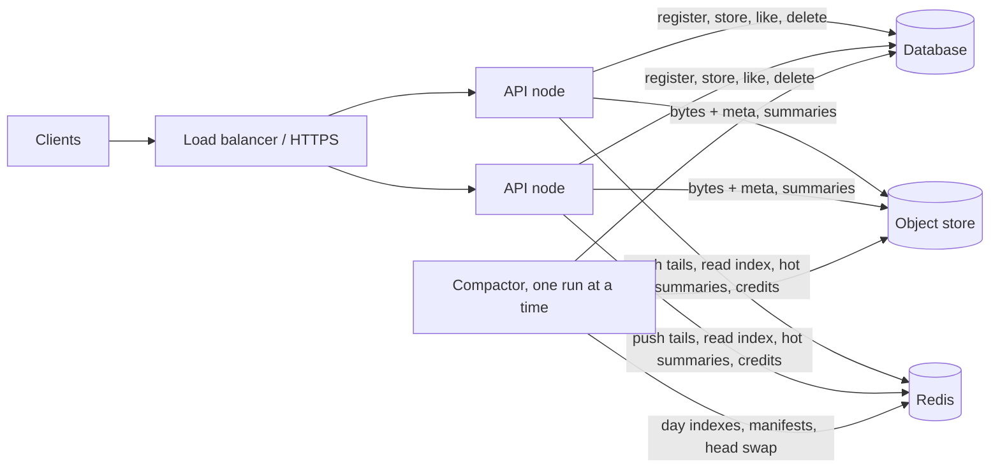
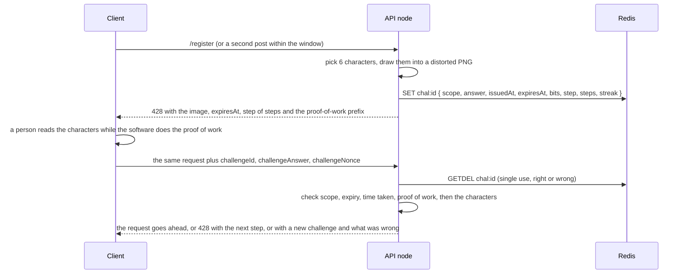
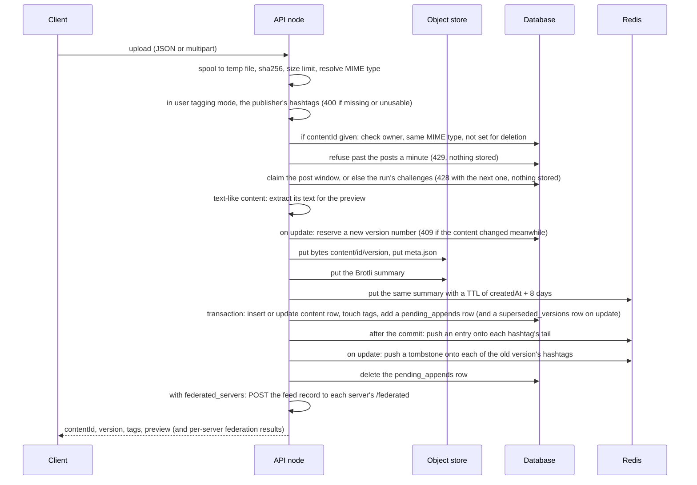
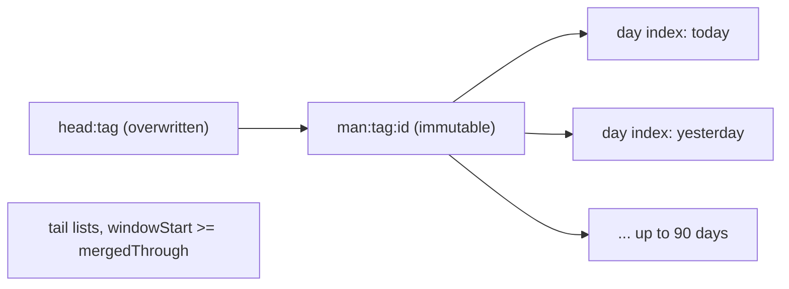
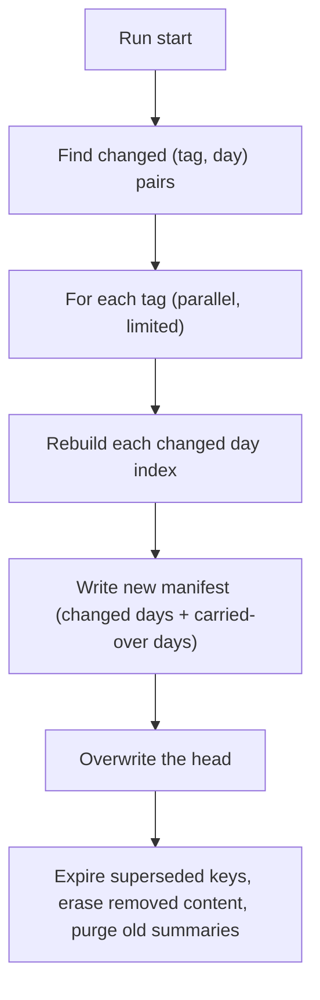

# How theuniverse works

This document explains the application end to end: what each part does, how a request moves through the system, how the feed is built, and why it's built that way. For setup, the API reference and configuration tables, see [README.md](README.md). For cloud deployment, see [deploy/README.md](deploy/README.md).

## Contents

1. [What it is](#1-what-it-is)
2. [The core idea](#2-the-core-idea)
3. [Architecture](#3-architecture)
4. [Code map](#4-code-map)
5. [Data model](#5-data-model)
6. [Request flows](#6-request-flows)
7. [The feed index](#7-the-feed-index)
8. [The compactor](#8-the-compactor)
9. [How a feed is built](#9-how-a-feed-is-built)
10. [Pagination and cursors](#10-pagination-and-cursors)
11. [Consistency, failure and recovery](#11-consistency-failure-and-recovery)
12. [Performance and scale](#12-performance-and-scale)
13. [Deployment topology](#13-deployment-topology)
14. [Known limits](#14-known-limits)

---

## 1. What it is

theuniverse is an open-source social media server, written in TypeScript on Fastify (Node 22).

- **Publishers** register, get an API key, and store content of any type: text, HTML, PDF, images, video, audio, or arbitrary files. With each piece of content, they declare whether it was created with AI.
- **Hashtags** come from the publisher, or from the server's admin, as the server's tagging mode says ([section 6](#post-store)).
- **Users** like content. A like is permanent, and each user can like a piece of content once.
- **Readers** ask for a feed of one or more hashtags over the last N hours (up to 168), optionally only content created with AI or only content that wasn't. The feed is capped by a **token budget** (100,000 by default), because it's meant to be consumed by people and by AI models with finite context windows.
- **Federation** shows a publisher's content in the feeds of other servers they've registered with. The server that stores it sends each of them the feed record, never the bytes, and their feeds link back to it ([section 6](#federation)).

The server is designed for a read-heavy workload: many more feed reads than posts, many tags per feed request, and many API nodes behind a load balancer.

## 2. The core idea

**The feed never touches the database, and almost never leaves RAM.**

Each hashtag has a small **index in Redis**: per UTC day, the post ids worth showing with their like counts and AI flags, packed into 30 bytes each. A post's **summary** (its feed record, with the start of the post) is stored once, Brotli-compressed plain text, in an object store for the whole retention period, and also in Redis while the post is younger than 8 days. A feed request plans the whole response from the indexes alone, then fetches the summaries it picked: posts from the last 8 days, which are most of what feeds return, come from Redis in one round trip; older posts come from the object store.

Everything else follows from that rule:
- **Writes are appends.** A new post pushes one short line onto each of its hashtags' Redis lists ("tails"). Even removals are appends: deleting content or replacing a version pushes a tombstone that readers honour at once.
- **A background compactor** periodically merges tails into sorted, immutable day indexes, applies new like counts from the database, and trims old days. It also carries out deletions and erases replaced versions, removing them from the index, the summaries and storage together.
- **Readers see a consistent snapshot.** They follow a tiny per-tag head to an immutable manifest, so a reader is never blocked or shown a half-written index.
- **The database** holds identity, ownership, likes and versions. Writes, API-key checks, the compactor, and the lookup endpoints (`/content`, `/users/:id`, `/tags`) use it. The feed never does.

## 3. Architecture



| Component | Role | Backends |
|---|---|---|
| API nodes | Stateless Fastify servers. Any number of them behind a load balancer. | Containers or VMs |
| Database | Users, API keys, content rows (owner, current version, likes), hashtags, likes. | SQLite, Postgres, MySQL (via Kysely) |
| Content store | Uploaded bytes, `content/<id>/<version>`, plus a `<version>.meta.json` beside each. | Any Apache OpenDAL backend: fs, S3, GCS, Azure Blob, SFTP, WebDAV, Drive, OneDrive, Dropbox, HDFS, ... |
| Summary store | Every summary for the retention period, `summaries/<day>/<id>/<version>.br`. | Any OpenDAL backend; the content store unless `SUMMARY_SCHEME` is set |
| Redis | Per-tag heads, manifests, day indexes and tails; summaries of the last 8 days; publisher credits. | Any Redis-protocol server with a single primary: Redis, Valkey, ElastiCache, Memorystore, Azure Managed Redis. Without `REDIS_URL`, an in-process store (single node only), rebuilt on every start. |
| Compactor | Background job that maintains the index. One run at a time, enforced by a lease in the database. | In-process (`COMPACT_IN_PROCESS=true`) or standalone (`npm run compact`) |

Everything in Redis can be rebuilt from the database and the content store's meta files (`--rebuild`, [section 8](#8-the-compactor)).

## 4. Code map

```
src/
  server.ts            entry point: config, migrations, stores, app, optional in-process compactor
  app.ts               Fastify app: error handler, rate limiting, multipart, routes
  config.ts            every setting (env vars or theuniverse.config.json), validated with zod
  deps.ts              wiring: content store, Redis, summary store, publisher credits, appender, feed reader
  auth/apiKey.ts       API key issue/verify (sha256 hash, prefix lookup, constant-time compare)
  challenge/
    image.ts           challenge images: random characters, stroke glyphs, distortion, a PNG encoder
    challenges.ts      issuing and checking challenges (single use, proof of work), the post window and runs, the limit on posts a minute
  db/                  Kysely setup, schema types, the SQL migrations
  storage/
    hotStore.ts        the Redis client (and the in-process stand-in)
    summaryStore.ts    summary text format, Brotli, the Redis and object-store tiers
    publisherStore.ts  publisher credits in Redis
    contentStore.ts    bytes and meta files; OpenDAL operators; upload spooling
  media.ts             text extraction for previews (HTML, PDF)
  tags.ts              hashtag normalisation, parsing publishers' hashtags, "touch" on use
  versions.ts          writing a content version: bytes, meta, summary, commit, tail pushes, tombstones
  federation.ts        federated_servers: validation, and sending feed records to other servers
  util.ts              LRU and TTL caches, bounded-concurrency map
  tagfeed/
    layout.ts          index layout: Redis keys, packed day entries, tail lines, manifest types, sort order, quotas
    appender.ts        tail pushes ("prepend")
    reader.ts          head -> manifest -> day indexes (+ tails), with caches
  feed/
    plan.ts            the budget planner: halving, carry, extension, give-back, fresh slots, balanced order
    render.ts          loads the picked summaries and credits, streams the JSON response
    cursor.ts          pagination cursor encode/decode
  compact/
    compactor.ts       the compactor
    main.ts            standalone compactor CLI (--once, --all, --rebuild)
  routes/              register (and /users), store, federated, like, content (and delete), feed, tags
```

## 5. Data model

### Database

The portable SQL migrations in [`src/db/migrations`](src/db/migrations) work on all three databases. Every timestamp is UTC epoch milliseconds, and every id is a UUID.

| Table | Holds | Notes |
|---|---|---|
| `users` | `id`, `username` (unique), `publisher_url`, `created_at`, `updated_at`, `last_post_at`, `post_streak`, `recent_posts` | `updated_at` changes only when the username or URL actually changes. `last_post_at` is when the user last posted or was challenged to, which decides whether their next post needs challenges, and `post_streak` how many. `recent_posts` holds the times of their posts in the last minute, for the limit on posts a minute ([section 6](#challenges)). |
| `api_keys` | `user_id`, `key_prefix`, `key_hash`, `revoked_at` | Keys look like `tu_<12 hex>_<43 chars>`. Only the sha256 is stored. |
| `content` | `id`, `user_id`, `version`, `reserved_version`, `filename`, `mime_type`, `size`, `sha256`, `ai_generated`, `like_count`, `created_at`, `updated_at`, `delete_requested_at`, `origin_server`, `origin_content_id`, `origin_version` | One row per piece of content. `version` is the current one. `reserved_version` is the highest version number handed out to a write, committed or not. `ai_generated` is 1 if the publisher declared the current version created with AI, else 0. `created_at` never changes across versions. `delete_requested_at` is set by `DELETE`, and the compactor deletes the row later. The `origin_*` columns are set only on federated content: the origin server's base URL, and the content's id and current version there. A unique index on `(user_id, origin_server, origin_content_id)` gives each user one row per origin content. |
| `tags` | `name`, `created_at`, `last_appended_at`, `compacted_at` | Tells the compactor which tags have new tail entries. |
| `likes` | `(user_id, content_id)` primary key, `created_at` | The primary key enforces one like per user. |
| `pending_appends` | `(content_id, version)` primary key, `created_at` | A committed version whose tail appends aren't confirmed yet. Normally it lives only for the length of one `/store`. |
| `superseded_versions` | `(content_id, version)` primary key, `created_at` | A version replaced by an update, waiting for the compactor to remove it from the index and erase its bytes and summary. |
| `compactor_lease` | `id` (one row, `compactor`), `holder`, `expires_at` | The compactor run allowed to publish heads and delete, so runs never overlap ([section 8](#8-the-compactor)). |

### Content store

```
content/<contentId>/<version>             the uploaded bytes, unchanged
content/<contentId>/<version>.meta.json   { contentId, version, mimeType, filename, size, sha256,
                                            aiGenerated, preview, tags, createdAt, origin? }
```

Only the current version is kept: the compactor erases a replaced version once it's gone from the index. The meta file lets `/content` and the compactor recover a version's summary, preview and tags without the database, and `--rebuild` restore everything Redis held. Federated content has a meta file (with its `origin`) but no bytes. Meta files written by releases with an AI also hold its `related` summary, which is ignored.

### Summaries

One per content version, shared by all of its hashtags. Stored as plain text rather than JSON, since JSON repeats its keys and escapes in every record, which compresses worse, and Brotli-compressed in text mode at quality 11 (`SUMMARY_BROTLI_QUALITY`):

```
<version> <createdAtMs> <updatedAtMs> <aiGenerated: 1 or 0>
<userId>
<mimeType>
<hashtags, space-separated>
<preview kind: text or media>
<origin: "<server> <contentId> <version>" for federated content, else empty>
<an empty line>
␞                                   a line holding only U+001E (removed from the preview text)
<preview text: the first 100 words>
```

A media preview stores no text: its link to the raw bytes is built when read, on the origin server for federated content. The origin line was an empty line before federation existed, so local content's summaries are unchanged. A summary written before the AI flag existed has three numbers on its first line, and reads as not created with AI. Releases with an AI kept its summary, any number of lines, where the empty line is: they need a line there to read a summary, so a rollback can still read new ones, and reading skips whatever is there. A text summary with a full 100-word preview, about 710 bytes, compresses to about 310, against 405 for the same record as compressed JSON.

| Tier | Key | Kept |
|---|---|---|
| Object store | `summaries/<UTC day of createdAt>/<contentId>/<version>.br` | the retention period (`FEED_TAG_RETENTION_DAYS`, 90 days). The compactor deletes whole days past it. |
| Redis | `sum:<contentId>:<version>` (same bytes) | until the post is `SUMMARY_HOT_DAYS` (8) days old: written with that TTL. |

### Feed records

The feed builds each record from the summary, the like count in the index and the publisher's current credit:

```json
{ "contentId": "…", "version": 2,
  "publisher": { "userId": "…", "username": "alice", "publisherUrl": "https://alice.example.com" },
  "mimeType": "text/plain",
  "aiGenerated": false,
  "preview": { "kind": "text", "text": "first 100 words…" },
  "tags": ["news", "mumbai"], "likes": 17,
  "createdAt": "2026-11-06T12:00:00.000Z", "updatedAt": "2026-11-06T12:00:00.000Z" }
```

`preview` is either the first 100 words of text content, or `{ "kind": "media", "url": … }` linking to the raw bytes. `aiGenerated` is the publisher's declaration about the content itself. Federated content also has `"origin": { "server", "contentId", "version" }` after `publisher`; other records have no `origin` key. A typical text record is about 1 KB, which the server counts as about 250 tokens.

## 6. Request flows

### Authentication

Write endpoints take `userId` plus `apiKey`, either in the body or form fields, or as the `Authorization: Bearer <apiKey>` and `X-User-Id` headers. Verification looks keys up by user and prefix, hashes the presented key, and compares in constant time. `/register` is rate limited per IP.

### Challenges

To keep robots out, registering, and posting less than `CHALLENGE_POST_WINDOW_SECONDS` (60) after your previous post or challenge, need solved challenges: one to register, and for posts, more for each post in a row. The [README](README.md#challenges) describes what clients send. This is how the server handles it (`src/challenge/`), with no third-party service:



- **The image.** Six characters, chosen with `crypto.randomInt` from 24 that can't be mistaken for each other (no `0`/`O`, `1`/`I`, `5`/`S`, and so on), drawn as strokes rather than from a font: no font file sits on the server for a robot to match against. Each character gets its own size, rotation and shear and overlaps its neighbours. Curves as thick as the strokes run through them, so they can't be filtered out by thickness. The image is then bent by a sine wave, a band of it is inverted and noise is added. `src/challenge/image.ts` rasterises it and encodes the PNG itself (zlib and a CRC32); a 240×80 image takes about 5 ms and 21 KB of base64.
- **The proof of work.** The client must find a nonce that makes `sha256("<id>:" + nonce)` start with `CHALLENGE_POW_BITS` (18) zero bits: about 2^18 hashes on average (about 1.5 seconds in a desktop browser), which the client's software does while the person types. The server checks it with one hash. It doesn't stop a determined robot, but it makes every attempt cost CPU time, which a person never notices.
- **One answer per challenge.** The answer takes the challenge out of Redis with `GETDEL`, so it can be used once, whether the answer is right or wrong, and two requests racing with the same answer can't both pass. Every guess therefore costs a new image to read and a new proof of work.
- **The order of the checks.** The challenge must have been issued for this request (`register`, or `post:<userId>`), be at most `CHALLENGE_TTL_SECONDS` (120) old, and be at least `CHALLENGE_MIN_SOLVE_MS` (2,000) old, since no person reads and types it faster. The proof of work comes next, and the characters last (uppercased, spaces and hyphens removed, compared in constant time). A robot that answers too fast or skips the work never learns whether its characters were right.
- **Failures.** Any failed check is `428` with a new challenge, and an `error` saying what was wrong. The key lives a minute past its expiry, so a late answer is told it was late rather than unknown.

**The post window and runs.** `/store` and `/federated` (both put a post in the feeds) share one window and one run per user, kept in `users.last_post_at` and `users.post_streak`:
- A post first claims the window with one conditional statement: `UPDATE users SET last_post_at = now, post_streak = 0 WHERE id = ? AND (last_post_at IS NULL OR last_post_at <= now - window)`. If it updated the row, the post needs no challenge, and the run starts over. Of several posts sent at once, only one can pass this way.
- Otherwise the post is in a run, and moves `last_post_at` forward to its own time. Every challenge therefore starts the window again, and a run only ends after a whole window with no post and no challenge.
- `post_streak` counts the posts in the run that passed with challenges, and sets how many challenges the next one needs (`postSteps`): one after none or one of them, then `2^(streak − 1)`. That gives 1, 1, 2, 4, 8, 16, …, so from the second on, each post costs as many challenges as the whole run before it.
- The post gets a chain of that many challenges, one at a time. Each is stored with its `step`, the chain's `steps` and the `streak` it was issued at. A right answer before the last step gets `428` with the next challenge, and a wrong one gets a new challenge at the same step. Each step is its own single-use key, so a step can't be replayed or skipped.
- The last right answer claims the post's place in the run: `UPDATE users SET post_streak = streak + 1 WHERE id = ? AND post_streak = streak`, where `streak` is what its chain was issued at. Only one chain can do that at each point of the run. A robot that solves several chains at once gets one post through, and the others are told another post went through, with a new, longer chain.
- The check comes after authentication and the request's own checks, and before anything is stored, so a challenged post stores nothing.
- If a post then fails (storage is down, a `409`), its claim is given back, so trying again costs no more than before. A post that passed without a challenge sets `last_post_at` back to null; one that passed with challenges sets `post_streak` back. The challenges it used aren't given back.
- Only posts that change something count. A `/store` that changes nothing (the same bytes and flag as the current version, and the same hashtags when the publisher's are used, in any order), and a `/federated` record already held, return before the check.

**The limit on posts a minute.** Runs make posting often expensive, but past a few posts in a row the number of challenges stops meaning anything. So no user posts more than `POST_RATE_LIMIT_PER_MINUTE` (3) times in any 60 seconds, however many challenges they solve. It's a sliding window, not a counter that resets every minute, so no burst across the turn of a minute gets more through.
- `users.recent_posts` holds the times of the user's posts in the last minute (epoch milliseconds separated by spaces, oldest first). It's changed only by compare-and-set: read it, drop the times more than a minute old, add or remove one, then `UPDATE users SET recent_posts = new WHERE id = ? AND recent_posts = old`. If another post changed it in between, that's tried again.
- The check comes first, before the post window: a post with the limit used up gets `429`, with a `Retry-After` header and `retryAfterSeconds` for when the oldest of those posts is a minute old. It's refused before any challenge, and before a sent solution is checked, so nobody solves challenges for a post that can't go through, and a step of a chain isn't used up by a refusal. A refused post doesn't move `last_post_at` either, so it doesn't extend the run.
- A post that passes the window or its challenges then adds its time with the compare-and-set, which can't add more than the limit allows. Of several posts sent at once, only that many get through. A post that finds the last place taken in between (only possible when posts go at the same time) gets `429` and gives its claim in the run back. The challenges it used aren't given back.
- If the post then fails, its time is removed again, so it doesn't count.

`CHALLENGE_REGISTER=false` turns off the registration challenge, `CHALLENGE_POST_WINDOW_SECONDS=0` the post window, and `POST_RATE_LIMIT_PER_MINUTE=0` the limit.

### `POST /register`, `GET /users/:id` and `PATCH /users/:id`

- **Register** creates a user and issues an API key, which is returned once. Usernames are unique: a duplicate gets `409`, checked before any challenge so nobody solves one for a name they can't have. Then it needs a solved challenge ([above](#challenges)): the first request gets `428`, and the same request with the solution creates the user. Every attempt counts towards the per-IP limit (`REGISTER_RATE_LIMIT_PER_HOUR`, 10), so registering uses at least two.
- **GET** returns the public profile: `userId`, `username`, `publisherUrl`, `createdAt`.
- **PATCH** (own profile only) changes the username and/or publisherUrl. It bumps `users.updated_at` only if something actually changed.

Register and PATCH also write the user's **publisher credit** to Redis (`pub:<userId>`). Feeds look credits up when they render, so a changed username or URL shows on every record at once, with nothing to rewrite. If that write fails, the compactor rewrites the credit of every user whose `updated_at` changed since its last run.

### `POST /store`



Details:
- **A post within a minute of the last post or challenge needs challenges,** more for each post in a row, checked before anything is stored ([above](#challenges)).
- **The preview** of text-like content (text, HTML, JSON, XML, PDF) is the first `FEED_PREVIEW_WORDS` words of its text: HTML without its markup, a PDF's extracted text (none for one over 200 MB). Anything else, and a document whose text can't be read or is empty, gets a link to the file.
- **Who picks the hashtags** is `TAGGING_MODE`:
  - `user` (the default): the publisher's `tags`, which every post must have (`400` otherwise).
  - `server`: every post gets `TAGGING_SERVER_TAGS`, and `tags` is ignored. The server refuses to start without at least one usable hashtag there. It's a stand-in for hashtags an admin supplies.
- **The publisher's hashtags** are a list, or one string separated by commas or spaces (a form field). Each is normalised (`#Central-Mumbai` becomes `centralmumbai`), and one with nothing usable left, or more than 10, is refused with `400`. They're checked before the post window, so nobody solves a challenge for a post that can't go through.
- **AI disclosure.** The publisher says whether the content was created with AI (`aiGenerated`); nothing detects or checks it.
  - It defaults to `false` for new content. An update that leaves it out keeps the current version's value, so a client that doesn't know about the flag can't drop a disclosure by editing.
  - It's per version, like the bytes: it goes into the content row, the meta file, the summary and every index entry the version gets. Changing only the flag (same bytes) is therefore a new version, like changing only the publisher's hashtags.
- **The summary is written once per version,** whatever the number of hashtags, before the commit. It's keyed by version like the bytes, so a write that loses the commit only ever removes its own. If either summary tier can't be written, the request fails before the commit and removes what it uploaded.
- **Updates.** Passing `contentId` creates a new version, normally `n + 1`. It must keep the original MIME type, otherwise `400`, and content set for deletion can't be updated (`409`). The version's `createdAt` stays the original's, so the post keeps its place in its original day (and its summary sits under the original day's prefix).
  - Once the preview text is extracted, the update reserves its version number by raising `reserved_version`, before it writes anything. No two writes ever get the same number, so they never share a `content/<id>/<version>` or summary key. A write that fails keeps its number, so versions can skip numbers. The number must stay below 65,536, the most a day index can hold.
  - The commit only succeeds if the row is still at the version the update started from. Of two concurrent updates of the same content (for example, a client retrying one that timed out during a slow upload), one commits and the other gets `409`, having touched only its own keys.
  - The same transaction queues the old version in `superseded_versions`, and touches the old version's hashtags as well as the new ones.
  - After the new entry is pushed, a tombstone hiding versions below the new one is pushed onto each of the old version's hashtags. Feeds then show only the new version, at once, including under hashtags the new version dropped. The tombstone goes after the entry, so a hashtag both versions carry never shows neither.
  - The compactor later removes the old version from the index and erases its bytes and summary ([section 8](#8-the-compactor)).
- **Commit, then append.** A tail only ever receives a version the database has committed, so a failed write can't leave an entry in the index.
  - If the transaction fails, nothing is pushed and the uploaded bytes and summary are removed. A commit can report an error yet still have been applied (for example, if the connection drops while committing). The version number belongs to this write alone, so the server re-reads the row: if it holds this version, the request carries on as a success. If a later version has already replaced it (it's in `superseded_versions`), the bytes are left for the compactor to erase. If the row can't be read, the bytes are kept in case the row points at them.
  - If a push fails after the commit, the request still succeeds, because the content is stored. The `pending_appends` row stays behind, and the compactor adds the entry to the index itself on its next run ([section 8](#8-the-compactor)).
- **The write path is shared.** Everything from the reserved version number on is `src/versions.ts`, which `/federated` uses too.

### Federation

A publisher registers with several servers. A `/store` with `federated_servers` (one `{ serverAddress, serverUser, serverKey }` or a list) then shows the new version in the feeds of each of those servers too, without copying the content.

```mermaid
sequenceDiagram
  participant C as Client
  participant A as Origin server
  participant B as Other server
  C->>A: /store with federated_servers
  A->>A: check PUBLIC_BASE_URL and FEDERATION_ALLOWED_SERVERS (400 before anything is stored)
  A->>A: store the version as usual
  A->>B: POST /federated { username, apiKey, origin: PUBLIC_BASE_URL, entry: the feed record }
  B->>B: verify the account there; find its copy of (origin, entry.contentId)
  B->>B: write a version: meta and summary with the origin, no bytes
  B-->>A: contentId and version there
  A-->>C: the stored version, plus federated: one result per server
```

The sender:
- sends the feed record exactly as its own feeds render it, with `likes` set to 0, since each server counts its own. The requests go out in parallel, each with `FEDERATION_TIMEOUT_MS` to answer, after the version is committed. A server that fails or refuses changes nothing here: its result says why, and the client can retry by storing the same content again, which federates the current version without a new one.
- doesn't follow redirects, and reads at most 64 KB of each answer, keeping only its `contentId`, `version` and `error`. The addresses come from users, so the operator can restrict them with `FEDERATION_ALLOWED_SERVERS`.
- passes a server's challenge back to the client. A server that answers `428` (the user posted there less than a minute ago) has its `challenge` added to that server's result, but only if it has exactly the expected shape: a UUID, a base64 PNG data URL, a date, its step and steps, and a proof-of-work prefix. The client solves it and stores the same content again under its `contentId`, which changes nothing here and so needs no challenge here, with `challengeId`, `challengeAnswer` and `challengeNonce` in that server's `federated_servers` entry. Those three fields are sent on to that server only, and the next step of its chain, if any, comes back the same way.
- keeps nothing about the servers: the keys are used for these requests only, and a later version is federated only to the servers its own `/store` names.

The receiver (`POST /federated`):
- authenticates the publisher's account by `username` (or `userId`) and `apiKey`. The key decides which user it is, so a username that happens to look like another user's id can't be mistaken for it.
- keeps one row per user per origin content, found by `(user_id, origin_server, origin_content_id)`. The first record creates content with a local id and version 1; a later origin version is an update, with its own reserved version number, a `superseded_versions` row and tombstones, exactly as on `/store`. The same origin version again changes nothing, an older one gets `409`, and so does a second request racing to create the same copy (the unique index refuses it).
- takes the hashtags, text preview (re-cut to `FEED_PREVIEW_WORDS`), MIME type and AI flag from the record, and its `createdAt`, unless that's later than its own clock. In `server` tagging mode, it gives the content its own `TAGGING_SERVER_TAGS` instead of the record's hashtags. It ignores the record's `publisher` and `likes`, and the `related` summary servers on releases with an AI send: the content is credited to the account here, so feeds show that account's current credit, and its likes are its own.
- shares the post window and run with its own `/store`: a new copy or a new version less than a minute after the account's previous post or challenge needs challenges, checked after everything above and before anything is written. It counts towards the account's posts a minute too, past which it gets `429`. The same version again changes nothing and needs none.
- writes the meta file and the summary, both with the origin, but no bytes. A media preview's URL is built from the origin, so it points at the bytes there; `/content/:id/raw` redirects there too.

Federated content is local content in every other way: the compactor indexes it, re-admits it and rebuilds it from its meta file like any other, and it can be liked and deleted. Only its origin can update it: `/store` with its `contentId` gets `409`.

### `POST /like`

Inside one transaction, the like is inserted (the primary key prevents doubles) and `content.like_count` is incremented. A repeated like returns `200` with `alreadyLiked: true`. A first like returns `201`. Feeds show the new count after the next compactor run. Content set for deletion returns `404`.

### `GET /content/:id` and `/content/:id/raw`

- `GET /content/:id` returns the publisher credit first, then the metadata (including `aiGenerated`) and summary.
- `/raw[?version=n]` streams the bytes of the current version, or redirects to a presigned URL on stores that support them, or for federated content to the bytes on its origin server. Any other version is `404`.
- Both return `404` for content set for deletion.

### `DELETE /content/:id`

Only the publisher can delete their content. The request sets `content.delete_requested_at` and returns `202` with `status: "pending_deletion"`. Repeating it returns the same `requestedAt`.

The content disappears at once, without the feed consulting the database:
- A tombstone covering every version is pushed onto the tail of every hashtag any version carried (the union of their meta files' tags). Readers hide the content from then on, including on later pages of feed sessions that started earlier ([section 7](#reading)). Those hashtags are also touched, so the compactor picks them up.
- `/content` and `/raw` return `404`, and `/like` returns `404`.
- `/store` refuses new versions with `409`. The `/store` update also checks `delete_requested_at` in its `WHERE` clause, so a deletion that lands while a new version is being stored still wins.

Nothing is removed at request time, and that's deliberate. The tombstones live in tails, which the compactor merges and then lets expire, so the content has to be gone from the day indexes by then. The compactor does all the removal in one run ([section 8](#8-the-compactor)): it rebuilds the indexes without the content, then deletes the row, every version's bytes and every version's summary from both tiers. Repeating the request re-pushes the tombstones, which repairs any push that failed the first time.

### `GET /tags?prefix=…`

Lists hashtags, most recently active first.

### `GET /feed?tags=a,b&hours=24[&mode=…][&aiGenerated=…][&cursor=…]`

This is described in [section 9](#9-how-a-feed-is-built). It reads only Redis, plus the object store for summaries of posts older than 8 days.

## 7. The feed index

### Layout

All keys are relative to `REDIS_KEY_PREFIX` (`tu:` by default):

```
head:<tag>                  JSON { v: 3, manifest, mergedThrough, compactedAt }    overwritten by the compactor
man:<tag>:<id>              JSON: every UTC day's index key, quota and count       immutable
day:<tag>:<gen>             packed binary: one UTC day's posts, best first          immutable
tail:<tag>:<windowStart>    list of text lines: new entries and tombstones          pushed by any node
tails:<tag>                 sorted set of the tag's tail windows
sum:<contentId>:<version>   Brotli summary, until the post is 8 days old            see section 5
pub:<userId>                publisher credit: "<publisherUrl>\n<username>"
chal:<id>                   JSON { scope, answer, issuedAt, expiresAt, bits, step, steps, streak }   one challenge, a minute past expiry
compactor:state             JSON { through, summariesPurgedBefore }
```



- **The head** is the only index key that's ever overwritten. It names the current manifest. Its `mergedThrough` marks the instant before which every tail window has been merged into the day indexes.
- **A manifest** lists each UTC day's index key, the token quota it was trimmed to, and its entry count.
- **A day index** holds that day's posts sorted by likes, then recency, as fixed 30-byte big-endian entries:

  | Bytes | 0–15 | 16–19 | 20–23 | 24 | 25–27 | 28–29 |
  |---|---|---|---|---|---|---|
  | Field | contentId (binary UUID) | likes (u32) | createdAt, whole seconds (u32) | flags (u8) | size of the rendered record in bytes (u24) | version (u16) |

  That's everything the planner needs: a reader can plan an entire feed from the day indexes alone, the size gives the token estimate, and flag bit 0 (created with AI) is what `aiGenerated` filters on. The size was a u32 before the flags byte existed. No record comes near 16 MB (a text preview is at most 60,000 characters), so an entry written then reads the same, with no flags set.
- **Tail lists** hold entries not yet compacted, and tombstones, one line each:
  ```
  r <contentId> <version> <createdAtMs> <updatedAtMs> <size> <flags>
  t <contentId> <below|*> <createdAtMs>
  ```
  An entry line pushed before flags existed ends at `<size>`, and reads with no flags set.
  A tombstone hides the content's versions below `below`, or every version for `*`. `createdAt` is the content's, which names the day holding its entries. `tails:<tag>` lists the windows that have a list, since a reader can't work out window keys on its own.

**Keys that must not be evicted have no TTL**: heads, manifests and day indexes in use, open tails, publisher credits and the compactor state. Hot summaries, challenges, and index keys and tails the compactor has superseded, have one. Redis must therefore run with a `volatile-*` eviction policy (`volatile-lru` in the bundled setups): under memory pressure it then drops hot summaries, which are read from the object store instead, never the index. (An evicted challenge is answered with a new one.)

### Retention and quotas

Each tag keeps one day index per UTC day for `FEED_TAG_RETENTION_DAYS` (90 by default). Each day keeps its best posts (most liked, then newest) up to a quota that halves with age, with a floor:

| Day age | 0 (today) | 1 | 2 | 3 | 4+ |
|---|---|---|---|---|---|
| Quota (tokens) | 100,000 | 50,000 | 25,000 | 12,500 | 10,000 (floor) |

A post only ever competes with posts from its own day. A flood of new posts today can't push out a popular post from three weeks ago. At the defaults, a busy tag indexes about 1M tokens (about 4,200 posts) across its 90 days: about 125 KB of day indexes and a manifest of about 9 KB.

### Writing: the "prepend"

The feed wants newest content first, but the day indexes are immutable. So new entries are **pushed onto tail lists**, and readers treat tails as the newest part of the tag's data. The effect is a prepend.

- **One list per tag per 5-minute window** (`FEED_TAIL_WINDOW_SECONDS`): `tail:<tag>:<windowStart>`. Every node pushes onto the same list. `RPUSH` is atomic, so lines from different nodes never interleave.
- **The window is registered first**, in `tails:<tag>`, then the line is pushed. A failure in between leaves a listed window with no list, which reads as empty; never a list no reader can find.
- **Recording activity:** `tags.last_appended_at` is updated for every hashtag a request pushes to (the new version's on a store, the old version's too on an update, and every version's on a delete), so the compactor knows the tag has new lines.

### Reading

For each requested tag, the reader (`src/tagfeed/reader.ts`):
1. reads the head (cached per node for `FEED_HEAD_CACHE_MS`, 1 second by default);
2. reads the manifest it names, and its day indexes in one `MGET` (both cached per node in an LRU, since they never change);
3. reads the open tails (`windowStart >= mergedThrough`, from `tails:<tag>`, cached like the head) in one pipeline, normally just the last few minutes;
4. produces candidates: tail entries first, then every day index's entries in index order. A tail entry hides an older entry for the same content, which is how new versions appear before compaction. Among tail entries for the same content, the higher version wins, and for the same version the later `updatedAt` wins;
5. marks candidates covered by a tombstone in the open tails as **hidden**. The planner never returns a hidden candidate, but it stays in its place in the list, so cursor positions written before the tombstone arrived still point at the same posts ([section 10](#10-pagination-and-cursors)).

A tombstone stays in an open tail until the compactor has merged it, by which point the day indexes no longer hold what it hides. Merged tails are kept for the cursor lifetime after that, so pinned cursor sessions keep seeing it too.

All requested tags load in parallel. ioredis pipelines concurrent commands automatically, so parallel requests share round trips.

## 8. The compactor

The compactor is the only writer of day indexes, manifests and heads. It runs every `COMPACT_INTERVAL_SECONDS` (60 by default).

**Runs never overlap.** A run that publishes its heads after a newer run has published would bring back content the newer run deleted (whose row, bytes and summaries are already gone), and roll back its like counts. So each run first takes the `compactor_lease` row in the database. A run that finds the lease held by a live run skips. This covers a scheduled job that outlasts its interval and several nodes with `COMPACT_IN_PROCESS=true`.
- The lease lasts `COMPACT_LEASE_SECONDS` (300 by default). Before every write that publishes a head or deletes anything (rows, bytes, summaries), the run checks it still holds the lease, renewing it once a third of that time has passed.
- If another run has taken over (for example, this one stalled until its lease expired), the run stops without writing anything more, and deletes the day indexes and manifest it wrote but never published. Every such write therefore starts with at least two thirds of the lease left, so a single write would have to stall for minutes for two runs' writes to overlap.
- A run that stops without releasing the lease (a crash, a killed job) delays the next run until the lease expires.

### What it does each run



**1. Find changed days.** The compactor collects a set of UTC days per tag:
- **New entries:** tags whose `last_appended_at >= compacted_at` and whose tail windows have closed. A window closes once it ends plus `COMPACT_GRACE_SECONDS`, which covers clock skew between nodes. The days come from the merged entries.
- **New likes:** content liked since the last run. Its day is marked under each of its hashtags, read from the meta file, and the content is flagged for **re-admission**.
- **Replaced versions:** every row in `superseded_versions`, under the replaced version's hashtags (the new version's are covered by its tail entries, like any new entry). A tag the new version dropped then loses the entry. Each row is a single version, so two quick updates queue both older versions, and neither is missed.
- **Pending appends:** versions whose `pending_appends` row is older than `COMPACT_GRACE_SECONDS`. Their tail push failed after the commit, or the node stopped before making it. Their day is marked under each of the version's hashtags, and the content is flagged for re-admission.
- **Deletions:** content set for deletion whose last write (`updated_at`, plus `COMPACT_GRACE_SECONDS` for its tail push to land) falls before this run's cutoff, so its tail entries are all in windows this run merges. A line can't be removed from an open tail, so newer content waits for a later run. Its day is marked under the hashtags of **every** version, since an older version's entry can outlive two quick updates.
- **Tombstones:** for any tag being compacted, the day of each tombstone in the tail windows it merges. This is a safeguard: the content's own entry above (deletion or replaced version) normally marks the same day.
- **Quota aging:** for any tag being compacted, days whose stored quota is larger than their current quota. Days past retention are dropped.

It also rewrites the Redis credit of users whose `updated_at` falls since the last run, which repairs a credit write that failed during `PATCH`.

**2. Rebuild a day index.** For one (tag, day), the compactor:
1. reads the day's current index and that day's entries from the closed tails. Newer versions win;
2. refreshes every entry's `likes` from the database, and drops entries whose content is gone, set for deletion or past retention;
3. rebuilds the entry of the current version from the database (version, likes, timestamps, AI flag, publisher) and the meta file (preview, tags) for liked or pending content missing from the index, and for any entry of another version than the database holds. If the current version no longer carries the tag, the content is dropped instead. So a lost push never makes a post disappear: the old version is replaced rather than dropped. A rebuilt entry's summary is checked in both tiers and written to whichever lacks it;
4. sorts by likes, then recency, keeps what fits in the day's quota, and writes a new immutable day index under a new key.

**3. Publish.** It writes a new manifest listing the rebuilt days and every unchanged day carried over as-is, then overwrites the head. It sets `tags.compacted_at` to the run's cutoff. It then deletes the `pending_appends` rows it handled, provided all of their tags compacted successfully. In the same way, for each deletion whose tags all compacted, it deletes the `content` row (its likes, `pending_appends` and `superseded_versions` rows cascade), and the bytes, meta file and summary (both tiers) of every version number up to `reserved_version`, including any left by a write that never committed. For each replaced version whose tags all compacted, it erases that version's summary, bytes and meta file, then deletes its `superseded_versions` row. A deletion or replaced version whose tag failed is retried on the next run.

**4. Clean up.**
- Day indexes the new manifest no longer uses, the previous manifest and the tail lists just merged aren't deleted: they get a TTL of `FEED_GEN_RETENTION_MINUTES` (60 by default, which is also the cursor lifetime) plus one tail window, so readers pinned to the previous head keep a complete view, and Redis removes them afterwards.
- Merged windows whose lists have expired are removed from `tails:<tag>`. Tags compacted recently but not in this run still get this pass.
- Once per UTC day, it deletes the summary store's days that have left the retention period (`summaries/<day>/`, one prefix per day).

Progress is recorded in `compactor:state` (`{ through, summariesPurgedBefore }`), so each run only looks at likes and profile changes since the previous run.

### Why readers are never blocked

Day indexes and manifests are immutable and are written before the head points to them. A reader holding an old head keeps a fully consistent view: the old manifest, the old day indexes, and the tails after the old `mergedThrough`. Those keys expire only after the retention period.

### Rebuilding and migrating

`npm run compact -- --once --rebuild` (in a container: `node dist/compact/main.js --once --rebuild`) rebuilds everything Redis holds from the database and the meta files: every piece of content within retention is re-admitted under its hashtags, each summary is written to whichever tier lacks it, and every publisher credit is rewritten. Run it after Redis has lost data, or once to migrate from the tag-file layout of earlier releases, whose tag store is no longer read. `--all` only rebuilds every day of every tag from the existing index.

## 9. How a feed is built

A request names tags (validated hashtags; up to 20), `hours` (1 to 168) and a `mode`:
- **`popular`** (the default): each day's most liked content first. This is the view for showcasing the latest and greatest.
- **`balanced`**: picks equally from each day's most liked, middle and least liked content. This is the view for reading.

It can also set **`aiGenerated`**: `true` for only content its publisher declared created with AI, `false` for only content declared not. The planner drops every other candidate before step 1, using the flag in the index entries, so the feed still reads only Redis. Everything below then works on the matching content alone: the budget, the turns between tags, the balanced thirds and the fresh pool. The cursor positions index those filtered lists, which is why the cursor pins the filter ([section 10](#10-pagination-and-cursors)).

The planner (`src/feed/plan.ts`) works only from index entries. Bodies are fetched afterwards. The two modes differ only in step 3: the order of each tag's records within a slice, and whether there are fresh slots. Budgets, turns between tags and pagination are the same.

### Step 1: slices

Time is cut into 24-hour **slices counted back from the request's anchor** (now, or the cursor's anchor). A 72-hour request has three window slices. Older 24-hour slices, back to `FEED_MAX_LOOKBACK_DAYS` (90), are "extended" slices.

### Step 2: budget per slice (halving)

The budget is `FEED_MAX_TOKENS` (100,000), with tokens estimated as bytes divided by 4. The newest slice gets 50%, the next 25%, then 12.5%, and so on. The oldest window slice takes the remainder.

| `hours=72` | Slice 0 (last 24h) | Slice 1 | Slice 2 |
|---|---|---|---|
| Allocation | 50,000 | 25,000 | 25,000 (remainder) |

### Step 3: filling a slice

- **Equal turns per tag.** Within a slice, the requested tags take turns picking one record each, so every tag gets an equal share. A tag that runs out lets the others continue.
- **Order within a tag:** UTC day, then likes (most first), then recency.
- **Balanced order (`mode=balanced`).** Each UTC day's records of a tag, in the order above, are split into thirds: the most liked, the middle and the least liked. The thirds then take turns (one from the top, one from the middle, one from the bottom, and so on), each in likes order.
  - For a day whose count isn't a multiple of three, the upper thirds take the extra records, so a day of one or two posts keeps its likes order. When a third runs out, the others carry on.
  - A slice can straddle two UTC days. Each day is split on its own, and the newer day comes first, as in popular mode.
  - The order depends only on the records, which the cursor pins, so it's the same on every page and the saved positions stay valid.
- **No duplicates.** Content that appears in several requested tags is returned once.
- **Fresh slots (popular mode, newest slice only).** Each tag's 2nd pick, and every 4th after that (`FEED_FRESH_EVERY`), comes from a pool of the tag's 200 newest posts with 0 likes (`FEED_FRESH_POOL`, `FEED_FRESH_MAX_LIKES`).
  - The pool is shuffled with a seed generated per feed session, so different viewers see different new posts.
  - A fresh slot is skipped when the likes order has already reached unliked posts.
  - This is how new content gets seen, and so gets the chance to earn likes, on busy tags.
  - Balanced mode has none: its least liked third already gets a third of the picks, and fresh slots would tip that balance.

### Step 4: moving unused budget

1. **Carry older:** budget a slice can't use (because it has too few records) moves to the next older slice.
2. **Extend:** budget left after the window reaches back into extended slices, newest first.
3. **Give back:** budget still left returns to the newest slices that had more records than fit.

The result never exceeds the budget. `truncated` is true when any slice still has records that weren't returned.

### Step 5: loading and streaming

`src/feed/render.ts` loads the bodies of every picked post, then streams the response:
- **Summaries of posts younger than `SUMMARY_HOT_DAYS`** come from Redis in one `MGET`. One Redis has lost (evicted, or lost in a restart) is read from the object store instead, and its Redis copy restored.
- **Older posts' summaries** come from the object store, up to 32 reads in parallel. Each node keeps the last `SUMMARY_CACHE_SIZE` (20,000) it read in memory, since they never change.
- **Publisher credits** for all of them come from one more `MGET`.
- Each record is then built from its summary, the like count in the index and the credit, and written in pick order. A post whose summary is gone (erased after the plan was made) is left out.

Response shape:

```
{ window, estimatedTokens, truncated, nextCursor,
  days: [{ from, to, extended, allocatedTokens, usedTokens,
           tags: { "<tag>": [ record, ... ] } }] }
```

## 10. Pagination and cursors

When `truncated` is true, the response includes `nextCursor`, an opaque token (version 7) that encodes:
- the **anchor** time, so slices stay aligned across pages;
- the `hours`, the `mode`, the `aiGenerated` filter and the tag list, which must match on later pages (otherwise `400`), since the positions index the mode's order over the filtered lists;
- a **pin** per tag (the manifest id and its `mergedThrough`), so every page reads exactly the same day indexes;
- **positions:** how far into each tag's list each slice has been consumed, including the fresh pool;
- the **fresh seed**.

Tail entries newer than the anchor are ignored on later pages. Combined with the pins, this means pages never repeat or skip records, even while new posts arrive and the compactor runs. A cursor is valid for `FEED_GEN_RETENTION_MINUTES`. After that (its pinned keys have expired), or for a cursor from an older format, the server returns `410` and the client starts over.

Tombstones are the exception to the anchor: they apply on every page, whenever they were written, so content deleted or replaced mid-session stops appearing on the following pages. Hidden records keep their place in the lists, so the saved positions stay valid. A hidden record a page has passed doesn't count as shown, so a newer version of the same content under another requested tag is still returned.

## 11. Consistency, failure and recovery

| Situation | Behaviour |
|---|---|
| A summary can't be written during `/store` (object store or Redis unavailable) | The request fails before the commit, and the bytes and meta file it uploaded are removed. |
| Database transaction fails during `/store` | Nothing is pushed to any tail. The uploaded bytes and summary are removed, and the request fails. If the commit actually went through despite the error, the request continues as a success instead. |
| Two updates of the same content overlap (e.g. a client retries one that timed out) | Each writes under its own reserved version number. The first to commit wins, and the other gets `409` and removes only its own bytes and summary. |
| A tail push fails, or the node crashes, after the commit | The request succeeds (or the client sees the connection drop). The `pending_appends` row remains, and the next compactor run adds the entry from the database and meta file. |
| Compaction of a tag fails | That tag is logged and retried on the next run, and readers keep using the previous head. A missing day index or manifest aborts the tag's compaction rather than losing data. |
| Likes | Visible in feeds after the next compactor run (about a minute). Until then, feeds show the previous counts. |
| A username or publisherUrl changes | Visible on every record at once (within `FEED_HEAD_CACHE_MS`). |
| Content is updated | Feeds show only the new version at once, including under hashtags it dropped (tombstones). The old version's bytes and summary stay until the next compactor run erases them, but `/raw` no longer serves them. |
| Content is deleted | Feeds, including later pages of sessions already under way, stop returning it at once (tombstones), and `/content` returns `404`. The database row, bytes and summaries stay until one compactor run removes the content from the index, the summaries and the database together: the next run, or a few minutes later if its entry is still in an open tail. |
| A tombstone push fails | Logged as a warning. That hashtag keeps showing the deleted content or old version until the compactor removes it, which it does regardless of the tombstone. Repeating a `DELETE` pushes the tombstones again. |
| Redis evicts or loses a hot summary | It's read from the object store and restored to Redis. |
| Redis is unavailable | Feeds, `/store` and `/register` (its challenges live there) fail with `500` until it's back. `/content`, `/users`, `/tags` and likes keep working. |
| The challenge key can't be found (expired, already answered, or evicted) | `428` with a new challenge. |
| A user sends several posts at once with their posts a minute nearly used up | Only as many get through as the limit allows (compare-and-set on `recent_posts`); the others get `429`. |
| Redis loses index data (a restart without persistence, a failover to a replica that lagged, an `allkeys-*` eviction policy) | A tag whose head is gone reads as empty; a tag whose manifest or day index is gone fails, and so does its compaction. Run `--rebuild` ([section 8](#rebuilding-and-migrating)), which restores everything from the database and the meta files. |
| A compactor run starts while another is going (e.g. a slow scheduled job, or two nodes with `COMPACT_IN_PROCESS=true`) | The new run finds the lease held and skips. Overlapping runs could otherwise publish a head built before a deletion over a newer one, bringing back content whose row and bytes are gone, and rolling back like counts. |
| A compactor run stalls until its lease expires, and another run takes over | The stalled run stops at its next lease check, before publishing a head or deleting anything. |
| A compactor run crashes or is killed | Its lease expires after `COMPACT_LEASE_SECONDS`, and until then later runs skip. |
| Clock skew between nodes | Tail windows are merged only after `COMPACT_GRACE_SECONDS` past their end. |
| A server named in `federated_servers` is down, slow, or refuses the record | `/store` still succeeds; that server's result in `federated` says why. Storing the same content again retries it. |
| `/federated` fails partway on the receiving server | The same as a failed `/store` there: nothing reaches its feeds unless the version committed, and a lost tail push is completed by its compactor. |
| Clock skew between servers | A federated record dated later than the receiving server's clock is dated by that clock instead. |

## 12. Performance and scale

**Feed read cost.** A warm 10-tag request costs about four Redis round trips (heads and tail windows from the 1-second cache, the tail lists, the hot summaries, the publisher credits), well under 10 ms inside a VPC, plus a few milliseconds of planning CPU. Manifests and day indexes come from the per-node cache. Posts older than 8 days add one object-store read each, in parallel: a request reaching back weeks typically adds 20–100 ms on S3, GCS or Azure Blob, less once the per-node cache is warm.

**Response size.**
- 100k tokens is about 400 KB of JSON and roughly 400 text posts.
- 200k tokens is about 800 KB and roughly 800 text posts (about 1,700 media posts).
- Responses aren't compressed by the server. Gzip would reduce them about 3–4×.

**Write cost.** `/store` is dominated by the upload itself, and for a PDF, by extracting its text. The storage work is one object PUT for the bytes, one for the meta file and one for the summary; one Redis `SET` for the summary and one for the credit; one small database transaction; and two Redis commands per hashtag. An update adds two small statements to reserve its version number, and one tombstone push per hashtag of the old version. A `DELETE` costs a few small database statements (plus one per hashtag, to touch it), one meta-file read per version, and one tombstone push per hashtag.

**Compaction cost.** It scales with the number of changed (tag, day) pairs, not with total history. A like on an old post rewrites one small day index (at most a few KB) plus that tag's manifest.

**Redis memory.** Size the primary for:
- **The index:** 30 bytes per indexed post per hashtag, plus about 100 bytes per tag per retained day for manifests. A busy tag at the defaults is about 135 KB; most tags hold far less. 10,000 busy tags take about 1.4 GB.
- **Hot summaries:** one per post (not per hashtag) younger than 8 days, at its compressed size plus about 80 bytes of Redis overhead, so roughly 0.4 KB per text post. 100,000 posts a day need about 0.3 GB; a million a day, about 3 GB.
- **Tails and credits:** about 100 bytes per post of the last hour, and per user.

Only hot summaries and superseded keys can be evicted, so set `maxmemory` with headroom over the index alone. Running out of room for summaries costs object-store reads, not correctness.

**Memory per API node.**
- Manifests and decoded day indexes of up to `FEED_INDEX_CACHE_SIZE` (500) tags.
- Up to `SUMMARY_CACHE_SIZE` (20,000) compressed summaries read from the object store, about 15 MB.
- Heads, tail windows and credits, cached for 1 second.
- Per request, only the planner's candidates and the picked summaries are held in memory.

## 13. Deployment topology

Ready-made Terraform for all three clouds is in [`deploy/terraform`](deploy/terraform). Each one builds the image, provisions everything, and prints an HTTPS URL.

| Cloud | API and HTTPS | Redis | Content and summaries | Database | Compactor |
|---|---|---|---|---|---|
| AWS | ECS Fargate and an ALB, behind CloudFront | ElastiCache for Valkey, primary + replica | S3 | RDS Postgres | 1 ECS task, looping |
| GCP | Cloud Run (`*.run.app`) | Memorystore for Redis, Standard HA | GCS | Cloud SQL Postgres | Cloud Run job, every minute |
| Azure | Container Apps (`*.azurecontainerapps.io`) | Azure Managed Redis, Enterprise cluster policy | Blob Storage | Postgres Flexible Server | 1-replica container app |

Rules on every cloud:
- `REDIS_URL` points every API node and the compactor at the same Redis, with a `volatile-*` eviction policy.
- Redis Cluster (cluster mode enabled) isn't supported, because the app sends multi-key commands across tags. A single primary with replicas is, and so is a proxy that presents one endpoint and splits multi-key commands across shards (Azure's Enterprise cluster policy).
- `COMPACT_IN_PROCESS=false` on every API node, with one compactor. Extra compactors are harmless (their runs skip while the lease is held), but they do no useful work.

## 14. Known limits

- Likes, and versions whose tail push failed, reach feeds only after a compactor run. So do deletions and replaced versions whose tombstone push failed.
- Redis is required for feeds and writes: there's no fallback while it's down, and its index must fit on one primary.
- An index entry's size is measured when it's written, so a later rename or a like count with more digits shifts the token estimate by a few bytes per record.
- API keys can't be rotated through the API.
- Responses aren't compressed by the server.
- A tag only covers its retention period (90 days by default), and within a day, only that day's quota of top posts. Balanced feeds split what the index keeps, so on a busy tag's older days, the least liked third means the least liked of that day's top posts. Feeds filtered by `aiGenerated` also choose from what the index keeps: a day's quota is filled from all of its posts, so on a busy tag's older days a filtered feed can find fewer matching posts than the tag once had.
- `aiGenerated` is the publisher's own declaration. Nothing detects or verifies it.
- Federation sends versions, not deletions: deleting content leaves its copies on other servers, which the publisher deletes there. Likes aren't federated either way.
- A receiving server trusts the record: it checks the publisher's account there, but not that the content exists on the origin, or that the origin is the server that sent it.
- Outside `server` tagging mode, it also keeps the record's hashtags, whoever chose them on the origin. A `user` server can therefore show federated posts whose publisher didn't choose their hashtags: the origin's `TAGGING_SERVER_TAGS`, or an AI's on an origin still running an earlier release.
- Servers on releases with an AI require its `related` summary in the records they receive, so they refuse records federated from this release (`400`) until they upgrade.
- `server` tagging mode gives every post the same configured hashtags. How an admin supplies them is still to be designed.
- Federation requests go to addresses users choose. `FEDERATION_ALLOWED_SERVERS` is the only restriction; nothing blocks private addresses by itself.
- Challenges slow robots down and make them cost something; they don't stop all of them. A machine-learning model trained on these images, or a person paid to solve them, will get through, and native code does the proof of work far faster than a browser.
- Challenges are visual only: there's no audio alternative for people who can't read the image.
- A multipart post that gets challenges has to upload its file again with every answer.
- The limit on posts a minute is per user and per server. A robot with many accounts posts that much more, which is part of why registering needs a challenge and is limited per IP.
