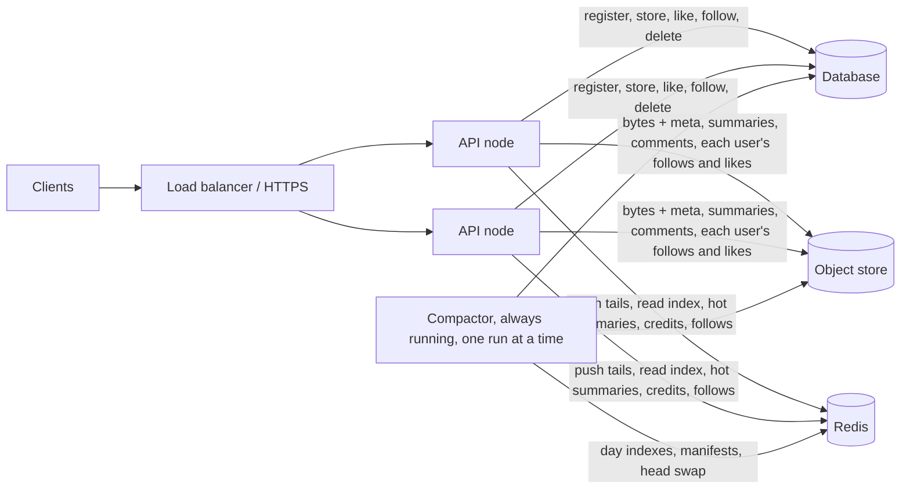
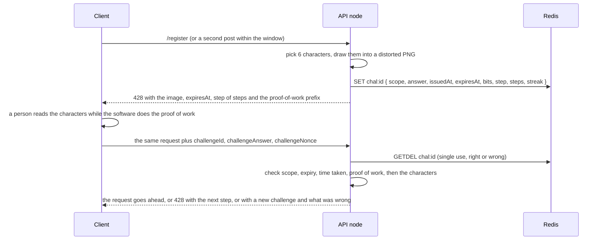
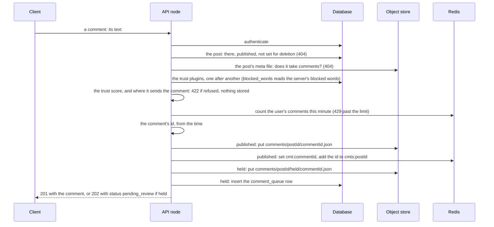
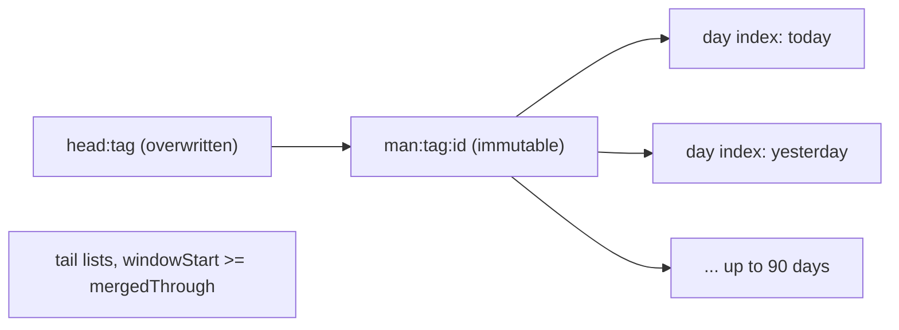
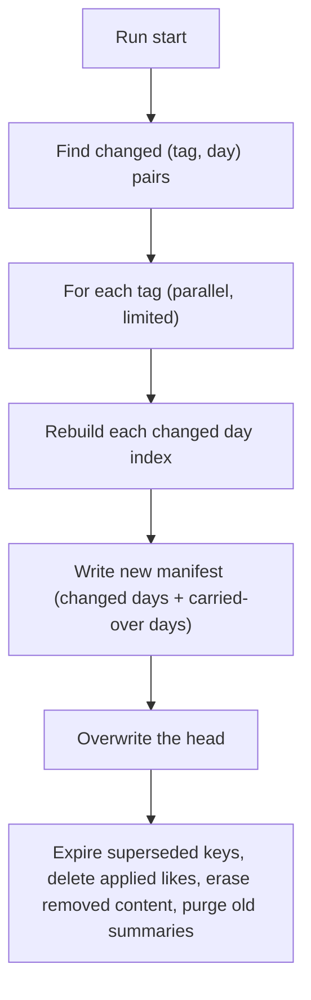

# How Evieverse works

This document explains the application end to end: what each part does, how a request moves through the system, how the feed is built, and why it's built that way. For setup and configuration, see [README.md](README.md). For what each endpoint takes and returns, see [API.md](API.md), and for the command-line tool, [CLI.md](CLI.md). Every setting, with its default, is in [`.env.example`](.env.example). For cloud deployment, see [deploy/README.md](deploy/README.md).

## Contents

1. [What it is](#1-what-it-is)
2. [The core idea](#2-the-core-idea)
3. [Architecture](#3-architecture)
4. [Code map](#4-code-map)
5. [Data model](#5-data-model)
6. [Request flows](#6-request-flows)
7. [The feed index](#7-the-feed-index)
8. [The compactor](#8-the-compactor)
9. [How a feed is built](#9-how-a-feed-is-built)
10. [Pagination and cursors](#10-pagination-and-cursors)
11. [Consistency, failure and recovery](#11-consistency-failure-and-recovery)
12. [Performance and scale](#12-performance-and-scale)
13. [Deployment topology](#13-deployment-topology)
14. [Known limits](#14-known-limits)

---

## 1. What it is

Evieverse is an open-source social media server, written in TypeScript on Fastify (Node 22).

- **Publishers** register, get an API key, and post. A post is one of five types: an image, a video or an audio file, each with an optional caption; text, of up to 40,000 characters; or a link, which is how any other file (a PDF, a web page) is shared. Everything they publish is credited to their username. With each piece of content, they declare whether it was created with AI. They can update content, which writes over it, and delete it.
- **Hashtags** come from the publisher, or from the server's admin, as the server's tagging mode says ([section 6](#post-store)).
- **Users** like content. A like is permanent, and each user can like a piece of content once.
- **Users comment** on the posts whose publishers turned comments on: flat, text only, up to 2,000 characters, written once and never edited ([section 6](#comments)).
- **Users follow** other users, up to 1,000 of them ([section 6](#following)).
- **Readers** ask for a feed of one or more hashtags over the past hour up to the past 90 days, most liked first or newest first, optionally with the hashtags related to those (the ones that tend to be on the same posts), or a feed of the posts of the users someone follows, newest first. Either can be limited to content created with AI or content that wasn't. Feeds come in **pages** of 50 posts by default (up to 100 when the reader asks), with a cursor for the next page.
- **Challenges** keep robots out: registering, and posting again within a minute, need a person to read a distorted image while their software does a proof of work. No user posts more than 3 times a minute, however many they solve ([section 6](#challenges)).
- **Moderation** is done by the server's admins, who can delete anything, by server moderators, who work through the moderation queue, and by moderators of each hashtag. The server refuses posts containing the admins' blocked words, and drops a hashtag from posts containing its moderators' blocked words or written by users muted on it. A post left with no hashtag isn't published. Every post gets a trust score, which has it refused, held in a moderation queue until a server moderator or an admin accepts it, or published. Every published post is also in the queue of each of its hashtags until a moderator of that hashtag approves it there, or removes the hashtag from it. Comments get the same trust score and wait in the same moderation queue, and a comment that users report waits in the report queue ([section 6](#comments)).
- **A command-line tool** for all of that is shipped by the server itself: anyone downloads it from there, it signs in with their API key, and the server holds it to its own build ([section 6](#the-cli)).

The server is designed for a read-heavy workload: many more feed reads than posts, many tags per feed request, and many API nodes behind a load balancer.

## 2. The core idea

**The feed never touches the database, and almost never leaves RAM.**

Each hashtag has a small **index in Redis**: per UTC day, the post ids worth showing with their like counts, AI flags and whether a moderator approved them, packed into 25 bytes each. Each publisher has one too, of their newest posts, which following feeds read, and whom each user follows and each hashtag's related hashtags are copied to Redis as well. A post's **summary** (its feed record, with the start of the post) is stored once, Brotli-compressed plain text, in an object store for the whole retention period, and also in Redis while the post is younger than 8 days. A feed request plans the whole response from the indexes alone, then fetches the summaries it picked: posts from the last 8 days, which are most of what feeds return, come from Redis in one round trip; older posts come from the object store.

Everything else follows from that rule:
- **Writes are appends.** A new post pushes one short line onto each of its hashtags' Redis lists ("tails"), and onto its publisher's. Even removals are appends: deleting content, or dropping a hashtag from it, pushes a tombstone that readers honour at once. So is a moderator's approval, which pushes a line that flags the post.
- **Content has one version.** An update writes over the post's bytes, its meta file and its summary, and the last write wins. What a post was before isn't kept.
- **A background compactor,** one process that's always running, merges tails into sorted, immutable day indexes every few seconds, applies new like counts and what tag moderators decided from the database, and trims old days. It also carries out deletions, removing content from the index, the summaries and storage together.
- **Readers see a consistent snapshot.** They follow a tiny per-tag head to an immutable manifest, so a reader is never blocked or shown a half-written index.
- **The database** holds identity, ownership, like counts, moderation rules, the moderation queue and what tag moderators decided. What a post is (its content type, size, text and hashtags) is in a meta file beside its bytes, not in the database. Writes (moderation is decided when a post is written), API-key checks, the compactor, and the lookup endpoints (`/content`, `/users/:id`, `/tags`) use it. Feeds never do.
- **Whom a user follows and what they liked** is in one file per user in the object store, not in the database, so neither grows a table with the number of users or posts. A follow or a like reads the user's file, changes it and writes it back ([section 6](#post-like)).
- **Comments aren't in the database either.** Each is one object in the content store, written once, with Redis as a cache over them: a post's comments are read without a query, and a comment is written without a row. Only a comment that waits in the moderation queue, or that was reported, has a row ([section 6](#comments)).

## 3. Architecture



| Component | Role | Backends |
|---|---|---|
| API nodes | Stateless Fastify servers. Any number of them behind a load balancer, which can check `GET /health` (`{ "ok": true }`). | Containers or VMs, or one function per group of routes ([below](#as-functions)) |
| Database | Users (and whether they're an admin or a server moderator), API keys, content rows (owner, likes, AI flag, when it was created), hashtags, the likes the compactor hasn't applied yet, moderators, mutes and blocked words, the moderation queue and tag moderators' decisions, the comments that wait in the moderation queue or were reported (their ids, not their text), and the compactor's lease. | SQLite, Postgres, MySQL (via Kysely) |
| Content store | Each content's bytes, `content/<id>`, plus `content/<id>.meta.json` beside them, which says what they are. Each comment, `comments/<postId>/<commentId>.json`. Each user's file, `users/<id>.json`: whom they follow and what they liked. | Any Apache OpenDAL backend: fs, S3, GCS, Azure Blob, SFTP, WebDAV, Drive, OneDrive, Dropbox, HDFS, ... |
| Summary store | Every summary for the retention period, `summaries/<day>/<id>.br`. | Any OpenDAL backend; the content store unless `SUMMARY_SCHEME` is set |
| Redis | Per-tag and per-publisher heads, manifests, day indexes and tails; summaries of the last 8 days; publisher credits; whom each user follows; each hashtag's related hashtags; the comments of the last day and each post's index of them; open challenges, each user's post window and posts of the last minute, and the counts behind the limits on registrations, upload links and comments; how far the compactor has got. | Any Redis-protocol server with a single primary: Redis, Valkey, ElastiCache, Memorystore, Azure Managed Redis. Without `REDIS_URL`, an in-process store (single node only), rebuilt on every start. |
| Compactor | One background process that maintains the index, and runs for as long as it's up: pass after pass, never two at once, and never more than one in `COMPACT_INTERVAL_SECONDS` (5). A lease in the database keeps two copies of it from overlapping. | In-process (`COMPACT_IN_PROCESS=true`), or standalone (`npm run compact`, which needs `REDIS_URL`): one container that's always up |

Everything in Redis but the open challenges, what users posted in the last minute and the counts behind rate limits can be rebuilt from the database and the content store's meta files and user files (`--rebuild`, [section 8](#8-the-compactor)). What Redis has of comments needs no rebuild: whatever it lacks is read from the content store when a post's comments are next asked for ([section 6](#comments)). A lost challenge is simply answered with a new one, a user whose recent posts are lost posts as if they hadn't posted lately, and a lost count starts again from nothing.

**Configuration.** Settings are read and validated with zod (`src/config.ts`) when the process starts, so a bad one stops it there. The [README](README.md#configuration) says how to set them, and [`.env.example`](.env.example) lists them all with their defaults. Both the API and the compactor apply the database migrations when they start, unless `DB_MIGRATE_ON_START=false` (then run `npm run migrate` when you deploy). Functions never do.

### As functions

The same server also runs split up: one function per group of routes, each scaling with its own traffic, with one address in front that sends each request to its group ([section 13](#13-deployment-topology)). The groups are a table in `src/functions/groups.ts`:

| Group | Routes | Opens the database |
|---|---|---|
| `feed` | `GET /feed`, `GET /feed/following` | No |
| `content` | `GET /content/:id`, `GET /content/:id/raw`, `GET /content/:id/comments`, `GET /content/:id/comments/:commentId` | Yes |
| `store` | `POST /uploads`, `POST /store` | Yes |
| `api` | Everything else | Yes |

- **A function is the same app with one group's routes.** `buildApp` registers the groups it's given: all of them for `src/server.ts`, one for a function. A request is therefore handled by exactly the code that handles it on a node. On AWS Lambda the request is passed into the app without a socket (`app.inject`); on platforms that run containers behind HTTP, the app listens as usual.
- **An instance is built once and reused.** The app, its Redis connection and its database pool are made when an instance starts and serve every request it gets. A start that fails is tried again on the next request.
- **Nothing a request relies on lives in a process.** The feed index, challenges, the counts behind rate limits and follow lists are in Redis, so functions need `REDIS_URL` and refuse to start without it. Caches are per instance, as they are per node.
- **Functions don't migrate the database** when they start, as many start at once. They keep a small pool (`DB_POOL_SIZE` 2, closed after 10 idle seconds), and the feed group opens no database at all.
- **A request finishes its work before it answers,** including removing its temp file, because a function can be frozen the moment it has answered.
- **The compactor isn't a function.** A function runs when it's called, and the compactor has to keep running, so it stays one process beside them: a container that's always up ([section 8](#8-the-compactor)).

## 4. Code map

```
src/
  server.ts            entry point: the API, with the in-process compactor if it's on
  app.ts               Fastify app: error handler, CORS, rate limiting, multipart, /health, routes
  config.ts            every setting (env vars or evieverse.config.json), validated with zod
  deps.ts              wiring: content store, user files, Redis, summary store, publisher credits, follows, appender, feed readers;
                       bootstrap() opens the database and builds them all for an entry point, bootstrapStores() all but the database
  time.ts              HOUR and DAY, UTC days, whole seconds, ISO timestamps
  auth/apiKey.ts       API key issue/verify (sha256 hash, looked up by user and hash)
  http/
    errors.ts          HTTP errors as JSON: 400 for invalid requests, 413 for uploads too large, Retry-After on 429, 422 with extra fields
    schemas.ts         request fields several routes share: credentials, hashtags in paths, boolean flags, list queries
    mime.ts            the MIME type: the client's, else from the file extension
    listCursor.ts      pages and cursors of the lists of follows (from a user's file) and mutes (keyset pages of the database)
    rateLimitStore.ts  the counts behind per-IP limits, kept in Redis so nodes and functions share them
  challenge/
    image.ts           challenge images: random characters, stroke glyphs, distortion, a PNG encoder
    challenges.ts      issuing and checking challenges (single use, proof of work), the post window and runs, the limit on posts a minute
  db/
    index.ts           Kysely setup for SQLite, Postgres and MySQL; unique-violation detection, the upserts that differ by database,
                       and the lock on a user's row that their follows and likes take turns with
    schema.ts          table types
    migrator.ts        applies the portable SQL migrations (on start; migrate.ts is `npm run migrate`)
    migrations/        0001_initial.sql: the whole schema
  storage/
    hotStore.ts        the Redis client (and the in-process stand-in)
    summaryStore.ts    summary text format, Brotli, the Redis and object-store tiers
    publisherStore.ts  publisher credits in Redis
    userFileStore.ts   each user's file in the content store: whom they follow and what they liked
    followStore.ts     the copy of whom each user follows that following feeds read, in Redis
    relatedTagStore.ts each hashtag's related hashtags, which feeds asked to add them read, in Redis
    contentStore.ts    bytes and meta files, presigned links to read and to upload, making an upload a content's bytes
    commentStore.ts    comments as objects in the content store, held ones apart, and the cache of them in Redis: each post's index and each comment
    opendal.ts         OpenDAL operators (atomic overwrites on local disk)
    spool.ts           upload spooling: a temp file and its size limit
  posts.ts             the post types, link URLs, cutting previews, and reading stored previews as feeds show them
  upload.ts            reading a post from a request: multipart or JSON, the fields its type allows, its bytes spooled
                       or already in the content store (uploadId)
  content.ts           loading content with its publisher and meta file, for whoever may read it, and its feed record (summary)
  comments.ts          what a comment is: its id (a UUIDv7), its record in responses, and removing one with its rows in the queues
  tags.ts              hashtag normalisation, parsing publishers' hashtags, the tagging mode, "touch" on use, counting a write's hashtags and their pairs
  write.ts             writing content, new or over what's there: bytes, summary, meta, commit, tail pushes, tombstones, counting its hashtags; the checks every update passes
  deletion.ts          setting content for deletion: the row, tombstones on its hashtags (DELETE /content, and removing the last hashtag)
  moderation/
    words.ts           normalising blocked words, and the streaming whole-word and phrase scanner
    policy.ts          who moderates a hashtag, who works through the moderation queue, setting admins, and the rules a new post, an update or a comment is held to
    trust.ts           a post's or a comment's trust score: loading the trust plugins, running it through them, and where a score sends it:
                       refused, the moderation queue, or published
    queues.ts          what the moderation queue and the report queue have in common: posts and comments in one list, and what an item of either is
    tagDecisions.ts    what a hashtag's moderators decide about content under it: approving it, or removing the hashtag (a deletion if it was the last)
    admin.ts           the operator's tool for admins, straight against the database (`npm run admin -- grant|revoke|list`)
    bootstrap.ts       the admin account a deployment is set up with (BOOTSTRAP_ADMIN), which the migration step creates
  plugins/
    trust/             the trust plugins, one folder each: an algorithm every post and comment goes through, which may lower its trust score
      blocked_words/   no trust for a post or a comment with a word or phrase of the server's list
  cli/                 the CLI the server ships, bundled into one file by scripts/build-cli.mjs; it imports nothing else from src/
    bin.ts             the bundle's entry point: the terminal, the CLI's own file, running it again after an update
    main.ts            arguments to a command, exit codes, and what a 426 sets off
    commands.ts        the table of commands, each with who it's for, and the help
    client.ts          requests with a profile's key and the CLI's build; the errors a command can end with
    profiles.ts        saved servers and keys (~/.evieverse/profiles)
    update.ts          downloading the server's build, checking it, and replacing the CLI's own file
  util.ts              LRU and TTL caches, bounded-concurrency map
  tagfeed/
    layout.ts          index layout: Redis keys, publisher index names, packed day entries, tail lines, manifest types, sort orders, quotas
    read.ts            reading heads, JSON keys and tail lines from Redis, for the reader and the compactor
    appender.ts        tail pushes ("prepend")
    reader.ts          head -> manifest -> day indexes (+ tails), with caches; day indexes on demand for following feeds
  feed/
    plan.ts            the page planner: the algorithms and windows a feed can ask for, halving, carry, extension, give-back, fresh slots, chronological order
    related.ts         which related hashtags a feed adds to the ones it was asked for
    following.ts       the following-feed planner: newest first across publishers, loading only the days a page needs
    render.ts          loads the picked summaries and credits, streams the JSON response
    cursor.ts          pagination cursors encode/decode (hashtag feeds and following feeds)
  compact/
    compactor.ts       the compactor: a pass, and the loop that makes one after another
    lease.ts           the database lease that keeps the runs of two compactor processes from overlapping
    main.ts            the compactor as a process of its own (--once, --all, --rebuild)
  functions/
    groups.ts          the route groups: the routes each function serves, and whether it opens the database
    handler.ts         a route group as a function (the app built once per instance), functions' default settings
    lambda.ts          the AWS Lambda entry point: a route group, or the migrations (FUNCTION_GROUP)
    lambdaRuntime.ts   the Lambda runtime loop, and API Gateway HTTP API requests and responses
    http.ts            the entry point for containers that scale with traffic (Cloud Run, Container Apps): a route group
    edge.ts            the secret a CDN in front of the functions sends, and refusing requests without it
  routes/              register (and /users, /users/:id/key, /whoami), uploads, store, like, follow, content (and delete), comments, moderation (and /admins, /moderators), feed (and /feed/following), tags,
                       cli (the CLI's download, its install scripts, and the check that holds a CLI to the server's build)
scripts/build-cli.mjs  bundles src/cli into dist/cli/evieverse.mjs, with the manifest that names its build (part of `npm run build`)
test/                  vitest: API, feed index, the compactor as a process, planners, follows, moderation, the moderation queues and trust scores, comments, related hashtags, trust plugins, challenges, formats, migrations, CORS, functions, uploads, rate limits, admins and the CLI; helpers.ts has the test server and the requests they share
testbed/               a seeded Docker stack with a web page, for trying the server out (section 13)
deploy/terraform/      AWS, GCP and Azure (section 13)
compose.base.yml       the services the three compose files share (section 13)
```

## 5. Data model

### Database

The portable SQL migrations in [`src/db/migrations`](src/db/migrations) work on all three databases. Every timestamp is UTC epoch milliseconds, and every id is a UUID.

| Table | Holds | Notes |
|---|---|---|
| `users` | `id`, `username` (unique), `created_at`, `updated_at`, `admin`, `moderator` | `updated_at` changes only when the username actually changes. What a user posted lately, which the challenges and the limit on posts a minute go by, is in Redis, not here ([section 6](#challenges)). `admin` is 1 for the server's admins, set by an admin, a deployment or the operator, and `moderator` is 1 for its server moderators, set by an admin ([section 6](#moderation)). |
| `api_keys` | `id`, `user_id`, `key_hash`, `created_at`, `revoked_at` | Keys look like `tu_<12 hex>_<43 chars>`. Only the sha256 of the whole key is stored, and a key is looked up by its user and that hash. |
| `content` | `id`, `user_id`, `ai_generated`, `like_count`, `created_at`, `delete_requested_at` | One row per piece of content: whose it is, how liked, and when it was created. What it is (content type, size, text, hashtags, when it was last written) is in its meta file in the content store, which an update writes over. `ai_generated` is 1 if the publisher declared the content created with AI, else 0. `created_at` never changes. `delete_requested_at` is set by `DELETE`, and the compactor deletes the row later. |
| `tags` | `name`, `created_at`, `last_appended_at`, `compacted_at` | Tells the compactor which tags have new tail entries. Publisher indexes have rows too, named `@<userId>`, which `/tags` leaves out. |
| `tag_pairs` | `(tag_a, tag_b)` primary key, `posts`, `updated_at` | How many posts each hashtag has been on (`tag_a = tag_b`) and how many each pair of hashtags has been on together (`tag_a < tag_b`), counted as posts are stored ([section 6](#post-store)). Related hashtags are worked out from it ([section 8](#8-the-compactor)). `updated_at` is when the row was last counted, and an index on it finds the rows changed since a compactor run. An index on `tag_b` finds a hashtag's pairs where it's the second of the two. Counts only go up. |
| `likes` | `(user_id, content_id)` primary key, `created_at` | The likes the compactor hasn't copied into the feed index yet: `/like` inserts a row, and the run that applies the like deletes it ([section 8](#8-the-compactor)). So the table holds a few seconds of likes, not every like ever made. What refuses a second like is the user's file in the content store ([below](#content-store)), though the primary key does too while the row is there. |
| `tag_moderators` | `(tag, user_id)` primary key, `created_at` | Who moderates which hashtag. An index on `user_id` lists a user's hashtags for their profile. |
| `tag_mutes` | `(user_id, tag)` primary key, `created_at` | Users muted on a hashtag. The primary key finds a publisher's mutes on a post's hashtags; an index on `(tag, created_at)` lists a hashtag's. |
| `blocked_words` | `(tag, word)` primary key, `created_at` | Normalised words and phrases (lowercase, without accents, words separated by one space). The list of tag `*`, which no hashtag can be, is the server's. |
| `moderation_queue` | `content_id` primary key, `trust_score`, `created_at` | The content that's stored but not published: its last write's trust score sent it to the moderation queue ([section 6](#moderation)). This is the only place a trust score is kept. `created_at` is since when it waits, which orders the queue; an update that's held too keeps it. The row goes when a server moderator or an admin accepts the content, when an update of it is published, or with the content row. |
| `comment_queue` | `comment_id` primary key, `content_id`, `trust_score`, `created_at` | The comments that are stored but not published: their trust score sent them to the moderation queue ([section 6](#comments)). It holds a comment's id and its post's, not its text, which is in the content store. `created_at` is when the comment was sent, which orders it among the posts of `moderation_queue`. The row goes when a server moderator or an admin accepts or rejects the comment, when its author deletes it, or with the content row. A published comment never has one. |
| `comment_reports` | `(comment_id, user_id)` primary key, `content_id`, `reason`, `created_at`, `accepted_at` | Users' reports of published comments: one per user and comment. `accepted_at` is null until a server moderator or an admin accepts the comment, and the comments with such a row are the comments in the report queue. The rows go with the comment when it's deleted, and with the content row. A comment nobody reported has none. |
| `tag_moderation` | `(content_id, tag)` primary key, `decision`, `moderator_id`, `decided_at`, `applied_at` | What a hashtag's moderators decided about content under it: `approved` or `removed`. `applied_at` is null until a compactor run has applied the decision to the index ([section 8](#8-the-compactor)), and an index on it finds those. An update of the content deletes its `approved` rows; `removed` rows stay for as long as the content does, which is what keeps the hashtag off it. |
| `pending_appends` | `(content_id, tag)` primary key, `created_at` | A hashtag's tail (or a publisher's own index's) that may not hold a write's line for the content yet: its entry, or the tombstone for a hashtag an update dropped. Normally a row lives only for the length of one `/store`. For one left behind, the compactor rebuilds the content's entry in that hashtag from the database and the meta file. The rows go with the content row. |
| `compactor_lease` | `id` (one row, `compactor`), `holder`, `expires_at` | The compactor run allowed to publish heads and delete, so the runs of two compactor processes never overlap ([section 8](#8-the-compactor)). |

### Content store

```
content/<contentId>             the post's bytes: its file unchanged, a text post's text, or a link's URL
content/<contentId>.meta.json   { contentId, mimeType, size, aiGenerated, comments, preview, text?, tags, updatedAt }
comments/<contentId>/<commentId>.json        a comment on the post: { commentId, contentId, userId, text, createdAt }
comments/<contentId>/held/<commentId>.json   the same, while it waits in the moderation queue
uploads/<userId>/<uploadId>     a file sent with an upload link, until /store posts it or the store expires it
users/<userId>.json             { userId, following: { <userId>: <followedAtMs>, ... }, likes: [<contentId>, ...] }
```

A user's file holds whom they follow, each with when, and the ids of the content they liked. It's the only record of either: the database has no table of follows, and its `likes` table only holds likes on their way into the feed index. A user who never followed or liked anything has no file. Follows, unfollows and likes read the file, change it and write it back ([section 6](#post-like)); `GET /users/:id/following` and `--rebuild` read it. Likes are permanent, so the list only grows, by about 39 bytes a like.

Content has one version: an update writes over the bytes and the meta file, and nothing of what was there is kept. The meta file is where the content's description lives, rather than in the database: `/content` reads its content type, size, text, hashtags and `updatedAt` from it, and the compactor and `--rebuild` restore summaries and index entries from it. Its `text` is a text post's whole text, or a caption, which `GET /content` returns; the preview holds only its start. Its `size` is that of the bytes as stored. Its `updatedAt` is when the content was last written: posted, updated, or a hashtag removed from it (the content's creation time is in the database). The bytes are stored with their content type where the backend keeps one (S3, GCS and Azure Blob do), which is what a signed link to them serves. On a local disk (`fs`), writes go to a temp directory and are renamed into place, so a reader never sees half a file. The meta file's `comments` is whether the post takes comments; a meta file written before there were comments has none, which reads as off.

A comment is one object, written once and never changed, and the only record of a published comment: the database has no table of them. Its name is its id, a UUIDv7, which starts with the time the comment was sent, so the names under a post's prefix are in the order its comments were sent, and one list of the prefix is the post's comments in order. A comment that waits in the moderation queue is under `held/`, where no list of the post's comments finds it; accepting it moves it out. How they're read is in [section 6](#comments).

### Summaries

One per piece of content, shared by all of its hashtags; an update writes over it. Stored as plain text rather than JSON, since JSON repeats its keys and escapes in every record, which compresses worse, and Brotli-compressed in text mode at quality 11 (`SUMMARY_BROTLI_QUALITY`):

```
<createdAtMs> <updatedAtMs> <aiGenerated: 1 or 0> <comments: 1 or 0>
<userId>
<mimeType>
<hashtags, space-separated>
<preview kind: text, image, video, audio or link>
<the first 100 words of a text post or caption, or a link's URL: everything after the five lines above>
```

An image's, video's or audio's link to its bytes isn't stored: it's built when read. `comments` is whether the post takes comments, which is how a feed record says so without reading anything else; a summary written before there were comments has three numbers on its first line, and reads as a post that takes none. A summary doesn't hold the like count or the publisher's name, which change: the feed adds them when it renders the record. A text summary with a full 100-word preview, about 710 bytes, compresses to about 310, against 405 for the same record as compressed JSON.

| Tier | Key | Kept |
|---|---|---|
| Object store | `summaries/<UTC day of createdAt>/<contentId>.br` | the retention period (`FEED_TAG_RETENTION_DAYS`, 90 days). The compactor deletes whole days past it. |
| Redis | `sum:<contentId>` (same bytes) | until the post is `SUMMARY_HOT_DAYS` (8) days old: written with that TTL. |

An update writes the object store, then Redis. A node that read an older post's summary from the object store keeps it in memory for `SUMMARY_CACHE_SECONDS` (60), so a post older than 8 days can show on that node as it was for that long after an update. A summary read from the object store is copied back to Redis only where Redis has none, so a read that started just before an update never puts the old summary over the new one.

### Feed records

The feed builds each record from the summary, the like count in the index and the publisher's current credit:

```json
{ "contentId": "…",
  "publisher": { "userId": "…", "username": "alice" },
  "mimeType": "text/plain",
  "aiGenerated": false,
  "comments": true,
  "preview": { "kind": "text", "text": "first 100 words…" },
  "tags": ["news", "mumbai"], "likes": 17, "moderated": false,
  "createdAt": "2026-11-06T12:00:00.000Z", "updatedAt": "2026-11-06T12:00:00.000Z" }
```

`moderated` comes from the index too, like the like count: it's the entry's flag in the index of the hashtag the record is listed under ([section 7](#layout)). Records that aren't read from a hashtag's index (the following feed's, the moderation queue's) have no `moderated`.

`preview` follows the post's type:
- a text post: `{ "kind": "text", "text": … }`, its first 100 words, at most 1,000 characters of them;
- an image, video or audio post: `{ "kind": "image", "url": …, "text": … }` (or `video`, `audio`), linking to the raw bytes, with the caption's first 100 words, cut the same way. Without a caption there's no `text`;
- a link post: `{ "kind": "link", "url": … }`.

`aiGenerated` is the publisher's declaration about the content itself. `comments` is whether the post takes comments, from the summary; a record doesn't say how many it has ([section 14](#14-known-limits)). A typical text record is about 1 KB; an image, video or audio record without a caption, or a link, about half that.

## 6. Request flows

What each endpoint takes and returns is in [API.md](API.md). This section is what the server does with a request, and why.

### Authentication

Write endpoints check a user id and an API key (`src/auth/apiKey.ts`). Verification hashes the presented key and looks for a key of that user with that hash. Only the whole key gives the hash, so a row found is the key, and there's nothing left to compare. The same lookup reads whether the user is an admin or a server moderator, and the moderation endpoints check their roles after it ([below](#moderation)). Each user gets one key, at registration, and can replace it ([below](#post-usersidkey)); the admin account a deployment creates gets its key from the deployment instead ([below](#moderation)). `GET /whoami` answers a key with its account and roles, which is how the CLI checks one. A gateway that signs in to the server with its own `Authorization` header (Google's API Gateway does) passes the client's on as `X-Forwarded-Authorization`, so that header is read first. Reads (`/feed`, `/feed/following`, `/content`, `/users/:id` and its follow list, `/tags`) need no key, so they never look one up. `/register` is rate limited per IP.

Every error leaves through one handler (`src/app.ts`, `src/http/errors.ts`), as JSON. A request that fails its zod schema becomes a `400` carrying zod's issues, and anything unexpected is logged and becomes a `500`.

### Challenges

To keep robots out, registering, and posting less than `CHALLENGE_POST_WINDOW_SECONDS` (60) after your previous post or challenge, need solved challenges: one to register, and for posts, more for each post in a row. [API.md](API.md#challenges) describes what clients send. This is how the server handles it (`src/challenge/`), with no third-party service:



- **The image.** Six characters, chosen with `crypto.randomInt` from 24 that can't be mistaken for each other (no `0`/`O`, `1`/`I`, `5`/`S`, and so on), drawn as strokes rather than from a font: no font file sits on the server for a robot to match against. Each character gets its own size, rotation and shear and overlaps its neighbours. Curves as thick as the strokes run through them, so they can't be filtered out by thickness. The image is then bent by a sine wave, a band of it is inverted and noise is added. `src/challenge/image.ts` rasterises it and encodes the PNG itself (zlib and a CRC32); a 240×80 image takes about 5 ms and 21 KB of base64.
- **The proof of work.** The client must find a nonce that makes `sha256("<id>:" + nonce)` start with `CHALLENGE_POW_BITS` (18) zero bits: about 2^18 hashes on average (about 1.5 seconds in a desktop browser), which the client's software does while the person types. The server checks it with one hash. It doesn't stop a determined robot, but it makes every attempt cost CPU time, which a person never notices.
- **One answer per challenge.** The answer takes the challenge out of Redis with `GETDEL`, so it can be used once, whether the answer is right or wrong, and two requests racing with the same answer can't both pass. Every guess therefore costs a new image to read and a new proof of work.
- **The order of the checks.** The challenge must have been issued for this request (`register`, or `post:<userId>`), be at most `CHALLENGE_TTL_SECONDS` (120) old, and be at least `CHALLENGE_MIN_SOLVE_MS` (2,000) old, since no person reads and types it faster. The proof of work comes next, and the characters last (uppercased, spaces and hyphens removed, compared in constant time). A robot that answers too fast or skips the work never learns whether its characters were right.
- **Failures.** Any failed check is `428` with a new challenge, and an `error` saying what was wrong. The key lives a minute past its expiry, so a late answer is told it was late rather than unknown.

**The post window and runs.** Each user's posts through `/store` have one window and one run, kept in Redis as `run:<userId>`: `<last> <streak>`, where `last` is when the user last posted or was challenged to. The key lasts one window, and a user without one hasn't posted within it. Nothing here touches the database. Every change is a compare-and-set (`HotStore.swap`, one Lua script on the one key): read the value, work out the new one, and set it only if the key still holds what was read; if another post changed it in between, that's tried again (up to 20 times, after which the post gets `429`).
- A post first claims the window: if there's no run, or `last` is a whole window ago, it sets `last` to its own time and `streak` to 0. The post then needs no challenge, and the run starts over. Of several posts sent at once, only one can pass this way.
- Otherwise the post is in a run, and moves `last` forward to its own time. Every challenge therefore starts the window again, and a run only ends after a whole window with no post and no challenge.
- `streak` counts the posts in the run that passed with challenges, and sets how many challenges the next one needs (`postSteps`): one after none or one of them, then `2^(streak − 1)`. That gives 1, 1, 2, 4, 8, 16, …, so from the second on, each post costs as many challenges as the whole run before it.
- The post gets a chain of that many challenges, one at a time. Each is stored with its `step`, the chain's `steps` and the `streak` it was issued at. A right answer before the last step gets `428` with the next challenge, and a wrong one gets a new challenge at the same step. Each step is its own single-use key, so a step can't be replayed or skipped.
- The last right answer claims the post's place in the run: it sets the run's `streak` to one more, but only if it's still what its chain was issued at. Only one chain can do that at each point of the run. A robot that solves several chains at once gets one post through, and the others are told another post went through, with a new, longer chain.
- The check comes after authentication and the request's own checks, and before anything is stored, so a challenged post stores nothing.
- If a post then fails (storage is down, a `409`), its claim is given back, so trying again costs no more than before. A post that passed without a challenge deletes the run it started; one that passed with challenges sets `streak` back. The challenges it used aren't given back.
- Only posts that change something count. A `/store` of a text or link post that changes nothing (the same text or URL and flag as the content has, and the same hashtags when the publisher's are used, in any order) returns before the check. A file is never compared: sending one is an update.

**The limit on posts a minute.** Runs make posting often expensive, but past a few posts in a row the number of challenges stops meaning anything. So no user posts more than `POST_RATE_LIMIT_PER_MINUTE` (3) times in any 60 seconds, however many challenges they solve. It's a sliding window, not a counter that resets every minute, so no burst across the turn of a minute gets more through.
- `posts:<userId>` in Redis holds the times of the user's posts in the last minute (epoch milliseconds separated by spaces, oldest first), and lasts a minute from its last change. It's changed by the same compare-and-set as the run: read it, drop the times more than a minute old, add or remove one, and set it only if it still holds what was read.
- The check comes first, before the post window: a post with the limit used up gets `429`, with a `Retry-After` header and `retryAfterSeconds` for when the oldest of those posts is a minute old. It's refused before any challenge, and before a sent solution is checked, so nobody solves challenges for a post that can't go through, and a step of a chain isn't used up by a refusal. A refused post doesn't move the run's `last` either, so it doesn't extend the run.
- A post that passes the window or its challenges then adds its time with the compare-and-set, which can't add more than the limit allows. Of several posts sent at once, only that many get through. A post that finds the last place taken in between (only possible when posts go at the same time) gets `429` and gives its claim in the run back. The challenges it used aren't given back.
- If the post then fails, its time is removed again, so it doesn't count.

`CHALLENGE_REGISTER=false` turns off the registration challenge, `CHALLENGE_POST_WINDOW_SECONDS=0` the post window, and `POST_RATE_LIMIT_PER_MINUTE=0` the limit.

### `POST /register`, `GET /users/:id` and `PATCH /users/:id`

- **Register** creates the user and issues an API key, of which only the sha256 is kept, so it can be returned only once. A username already taken is refused before any challenge, so nobody solves one for a name they can't have; the unique index refuses a duplicate that races past that check. Then it needs a solved challenge ([above](#challenges)). Every attempt counts towards the per-IP limit (`REGISTER_RATE_LIMIT_PER_HOUR`, 10), so registering uses at least two. The count is kept in Redis (one atomic increment per attempt, `src/http/rateLimitStore.ts`), so every node and function shares it. The IP is the connection's own, or behind proxies the one `TRUST_PROXY` says to read from `X-Forwarded-For`.
- **GET** reads the user's row, and their hashtags from `tag_moderators`.
- **PATCH** bumps `users.updated_at` only if something actually changed.

Register and PATCH also write the user's **publisher credit** to Redis (`pub:<userId>`), and every post rewrites it. Feeds look credits up when they render, so a changed username shows on every record at once, with nothing to rewrite. If that write fails, the compactor rewrites the credit of every user whose `updated_at` changed since its last run.

A user can post as soon as they've registered: everything published is credited to their username. Accounts can't be deleted.

### `POST /users/:id/key`

Replaces the caller's own API key (`reissueApiKey` in `src/auth/apiKey.ts`), for a key that may have leaked. In one transaction it revokes the key the request was sent with, revokes any other key the account has, and inserts a new one, so the account always has exactly one key that works, and the old one stops working as the transaction commits. Keys are checked against the database on every request and cached nowhere, so there's nothing else to clear. Revoked rows stay in `api_keys`, with when they were revoked.

The transaction starts by locking the user's row (`lockUser`), so a user's replacements take turns, and revoking the presented key is what checks it: the update changes the row only if the key is still live, and the request gets `401` if it changed none. Two requests sent at once with the same key can both pass the route's first check, but the second waits for the first, then finds the key revoked. Without that, each would insert a key, and someone holding a leaked key could keep the account by replacing the key at the moment its owner does. The lock is on the user's row and not the key's because on MySQL two transactions that each lock the key through the index on `(user_id, key_hash)` and then insert a key for the same user deadlock. SQLite's one connection runs one transaction at a time, which does the same.

`ensureAdmin` ([below](#moderation)) works against this for the one account a deployment owns: every run makes the deployment's key that account's only one, so a key replaced here is revoked at the next deploy and the deployment's key, revoked here, works again. That account's key is replaced through the deployment.

### `POST /store`

```mermaid
sequenceDiagram
  participant C as Client
  participant A as API node
  participant OS as Object store
  participant DB as Database
  participant R as Redis
  C->>A: a post (JSON or multipart): its type, and its file, text or link
  A->>A: check the fields fit the type (400); spool the file, text or link to a temp file, size limit
  A->>DB: authenticate
  A->>A: in user tagging mode, the publisher's hashtags (400 if missing or unusable)
  A->>DB: if contentId given: check owner, not set for deletion
  A->>OS: if contentId given: read its meta file; same MIME type (400)
  A->>A: a text or link post with the same text or URL, flags and hashtags as the content? answer unchanged, store nothing
  A->>DB: the trust plugins, one after another (blocked_words reads the server's blocked words)
  A->>DB: moderation rules: blocked words of the post's hashtags, the publisher's mutes on them, hashtags moderators removed from this content
  A->>A: with blocked words: scan the text, caption or link, the filename and the hashtags
  A->>A: the trust score the plugins left, and where it sends the post: 422 if deleted, or no hashtag left, nothing stored; else held or published
  A->>A: the hashtags left are the content's, on the same text or link post going where the content is? answer unchanged
  A->>R: refuse past the posts a minute (429, nothing stored)
  A->>R: claim the post window, or else the run's challenges (428 with the next one, nothing stored)
  A->>A: the preview: the first words of the text or caption, the file's link, or the link
  A->>DB: on update: add a pending_appends row for each hashtag, kept and dropped, and the publisher's index
  A->>OS: put bytes content/id (over the ones there, on update)
  A->>OS: put the Brotli summary
  A->>R: put the same summary with a TTL of createdAt + 8 days
  A->>OS: put content/id.meta.json
  A->>DB: transaction: insert the content row (or check it's still live and set its AI flag), put it in or take it out of moderation_queue, on update delete its approvals, touch tags, stamp the pending_appends rows
  A->>R: after the commit: rewrite the publisher credit
  A->>R: published: push an entry onto each hashtag's tail, and the publisher's index's
  A->>R: on update: push a tombstone onto each hashtag the update dropped (held: onto every hashtag, and the publisher's index)
  A->>DB: delete the pending_appends rows whose push succeeded
  A->>DB: count the post's hashtags, and each pair of them, in tag_pairs (on update: the ones it adds)
  A-->>C: 201 (200 on update, 202 with status pending_review if held) with contentId, tags, preview, aiGenerated, comments (and removedTags)
```

Details:
- **Post types.** `src/posts.ts` defines the five types, and `src/upload.ts` checks a request has the fields its type allows and no others. A link's URL is stored as the URL parser writes it. There's no type for other files: a PDF or a web page is posted as a link to wherever it's hosted.
- **The upload.** However a file arrives (a multipart part, or base64 in JSON), it's streamed to a temp file under `STORAGE_TMP_PATH`, and refused with `413` past `MAX_UPLOAD_BYTES`. A text post's text and a link's URL are spooled the same way, as the post's bytes, so every type is stored alike. The temp file is removed before the response is sent.
- **A file sent ahead (`uploadId`).** A request to a server run as functions carries a few megabytes at most, so a larger file goes to the content store itself first.
  - `POST /uploads` authenticates, checks the file's declared type and size as `/store` would, and returns a presigned link to `uploads/<userId>/<uploadId>` in the content store, valid for `CONTENT_SIGNED_URL_SECONDS`. The client sends the file there; it never passes through the server. A content store that can't sign links (local disk, SFTP, WebDAV) answers `501`.
  - `/store` with the `uploadId` looks for the upload under the authenticated user's id, so nobody posts another user's upload. A missing or empty one gets `400`, and one past `MAX_UPLOAD_BYTES` gets `413` and is removed.
  - The link can't limit what's sent to it, and whoever holds it can send again until it expires. So nothing measured beforehand is relied on. The upload's size is checked again before anything is written, then it's copied to `content/<id>` (within the store where it can, otherwise through the server), and the size the meta file records is that of the copy, where no client can write. A copy that turns out too large is removed and refused: only a client that swapped its upload for a larger one in that moment gets there, and on an update what it loses is its own post's bytes.
  - The upload is removed once the post is stored. A request that ends any other way (a challenge, a `409`) leaves it, so the client sends `/store` again with the same `uploadId`, not the file. Uploads nobody posts are the content store's to expire, with a lifecycle rule on `uploads/` (the Terraform modules set one day).
  - A user can ask for `UPLOAD_LINKS_PER_MINUTE` (10) links in a minute, counted in Redis, since each lets them put a file in the store.
- **The MIME type** of a file is the client's `contentType` (or the file part's type), unless that's missing or `application/octet-stream`, in which case the filename's extension decides it (`.png`, `.mp4`, `.mp3`, and so on). It must be of the post's type (`image/*` for an image, and so on), otherwise `400`. A text post's is `text/plain`, and a link's `text/uri-list`.
- **A post within a minute of the last post or challenge needs challenges,** more for each post in a row, checked before anything is stored ([above](#challenges)).
- **An unchanged text or link post stores nothing.** A `/store` with a `contentId` whose text or URL, AI flag and comments flag are the content's (read from its meta file), and whose hashtags are too where the publisher picks them (in any order), returns `{ contentId, unchanged: true }`. It needs no challenge and doesn't count as a post. A file is never compared with the one stored, since the server keeps no hash of it: an image, video or audio post that's sent again is written again.
- **The preview** follows the type: a text post's first `FEED_PREVIEW_WORDS` words, at most `FEED_PREVIEW_CHARS` characters of them; an image's, video's or audio's link to its bytes, with its caption cut the same way; or a link's URL. The whole text or caption goes in the meta file, as `text`.
- **Who picks the hashtags** is the [tagging mode](API.md#hashtags) (`postTags` in `src/tags.ts`): the publisher, or the server, which then gives every post `TAGGING_SERVER_TAGS` and ignores what the publisher sent. In that mode the server refuses to start without at least one usable hashtag there. It's a stand-in for hashtags an admin supplies.
- **The publisher's hashtags** are normalised (`#Central-Mumbai` becomes `centralmumbai`) and checked before the post window, so nobody solves a challenge for a post that can't go through.
- **Moderation** comes next, also before the post window and the limit on posts a minute, so a refused post costs no challenge and doesn't count ([below](#moderation)). The post gets a trust score from the trust plugins, of which the server's blocked words bring it to 0, and the score has it refused with `422`, held in the moderation queue, or published. Hashtags its publisher is muted on, hashtags a moderator removed from this content, and hashtags whose blocked words it contains, are dropped; a post left with none gets `422`, with `removedTags`. The post is then written with the hashtags left, and the response lists the dropped ones in `removedTags`.
- **A held post is written like any other,** up to the commit, which also puts it in `moderation_queue` with its score. It then pushes no entry, so no index has it and no feed shows it; the response is `202` with `status: "pending_review"`. A held update of published content pushes a tombstone onto every hashtag the content had or now has, and onto the publisher's index, which hides it at once. An update that isn't held takes the content out of the queue in its commit, and pushes its entries as ever ([below](#moderation)).
- **AI disclosure.** The publisher says whether the content was created with AI (`aiGenerated`); nothing detects or checks it.
  - It defaults to `false` for new content. An update that leaves it out keeps the content's value, so a client that doesn't know about the flag can't drop a disclosure by editing.
  - It goes into the content row, the meta file, the summary and every index entry the write pushes. Changing only the flag is therefore an update, like changing only the publisher's hashtags.
- **Whether the post takes comments** (`comments`) is the publisher's to say, and to change with an update ([below](#comments)).
  - It defaults to `false` for new content, and an update that leaves it out keeps the content's value, as for the AI flag.
  - It goes into the meta file and the summary, and nowhere else: not the content row, and not the index entries, since no feed filters on it. The meta file is what the comment routes go by, and the summary is how a feed record says it. Changing only the flag is an update, which writes both again.
- **The summary is written once per write,** whatever the number of hashtags, before the commit. If either summary tier can't be written, the request fails before the commit.
- **The order of a write.** The bytes go first, then the summary, then the meta file, then the database, then the tails. The meta file is last of the three in the stores because it's what says what the content is: `/content`, the compactor and `--rebuild` all go by it.
- **Updates.** Passing `contentId` writes over the content. Content has one version, so nothing of what it was is kept: no old bytes, meta file or summary remain to be erased later. Only the publisher can update their content. Every update passes the same checks (`assertUpdatable` in `src/write.ts`): the content isn't set for deletion, and keeps its original MIME type, and so its type. `createdAt` stays the same, so the post keeps its place in its original day (and its summary sits under the original day's prefix); the write's own time is `updatedAt`, in the meta file, the summary and the index entry.
  - **The last write wins.** Nothing orders two updates of the same content sent at once: each writes its bytes, summary and meta file over the other's, and the content ends up as the last of each to be written. From one publisher's own two requests, that can be the bytes of one with the meta file of the other. Sending the update again puts it right. This is deliberate: only the publisher can update their content, so two updates at once are one client's doing, and guarding against them cost a version number, a reservation and a table.
  - An update pushes a new entry onto each hashtag it keeps (and the publisher's index), which readers take in place of the older one, since the later `updatedAt` wins ([section 7](#reading)). The post shows as it now is at once, because its summary has been written over.
  - A tombstone is then pushed onto each hashtag the update dropped. It carries the update's time, and hides the entries of that content written before it, so that hashtag's feeds stop showing the content at once. Entries go before tombstones, so the content is never missing from a hashtag it keeps.
  - The transaction touches the dropped hashtags as well as the kept ones, so the compactor rebuilds the content's day in each, which is where a dropped hashtag's index loses the entry for good ([section 8](#8-the-compactor)).
- **Commit, then append.** A tail only ever receives an entry for content the database holds, so a failed write can't leave an entry in the index.
  - **New content** the database doesn't take is removed from the stores, and nothing is pushed. A commit can report an error yet still have been applied (for example, if the connection drops while committing), so the server looks for the row: if it's there, the request carries on as a success; if it can't tell, the bytes are kept in case the row points at them.
  - **An update can't be taken back,** since it wrote over what was there. One that fails in the stores is reported as failed. If the meta file hadn't been written yet, the summary is put back to what the meta file still describes, so feeds go on showing the post as it was; the bytes may already be the new ones. One whose commit fails (the content was set for deletion meanwhile, or the database is down) is reported as failed too, with the stores already holding the update. Either way, sending the update again completes it.
  - So that the index follows whatever the stores end up holding, an update records its `pending_appends` rows before it writes anything, one per hashtag kept or dropped and one for the publisher's index. If it stops half way, the compactor rebuilds the content's entry in each of those from the database and the meta file.
  - If a push fails after the commit, the request still succeeds, because the content is stored. That hashtag's `pending_appends` row stays behind, and the compactor rebuilds the entry itself on its next run ([section 8](#8-the-compactor)). Rows are stamped with when they were written, and a write clears only the rows it stamped, so it never clears one a later write is relying on.
- **The publisher's own index** (`@<userId>`, [section 7](#layout)) gets an entry exactly as a hashtag does. It's touched in `tags` with the post's hashtags, so the compactor picks it up.
- **The write path** is `src/write.ts`, from the bytes on. It also publishes what is accepted from the moderation queue (`publish`), which is the last step of a held write, made later: the entries pushed onto the tails ([below](#moderation)).
- **The write's hashtags are counted last,** in `tag_pairs`, for [related hashtags](#related-hashtags) (`countTagPairs` in `src/tags.ts`). New content adds one to the row of each of its hashtags and of each pair of them: a post with 3 hashtags touches 6 rows, and one with the most a post can have, 10, touches 55, in one upsert. An update counts only the hashtags it adds, each with the ones the post now has. A held post is counted like a published one, when it's stored, and accepting it counts nothing more.
  - It's one statement after the commit, outside the transaction: the rows of a busy hashtag are counted by every post under it, and a transaction would hold their locks while it did everything else. So a count that fails is logged and lost, and the write stands. Nothing depends on a count being exact.
  - Counts never go down. A post that's deleted, rejected from the queue, or loses a hashtag to an update or a moderator stays counted, and a hashtag an update drops and a later one gives back is counted again.
- **An update makes the content unmoderated again.** Its commit deletes the content's `approved` rows in `tag_moderation`, and the entries it pushes aren't flagged: what the hashtags' moderators approved was the content as it was.

### `POST /like`

What a user liked is in their file in the content store, `users/<userId>.json` ([section 5](#content-store)), which is what makes a like once per user. The `likes` table is only how the compactor learns of a like. One transaction:
1. locks the user's `users` row (`withUserLock` in `src/db/index.ts`: `SELECT … FOR NO KEY UPDATE` on Postgres, `FOR UPDATE` on MySQL; SQLite runs one transaction at a time anyway);
2. checks the content exists, isn't set for deletion and isn't waiting in the moderation queue (`404`);
3. reads the user's file. If it lists the content, the like is a repeated one, and nothing more happens;
4. adds the content's id to the file and writes it back;
5. inserts the `likes` row and increments `content.like_count`.

- **Why the user's row comes first.** No store can make reading a file, changing it and writing it back one step. With the row locked, a user's likes, follows and unfollows take turns at their file: each reads what the one before wrote, so two likes of the same content sent at once count once, and neither of two changes sent at once writes over the other. The lock is per user, so it holds nobody else up.
- **The file before the count.** If the request stops between the two (the database goes away), the like is in the file and isn't counted: the user can't make it again. The other order would leave a like counted that a second request could count again.
- **The count** stays in the database until the next compactor run copies it into the day indexes, which is when feeds show it. That run finds the content by its `likes` rows, and deletes them once the content's indexes are published ([section 8](#8-the-compactor)). Until then the primary key refuses a second row too: a like the file had lost (a content store restored from a backup, say) is answered as a repeated one, and is in the file again.

### Following

Whom a user follows is in the same file, as `following`: each user id with when they were followed. Nothing in the database records a follow. It's copied to Redis for the following feed.

- **A follow** locks the follower's `users` row as a like does, then reads their file. One it already holds changes nothing. Otherwise it's refused with `409` if the file holds `MAX_FOLLOWING` (1,000) follows, and else added, with the time, and the file written back.
- **An unfollow** takes the same lock, removes the user from the file if it's there, and answers whether it was.
- **The limit holds** because the follows are counted with the lock held: of several follows sent at once, each counts what the previous one wrote, and only as many get through as the limit allows.
- **Copying to Redis.** Following feeds read neither the database nor the file, so every request (one that changed nothing too) then writes the file's whole list to `fol:<userId>`, one user id per line, still holding the lock, so an older list never lands on a newer one. A user who follows nobody has no key. If that write fails, the request is answered `503`, though the file has changed: nothing else would bring Redis into line (the compactor only does on `--rebuild`), and sending the request again does.
- **The list** (`GET /users/:id/following`) reads the file, orders it by `[followedAt, userId]`, most recent first, and takes the page the cursor asks for (`src/http/listCursor.ts`, whose cursors the list of a hashtag's muted users shares), then reads that page's usernames from the database.
- **Who follows a user isn't listed.** Each follow is only in the follower's file, so finding a user's followers would mean reading every file. Keeping them in the followed user's file as well would make the file of a user with millions of followers one that every one of their follows rewrites.

### `GET /content/:id` and `/content/:id/raw`

- `GET /content/:id` reads the content's row with its publisher's (`loadContent` in `src/content.ts`), which gives the credit, the like count, the AI flag and `createdAt`, and its meta file, which gives the content type, the size, the preview, the whole text or caption, the hashtags, whether it takes comments and `updatedAt`.
- `/raw` asks the content store for a presigned URL and redirects to it. Stores that can't presign (a local disk) have the bytes streamed through the server instead, with the size the store gives for them (so a half-finished update never sends a wrong length) and the content type the store keeps, or the meta file's where it keeps none.
- The link to a post's bytes is `/content/<id>/raw` for as long as the post exists, whatever updates it gets. Nothing in it changes with an update, so how long a copy is good for is up to whatever caches in front of the server.
- Content set for deletion is treated as gone by both, though its row is still there.
- Content waiting in the moderation queue is unpublished, so both answer `404` for it as well, unless the request's headers authenticate as its publisher, a server moderator or an admin. These are the only reads that look at credentials, and only for such content: a request for published content never looks a key up. Missing or wrong credentials get the same `404` as anyone, so nothing says the content is there.

### `DELETE /content/:id`

Only the publisher and the server's admins can delete content. The request sets `content.delete_requested_at`, once: repeating it keeps the first time. The same steps (`src/deletion.ts`) take content down when a moderator removes its last hashtag ([below](#moderation)).

The content disappears at once, without the feed consulting the database:
- A tombstone that hides the content whenever it was written is pushed onto the tail of each of its hashtags (its meta file's tags), and of the publisher's own index. Readers hide the content from then on, including on later pages of feed sessions that started earlier ([section 7](#reading)). Those hashtags are also touched, so the compactor picks them up.
- `/content` and `/raw` return `404`, and `/like` returns `404`. So do the content's comments, to read, to add to and to report: every comment route loads the content first.
- `/store` refuses updates with `409`. The update's transaction also checks `delete_requested_at` in its `WHERE` clause, so a deletion that lands while an update is being stored still wins: the update is refused, and pushes nothing.

Nothing is removed at request time, and that's deliberate. The tombstones live in tails, which the compactor merges and then lets expire, so the content has to be gone from the day indexes by then. The compactor does all the removal in one run ([section 8](#8-the-compactor)): it rebuilds the indexes without the content, then deletes its comments, the row, the bytes, the meta file and the summary from both tiers. Repeating the request re-pushes the tombstones, which repairs any push that failed the first time.

### Comments

[API.md](API.md#comments) says what the endpoints take and return. A comment is flat, text only (at most 2,000 characters), and written once: it's deleted, never edited. The design follows from keeping comments out of the database: a comment is an object in the content store ([section 5](#content-store)), Redis is a cache over those objects, and the database is asked only what it's asked for `GET /content/:id`: whether the post is there. The code is `src/comments.ts`, `src/storage/commentStore.ts` and `src/routes/comments.ts`.

**The flag.** A post takes comments if its meta file says so (`takesComments` in `src/content.ts`), which `/store` writes ([above](#post-store)). Every comment route but `DELETE` reads the meta file after loading the post, and answers `404` for a post that doesn't take them. Turning the flag off deletes nothing: the objects stay, and are listed again when it's turned back on. A deletion works either way, so what was written while the post took comments is still its author's, and the publisher's, to delete.

**Ids are the order.** A comment's id is a UUIDv7 (`newCommentId`): 48 bits of the time it was made, then 12 bits that count the ids the process made in that millisecond, then random bits. So a post's comment ids sort in the order the comments were sent, and the id is at once the object's name, the member of the post's index and the cursor of a page. There's no sequence to allocate and no counter to keep. A process whose clock goes back, or that makes more than 4,096 ids in a millisecond, goes on from its last id's time, so its own ids never go down. Two nodes order their comments by their clocks, and two comments of the same millisecond from different nodes by their random bits: an order nobody chose, but the same for every reader.

**Writing a comment** (`POST /content/:id/comments`):



- **A published comment writes no row.** The database is read (the key, the post's row, the server's blocked words) and not written. The comment is one `PUT` to the content store and two writes to Redis.
- **The gate is the posts'** (`moderateComment` in `src/moderation/policy.ts`): the same plugins, through the same `trustOf`, and the same two thresholds through `routeOf` ([below](#moderation)). A plugin is passed `commentOn`, the post's id, in place of a post's `contentId`, with no hashtags and the comment's text as its only text, so one that should treat comments differently can. `blocked_words` treats them alike, with its own wording for the refusal. What isn't the posts' is everything about hashtags: a comment has none, so no hashtag's blocked words or mutes are read, and a hashtag's moderators have no say over it.
- **The limit** is `COMMENTS_PER_MINUTE` (10) a user, a counter in Redis (`comments:<userId>`, one atomic increment that lasts a minute from its first count), checked after the gate, so a refused comment doesn't count. There's no challenge.
- **The object first, then Redis.** If the comment can't be put in the post's index, the object is removed again and the request fails: a comment the store had and a complete index lacked would be hidden until the index was next built.
- **A held comment** is written under `held/`, and then gets its `comment_queue` row with its score. The object goes first so the queue never lists a comment the store doesn't have. If the row can't be inserted (the post's row went meanwhile, say), the object is removed again and the request fails.

**Redis, a cache over the store.** Two kinds of key, both written with a TTL of `COMMENTS_HOT_HOURS` (24):
- `cmts:<postId>` is the post's **index**: a sorted set of its published comments' ids, all at score 0, which Redis therefore keeps in the order of the ids themselves. A page is a range of it (`ZRANGEBYLEX` after the cursor, or `ZREVRANGEBYLEX` before it), and the post's count is `ZLEXCOUNT`. It holds one more member, `~`, once it holds every comment the store has: that's what says the index is **complete**. `~` sorts after every id, so ranges and counts stop before it.
- `cmt:<commentId>` is a comment's JSON, read for a page with one `MGET`.

Either can be missing at any time, since Redis evicts and expires, and nothing is done to prevent it:
- **An index that isn't complete is built from the store.** A reader that doesn't find `~` lists the post's prefix, which is one `LIST` and gives every published comment's id in order, since held ones are under `held/`. It answers from that list, and adds the ids to the index, then `~`. Building only adds members, so a comment sent while it's under way isn't lost from the index, and `~` goes in last, so the index is never called complete before it is. Readers of one post in one process share one list.
- **An index begun by a new comment isn't mistaken for the whole.** A comment on a post whose index expired adds its id to an empty set, with no `~`. The next reader builds the rest.
- **The TTL is set when the index is created, and not extended** by the comments added or the pages read since. So every index is rebuilt from the store at least once every `COMMENTS_HOT_HOURS`, and one that came to differ from the store (a Redis that lost writes in a failover) is right again by then.
- **A comment Redis doesn't have is read from the store,** and kept, only where Redis has nothing by then (`SET NX`).

Reading (`GET /content/:id/comments`) is therefore: the post's row and meta file, as for `GET /content/:id`; then for a post whose comments are in Redis, four small commands for the page and its count and one `MGET` for the comments, plus the authors' credits (`pub:<userId>`, as feeds read publishers'). The read routes are in the `content` route group, and the write routes in `api` ([section 3](#as-functions)).

**Deleting a comment** (`removeComment`) deletes its rows in the two queues' tables, if it has any, then the comment (`CommentStore.remove`): `cmt:<commentId>` is set to an empty value, the object is deleted, and the id is taken out of the index.
- The empty value is a tombstone. A reader that finds an id in the index and an empty value, or no object, treats the comment as gone and takes the id out of the index. So an index built from a list made just before the deletion doesn't bring the comment back.
- A reader that had read the object just before the deletion writes it to Redis only if nothing is there, so it doesn't put the comment over the tombstone.
- Who may delete is checked first: the author, an admin, or the post's publisher for a published comment. Its author gets a notice unless they did it themselves.

**The two queues.** Only here does a comment have a row, and the row holds the comment's id and its post's, never its text (`comment_queue`, `comment_reports`, [section 5](#database)). `src/moderation/queues.ts` is what the queues share.
- **`GET /moderation/queue` and `GET /moderation/reports`** each read a `UNION ALL` of the posts' table and the comments', as one list in one order (since when each waits, then its id), paged by one keyset cursor. A column of the union says which kind a row is. Each row is then read from where it lives: a post's meta file, or the comment's object, held or published.
- **Accepting a held comment** (`CommentStore.publish`) writes it where published comments are, adds it to Redis, and deletes the held object. Its id is the one it was sent with, so it takes its place among the post's comments by when it was sent. **Rejecting** removes it. Either deletes the `comment_queue` row first, in a transaction the store's work is done inside: of two decisions on one comment only one finds the row, and a decision that fails puts the row back, to be decided again. Publishing can be repeated safely, since each step writes over what the last attempt left.
- **A report** inserts a `comment_reports` row, once per user and comment, after checking the comment is published. Accepting stamps the rows that wait, as for a post's reports, and deleting removes the comment as above. A post's reports and its comments' are in different tables and decided on apart, but one limit (`REPORTS_PER_HOUR`) counts both.
- A comment in either queue whose post is set for deletion isn't listed: both queries leave out content with `delete_requested_at`.

**With the post.** When the compactor deletes a post, it first removes everything under `comments/<postId>/`, published and held, and the post's index ([section 8](#8-the-compactor)). The rows in `comment_queue` and `comment_reports` go with the content row, by their foreign keys. What Redis still has of each comment expires.

### Moderation

[API.md](API.md#moderation) lists the endpoints. Underneath, moderation follows the same rule as everything else: feeds never read the database. So every rule is applied when a post is written, and what an admin or a moderator decides about a post is put where feeds do read: a line on a tail at once, and the day index when the compactor next runs.

**Roles.** There are three, and authentication reads the first two with the key (`AuthUser.admin` and `AuthUser.moderator`), so checking them costs no query:
- **Admins** (`users.admin`) can do everything below, and everything the other two roles can.
- **Server moderators** (`users.moderator`) work through the moderation queue, and nothing else: `moderatesServer` (`src/moderation/policy.ts`) is true for them and for admins, and it's the check on `GET /moderation/queue`, on accepting and rejecting there, and on reading content that waits there. Admins appoint them with `PUT` and `DELETE /moderators/:userId`, which set the column, and list them with `GET /moderators`. The two columns are independent: an admin doesn't need `moderator`, and a user who has both keeps it when they stop being an admin. Rejecting is the only way the role takes content down, and only content in the queue: `DELETE /content/:contentId` still takes the publisher or an admin.
- **Tag moderators** (`tag_moderators`) are appointed by admins to a hashtag. A user may act on a hashtag if they're an admin or have a row there for it, which is one primary-key lookup after authentication. A server moderator has no say over a hashtag without such a row.

**Who sets `users.admin`.** Three things do:
- **An admin,** over the API: `PUT` and `DELETE /admins/:userId` (`src/routes/moderation.ts`). No request from anyone else can make an admin.
- **A deployment,** for the first one. With `BOOTSTRAP_ADMIN` set, the migration step (`npm run migrate`, or the `migrate` function) runs `ensureAdmin` (`src/moderation/bootstrap.ts`) after the migrations, in one transaction: it creates the account if its id is new, sets the flag, and makes the given key the account's only one, revoking any other. With the same value it changes nothing, so every deploy can run it, and a deploy with a new key replaces the old one. The variable holds the key's SHA-256, which is what `api_keys` stores, so the key itself stays with whoever made it. An account that exists keeps its name, since its owner may have changed it; one that has to be created fails the step if another user has the name.
- **The operator,** with `npm run admin -- grant|revoke <username or userId>`, or `list` (`src/moderation/admin.ts`), against the database in the server's configuration. It needs no key, so it's the way back in when no admin's key is at hand.

**The server always has an admin,** as far as the API goes: `DELETE /admins/:userId` never revokes the last one. Counting the admins first wouldn't be enough, as two admins revoking each other at once would each count two. Instead, every revocation names an admin it leaves in place (the caller, or for an admin stepping down, any other admin) and locks both rows before it reads them, with an update that changes nothing, as the first statements of its transaction. It revokes only if the one left in place is still an admin:
- Two revocations that share a row wait for each other, and both take their locks in the order of the ids, so they can't deadlock.
- Each revocation that commits held the row of an admin it left, so no set of them can remove every admin.
- A caller revoked while their own request was waiting gets `403`. An admin stepping down, whose chosen other admin was revoked meanwhile, picks another, up to 3 times, then gets `409`. With no other admin, it's `409` at once.

**Rules for a new post or update** (`moderatePost` in `src/moderation/policy.ts`). `/store` calls it after its own checks and before the limit on posts a minute and the post window. It runs the post through the trust plugins and, in parallel with them, reads:
- the blocked words of each of the post's hashtags;
- the publisher's mutes on those hashtags;
- for an update, the hashtags moderators removed from this content (`tag_moderation`).

When no hashtag's list applies, nothing is scanned for them. Otherwise the post's text (a text post's text, a caption, or a link's URL) goes through a `WordScanner`, and then its filename and each hashtag, as separate texts. The filename is read from the request for this and for the MIME type, and isn't stored.

**The trust score** (`src/moderation/trust.ts`) is a number from 0 to 100 that serves one purpose: saying where the post goes. Trust plugins work it out.
- **A plugin** is a folder of `src/plugins/trust`, whose `index.ts` exports an object with an `assess(post, ctx)` function as its default. `loadTrustPlugins` reads the folders when the app is built (`buildApp`, for the apps that have the database), imports each, and names each plugin after its folder. They're kept in `RouteDeps.trustPlugins`, in the order of the folders' names, and logged. A folder with no index file, or whose default export has no `assess`, is an error there, so a server never starts without a plugin it was meant to have. The build compiles the folders to `dist/plugins/trust` with the rest of `src`, where the loader finds `index.js`; run from source (`npm run dev`, tests) it finds `index.ts`. Adding a plugin is adding a folder, and nothing else changes.
- **`trustOf`** gives a post its score, and a comment its score ([above](#comments)). It starts at 100 and calls each plugin in turn with the post (`userId`, `contentId` for an update, `commentOn` for a comment, `tags` as sent, before any is dropped, and `texts`) and a context (`db`, `config`, `now`, and `score`, the score so far). A plugin answers `{ set }`, `{ reduce }`, or nothing.
- **The score only goes down.** The new score is the lower of the current one and what the plugin asked for: a `set` above the current score changes nothing, and a `reduce` takes that much off. It's then kept at 0 or more and rounded down to a whole number, since `moderation_queue.trust_score` is a small integer. So a plugin can't undo what another did, and where they disagree, the lower score wins. An answer that's neither a `set` nor a `reduce`, or a negative `reduce`, is an error.
- Every plugin runs, even once the score is 0, so that each sees every post. Order only matters when sets and reductions mix: set to 50 then reduce by 20 leaves 30, and the other way round leaves 50.
- A change can carry a `reason`. `trustOf` keeps the one that came with the last change that lowered the score, and it's what the publisher is told if the post is refused. Without one, they get a general message.
- A plugin that throws fails the request (`500`), before anything is stored. The post isn't published unscored.
- **`blocked_words`** (`src/plugins/trust/blocked_words`) is the plugin the server comes with. It reads the server's list (tag `*`), scans the post's texts and hashtags with a `WordScanner`, and sets the score to 0 on a match, with the reason "the post contains a word or phrase this server doesn't allow", or for a comment, "the comment contains…". With an empty list it scans nothing. Hashtags' own lists aren't a matter of trust, and stay in `moderatePost`.
- `routeOf` compares the score with two thresholds from the configuration (`trust.deleteBelow` and `trust.allowFrom`, the variables `TRUST_SCORE_DELETE_BELOW` and `TRUST_SCORE_ALLOW_FROM`). Under the first, the post is deleted on arrival: `moderatePost` throws `422` before anything is stored, so there's nothing to delete. Under the second, it's held in the moderation queue. Otherwise it's published. The configuration refuses a first threshold above the second.
- The score isn't stored with the content, sent to the publisher or put in the index. `/store` passes it to the write only for a held post, which records it in `moderation_queue` for whoever decides.
- With the defaults (25 and 75) and only `blocked_words`, whose scores are 0 and 100, nothing is ever held: a post with a blocked word is refused, as before trust scores existed, and the rest are published.

Each hashtag is then dropped if the publisher is muted on it, otherwise if a moderator removed it from this content, otherwise if its own list matched, and that's its `reason` in `removedTags`. With none left, the post gets `422`. A `/store` of a text or link post whose hashtags left are exactly the content's, with the same text or URL and flag, and which is going where the content already is (held or published), is answered as unchanged, so a muted publisher re-sending the hashtag they're muted on writes nothing.

**The scanner** (`src/moderation/words.ts`) finds whole words and phrases in text that arrives in chunks of any size:
- Text is folded as hashtags are: NFKD, Latin accents stripped, lowercased. A word is a run of letters, combining marks and digits. Entries are folded the same way, and stored with their words separated by one space.
- A word cut by a chunk boundary is carried into the next chunk. The carry is capped at 101 characters, one more than the longest entry, so a word longer than any entry is never matched, and a text that's one endless word costs no memory.
- Phrases match the last N words seen, for each phrase length N among the entries (at most 8), whatever was between them. Each text ends separately, so a phrase never spans the end of a post's text and its filename.
- The text is the post's whole text or caption, not just the preview. What's in an image, video or audio file isn't scanned.

**The moderation queue** is the table `moderation_queue`: the content that's stored and not published. Being in it is what "unpublished" means everywhere:
- **No index has the content.** The write that was held pushed no entry. The compactor never adds one either: every day index it builds, for whatever reason (a like, an unconfirmed append, `--rebuild`), leaves out content with a row there ([section 8](#8-the-compactor)).
- **Readers don't see it.** `loadContent` reads the row with the content, and `/content`, `/raw` and `/like` treat held content as they treat content that isn't there, except that its publisher, server moderators and admins can read it ([above](#get-contentid-and-contentidraw)). A hashtag's moderators get `404` for it too: they decide on what's published.
- **`GET /moderation/queue`** reads the table oldest first, a page at a time (`src/http/listCursor.ts`), and each post's meta file, which is where the hashtags, the preview and the whole text are. It's for server moderators and admins, so it reads the database as the other moderation endpoints do. The comments that wait are in the same list, from `comment_queue` ([above](#comments)).

**Accepting** (`ContentWriter.publish` in `src/write.ts`) does what the held write didn't. In one transaction it locks the content's row with an update that changes nothing, checks the content isn't set for deletion, deletes its `moderation_queue` row (no row: `404`, so two people can't both publish it), reads the meta file, touches its hashtags and stamps `pending_appends` rows. After the commit it pushes an entry onto each hashtag's tail and the publisher's index, as a write does, and clears the rows it pushed. The entries are stamped with the time of acceptance, not of the write, so they show whatever tombstones a held update left on those tails. `createdAt` is the content's, so the post sits in the day it was sent.

**Rejecting** sets the content for deletion (`src/deletion.ts`), as `DELETE /content` does. Its `moderation_queue` row goes with the content row.

**An update of held or published content** decides again where the content is, in its own commit:
- Held: the row is inserted, or kept with its `created_at` and the new score. The tombstones it then pushes hide every entry of the content pushed until then. They're stamped after the commit, so an entry an acceptance pushed while the update was under way is hidden too, and one pushed afterwards isn't.
- Not held: the row is deleted, and the entries pushed. So a publisher who fixes a held post publishes it, with nobody's decision, because the fixed post is one the server trusts.
- Updates and acceptances lock the content's row first, so they take turns, and whichever commits last decides whether the content is in the queue.

**A hashtag's queue** isn't a table. Every post is published unmoderated, and each entry in a hashtag's index carries a flag saying whether a moderator of that hashtag approved the post there ([section 7](#layout)). The queue is the hashtag's feed with `moderated=false`, read from the index like any feed ([section 9](#9-how-a-feed-is-built)). What takes a post out of it is a moderator's decision, recorded in `tag_moderation`, one row per content and hashtag (`src/moderation/tagDecisions.ts`):

**Approving** (`PUT /content/:id/tags/:tag`):
1. The content must be published and carry the hashtag, without a removal recorded for it (`404` otherwise).
2. An `approved` row is inserted. If one is there, the answer is `alreadyApproved`. If another moderator removed the hashtag meanwhile, the removal stands, and the answer is `404`.
3. The hashtag is touched, and an approval line pushed onto its tail. Readers flag the content's entries that came before the line as moderated ([section 7](#reading)), so the post leaves the queue at once.
4. The compactor's next run sets the flag in the day index from the row, and stamps the row's `applied_at`.

**Removing a hashtag** (`DELETE /content/:id/tags/:tag`):
1. The same check as for approving.
2. A `removed` row is written, over an approval if there was one, with `applied_at` null.
3. If the content is left with no hashtag (counting the removals not yet applied), it's set for deletion, as `DELETE /content` does (`src/deletion.ts`), and the response is `202`.
4. Otherwise the hashtag is touched, and a tombstone pushed onto its tail that hides every entry of the content there, whenever written. The content leaves the hashtag's feeds at once.
5. With `mute`, the publisher is muted on the hashtag too.
6. The compactor's next run takes the hashtag off the content: it writes the summary and the meta file again without it, and builds the hashtag's day index without the content ([section 8](#8-the-compactor)). Until then, `GET /content` and the content's records under its other hashtags still list it.

**The request doesn't write the meta file,** and that's deliberate. The publisher may be updating the content at the same moment, and a moderator's request writing the meta file would race that update for the last word on what the content is. Leaving it to the compactor, which is one process, means the removal is applied to whatever the meta file then says, and again if it has to be (below).

**A removal stays.** `moderatePost` drops the hashtag from every later update of that content, with the reason `removed`, and the tombstone hides every entry, so no update gets the hashtag back. The publisher's other content isn't affected: what keeps a hashtag off all of a publisher's content is a mute on it, which `mute` sets in the same request, or the hashtag's blocked words.

**An approval lasts until the content changes.** An update deletes the content's `approved` rows in its commit and pushes entries that aren't flagged. A reader flags only the entries that came before an approval line, so an update's entry pushed after it is unmoderated at once, and the compactor finds no row to flag it by.

**Racing the publisher.** An update that read its rules just before a removal can still write the hashtag to the meta file, and push an entry for it, after the compactor has taken it off. The tombstone hides that entry meanwhile. When the compactor merges it, it finds an entry under a hashtag with an applied removal, leaves it out of the index, and marks the removal as not applied, so the next run takes the hashtag off the meta file again. An approval can race an update the same way: one made as the update is being written, of the post as the moderator last saw it, can end up flagging the updated post, until its next update. Nothing detects that; a moderator who sees it can remove the hashtag.

### The CLI

[CLI.md](CLI.md) covers installing and using it. It's a client like any other: each command is one request to an endpoint above, with the user's id and key (`src/cli`). It holds no permissions of its own. The table of commands says who each is for, which sorts the help and marks there what the key in use may do (from `GET /whoami`), but a request is allowed or refused where it arrives, by the same checks as from any client. So there's one tool for admins, server moderators, tag moderators and everyone else.

**One file, shipped by the server.** `npm run build` bundles `src/cli` into `dist/cli/evieverse.mjs` (`scripts/build-cli.mjs`, with esbuild): one ES module with no dependencies, which Node 20 or newer runs on any OS. The server reads it once when it starts and serves it from memory, with two install scripts generated around its address and the bundle's SHA-256 (`src/routes/cli.ts`). These routes are in the `api` group. A server run from source has no bundle, and answers them `404`.

**The build.** The bundle is named by a build id: the first 16 hex characters of the SHA-256 of the bundle as it comes out with an empty id in it. The script then bundles again with the id written in, and records `{ version, build, sha256, size }` in `dist/cli/manifest.json`, where `sha256` is of the file as shipped. The id is a hash of the CLI's code and of the version in `package.json`, and of nothing else, so the same source always gives the same build, and a release that changes neither keeps it.

**Holding the CLI to the server's build** (`requireCliBuild`). The CLI sends its build with every request, in `X-Evieverse-CLI`. An `onRequest` hook, on every route group, answers a request that names another build than the server's with `426` and the manifest, before anything else looks at it. Requests without the header pass, so no other client is affected, and the `/cli` routes are exempt, since that's where a CLI of any build gets the server's.

On a `426`, the CLI (`src/cli/main.ts`, `src/cli/update.ts`):
1. Downloads the bundle and checks its SHA-256 and size against the manifest in the `426`. Both come from the same server, so the check tells a whole download of that build from a cut-off one, or one from a node still running the previous build. It doesn't vouch for the server, which the user already trusts with their key.
2. Writes it beside its own file and renames it over it, so the file is never half of each.
3. Runs the new file with the same arguments, and exits with its exit code. That run is marked (`EVIEVERSE_UPDATED`), so a second `426` ends it with an error instead of a loop. That happens when nodes disagree during a deploy.

A copy run from source (`tsx src/cli/bin.ts`) has the build `dev` and no file to replace, so it works only with a server that's also run from source.

**Keys on the user's machine.** A profile is a JSON file, `{ server, userId, username, apiKey }`, in `~/.evieverse/profiles` (or `$EVIEVERSE_HOME`), written with mode `0600` in a directory of mode `0700`. That's the same file the Terraform modules write for a deployment's admin ([section 13](#13-deployment-topology)). `login` reads the key from a prompt that doesn't echo, or from `EVIEVERSE_API_KEY`, never from an argument, where it would be left in the shell's history. `key rotate` replaces the key ([`POST /users/:id/key`](#post-usersidkey)) and writes the new one over the old in the profile, without printing it. If the file can't be written, the command fails with the new key in its error, since by then the server has revoked the old one and the key is nowhere else.

### `GET /tags?prefix=…`

Reads the `tags` table, ordered by `last_appended_at`, leaving out the publisher indexes' rows (`@<userId>`), which aren't hashtags.

### `GET /feed?tags=a,b&hours=24[&algorithm=…][&addRelated=…][&aiGenerated=…][&moderated=…][&cursor=…]`

This is described in [section 9](#9-how-a-feed-is-built). It reads only Redis, plus the object store for summaries of posts older than 8 days. With `addRelated=true` that's still so: the related hashtags are in Redis too (`rel:<tag>`). With `moderated=false` it's a hashtag's moderation queue ([above](#moderation)), which therefore costs what a feed costs.

### `GET /feed/following?userId=…[&limit=…][&aiGenerated=…][&cursor=…]`

The posts of the users `userId` follows, newest first, described in [section 9](#following-feeds). It reads whom they follow from `fol:<userId>`, so like `/feed`, it reads only Redis and the object store. It needs no key, since follows are public, and reading them by API key would take the database.

## 7. The feed index

### Layout

All keys are relative to `REDIS_KEY_PREFIX` (`tu:` by default):

```
head:<tag>                  JSON { v: 4, manifest, mergedThrough, compactedAt }    overwritten by the compactor
man:<tag>:<id>              JSON: every UTC day's index key, quota and count       immutable
day:<tag>:<gen>             packed binary: one UTC day's posts, best first          immutable
tail:<tag>:<windowStart>    list of text lines: new entries, tombstones, approvals  pushed by any node
tails:<tag>                 sorted set of the tag's tail windows
sum:<contentId>             Brotli summary, until the post is 8 days old            see section 5
pub:<userId>                publisher credit: the username
fol:<userId>                whom the user follows: user ids, one per line          see section 6
rel:<tag>                   the hashtag's related hashtags, most related first, separated by spaces   see section 9
cmts:<postId>               sorted set of the post's published comments' ids, and "~" once it holds them all, for 24 hours   see section 6
cmt:<commentId>             a comment's JSON, or an empty value for one that was deleted, for 24 hours   see section 6
comments:<userId>           how many comments the user sent, for a minute                         see section 6
chal:<id>                   JSON { scope, answer, issuedAt, expiresAt, bits, step, steps, streak }   one challenge, a minute past expiry
run:<userId>                "<last> <streak>": the user's run of posts, for one post window        see section 6
posts:<userId>              the times of the user's posts in the last minute, for a minute         see section 6
uploads:<userId>            how many upload links the user asked for, for a minute                 see section 6
limit:<route>:<ip>          how many requests the address made to a rate-limited route (POST /register), for the limit's window
compactor:state             JSON { through, relatedThrough, summariesPurgedBefore }
```



- **Publisher indexes.** Each publisher also has an index of their own, named `@<userId>` in place of a tag (`head:@<userId>`, `day:@<userId>:<gen>`, and so on), which holds all of their posts whatever their hashtags. It's written, read and compacted like a hashtag's, except that its day indexes are sorted newest first and keep a fixed quota ([below](#retention-and-quotas)). Following feeds read it; `/feed` refuses `@` in a hashtag, and `/tags` doesn't list it.
- **The head** is the only index key that's ever overwritten. It names the current manifest. Its `mergedThrough` marks the instant before which every tail window has been merged into the day indexes.
- **A manifest** lists each UTC day's index key, the post quota it was trimmed to, and its entry count.
- **A day index** holds that day's posts sorted by likes, then recency, as fixed 25-byte big-endian entries:

  | Bytes | 0–15 | 16–19 | 20–23 | 24 |
  |---|---|---|---|---|
  | Field | contentId (binary UUID) | likes (u32) | createdAt, whole seconds (u32) | flags (u8) |

  That's everything the planner needs: a reader can plan an entire feed from the day indexes alone. Flag bit 0 (created with AI) is what `aiGenerated` filters on, and bit 1 (approved by a moderator of this hashtag) is what `moderated` filters on. Only the compactor sets bit 1, from `tag_moderation`, and never in a publisher's index.
- **Tail lists** hold entries not yet compacted, tombstones and approvals, one line each:
  ```
  r <contentId> <createdAtMs> <updatedAtMs> <flags>
  t <contentId> <before|*> <createdAtMs>
  a <contentId> <createdAtMs>
  ```
  An entry's `updatedAt` is when the write that pushed it was made; a write's entry never has the moderated flag, since what was just written is yet to be moderated. A tombstone hides the content's entries written before `before`, the time of the write that dropped the hashtag, so an entry from a later write that gave the hashtag back shows. `*` hides every entry, which is what a deletion pushes, and a moderator removing the hashtag. An approval flags the content's entries pushed before it as moderated. `createdAt` is the content's, which names the day holding its entries. `tails:<tag>` lists the windows that have a list, since a reader can't work out window keys on its own.

**Keys that must not be evicted have no TTL**: heads, manifests and day indexes in use, open tails, publisher credits, follow lists, related hashtags and the compactor state. Hot summaries, comments and posts' indexes of them, challenges, users' post runs and recent posts, the counts of upload links, of comments and of requests to rate-limited routes, and index keys and tails the compactor has superseded, have one. Redis must therefore run with a `volatile-*` eviction policy (`volatile-lru` in the bundled setups): under memory pressure it then drops hot summaries and comments, which are read from the object store instead, never the feed index. (An evicted challenge is answered with a new one. A user whose post run or recent posts were evicted posts as if they hadn't posted lately, and an evicted count starts again from nothing.)

### Retention and quotas

Each tag keeps one day index per UTC day for `FEED_TAG_RETENTION_DAYS` (90 by default). Each day keeps its best posts (most liked, then newest) up to a quota that halves with age, with a floor:

| Day age | 0 (today) | 1 | 2 | 3 | 4+ |
|---|---|---|---|---|---|
| Quota (posts) | 400 | 200 | 100 | 50 | 40 (floor) |

The quotas are `FEED_TAG_DAY_MAX_POSTS` and `FEED_TAG_DAY_MIN_POSTS`. A post only ever competes with posts from its own day. A flood of new posts today can't push out a popular post from three weeks ago. At the defaults, a busy tag indexes about 4,200 posts across its 90 days: about 105 KB of day indexes and a manifest of about 9 KB.

A publisher's index keeps days for as long, but each day keeps the newest `FEED_AUTHOR_DAY_MAX_POSTS` (1,000) posts, whatever their age or likes, sorted newest first. A following feed wants every post of the users followed in order of time, not the best ones. Likes still decide nothing there, but they're refreshed like a hashtag's, so records show the same count in both feeds.

Each publisher index entry's `createdAt` is in whole seconds, like every day index entry, while a tail line's is in milliseconds. Publisher indexes and following feeds therefore order by the whole second, then by content id (`compareRecent`), so a post keeps its place when the compactor moves it from a tail into a day index.

### Writing: the "prepend"

The feed wants newest content first, but the day indexes are immutable. So new entries are **pushed onto tail lists**, and readers treat tails as the newest part of the tag's data. The effect is a prepend.

- **One list per tag per 5-minute window** (`FEED_TAIL_WINDOW_SECONDS`): `tail:<tag>:<windowStart>`. Every node pushes onto the same list. `RPUSH` is atomic, so lines from different nodes never interleave.
- **The window is registered first**, in `tails:<tag>`, then the line is pushed. A failure in between leaves a listed window with no list, which reads as empty; never a list no reader can find.
- **Recording activity:** `tags.last_appended_at` is updated for every hashtag a request pushes to (the post's on a store, the ones it dropped too on an update, and the content's on a delete), and for the publisher's index, so the compactor knows the tag has new lines.

### Reading

For each requested tag, the reader (`src/tagfeed/reader.ts`):
1. reads the head (cached per node for `FEED_HEAD_CACHE_MS`, 1 second by default);
2. reads the manifest it names, and its day indexes in one `MGET` (both cached per node in an LRU, since they never change);
3. reads the open tails (`windowStart >= mergedThrough`, from `tails:<tag>`, cached like the head) in one pipeline, normally just the last few minutes;
4. produces candidates: tail entries first, then every day index's entries in index order. A tail entry takes the place of a day index's entry for the same content, which is how an update shows before compaction. Among tail entries for the same content, the later `updatedAt` wins, and of two stamped alike, the one pushed later;
5. marks candidates covered by a tombstone in the open tails as **hidden**: a day index's entry of tombstoned content, and a tail entry written before the tombstone's `before` (or stamped with the same millisecond and pushed before it). The planner never returns a hidden candidate, but it stays in its place in the list, so cursor positions written before the tombstone arrived still point at the same posts ([section 10](#10-pagination-and-cursors));
6. marks candidates as **moderated**: an entry that carries the flag, a day index's entry of content with an approval line in the open tails, and a tail entry pushed before the content's last approval line. A tail entry pushed after it is of a later write, which the approval wasn't of.

A tombstone stays in an open tail until the compactor has merged it, by which point the day indexes no longer hold what it hides. Merged tails are kept for the cursor lifetime after that, so pinned cursor sessions keep seeing it too. An approval line likewise stays until the run that merges it has set the flag in the day index.

All requested tags load in parallel. ioredis pipelines concurrent commands automatically, so parallel requests share round trips.

A following feed reads publisher indexes in two steps instead. It first opens every followed publisher's index (steps 1 and 3, and the manifest, but no day index), then loads only the day indexes the page needs ([section 9](#following-feeds)). The same hiding rules apply. Publisher indexes have their own reader, with its own cache of `FEED_AUTHOR_CACHE_SIZE` (5,000) manifests and day indexes, so following feeds never push hashtags out of the cache.

## 8. The compactor

The compactor is the only writer of day indexes, manifests and heads.

**It's one process that keeps running,** not a job something starts on a schedule (`Compactor.start` in `src/compact/compactor.ts`). For as long as it's up it makes pass after pass, which this document calls runs:
- A run starts `COMPACT_INTERVAL_SECONDS` (5 by default) after the previous one started, or as soon as that one ends if it took longer.
- So there are never two runs at once, since the next isn't started until the last has ended, and never more than one in `COMPACT_INTERVAL_SECONDS`.
- A run that fails is logged, and the next starts on time.
- Told to stop (`SIGTERM`, `SIGINT`), it finishes the run it's making, then exits.
- A run with nothing to do costs a few small database queries and one Redis read: the hashtags with new tail lines (asked only once per tail window, when the cutoff has moved on), tag moderators' decisions not yet applied, the likes waiting in `likes`, the profile changes and the hashtag counts since the last run, and the pending appends and deletions that are due.

It runs inside one API node (`COMPACT_IN_PROCESS=true`), or as its own process (`npm run compact`), which is how a deployment of several nodes or of functions runs it: one container that's always up ([section 13](#13-deployment-topology)).

**Two compactors never overlap either.** There can be two for a while: a deploy that starts the new container before the old one has gone, a `--rebuild` started by hand beside the one that's running, or several nodes with `COMPACT_IN_PROCESS=true`. A run that publishes its heads after a newer run has published would bring back content the newer run deleted (whose row, bytes and summary are already gone), and roll back its like counts. So each run first takes the `compactor_lease` row in the database, and releases it when it ends. A run that finds the lease held by a live run skips.
- The lease lasts `COMPACT_LEASE_SECONDS` (60 by default). Before every write that publishes a head or deletes anything (rows, bytes, summaries), the run checks it still holds the lease, renewing it once a third of that time has passed.
- If another run has taken over (for example, this one stalled until its lease expired), the run stops without writing anything more, and deletes the day indexes and manifest it wrote but never published. Every such write therefore starts with at least two thirds of the lease left, so a single write would have to stall for 40 seconds for two runs' writes to overlap.
- A run that stops without releasing the lease (a crash, a killed container) delays the next run until the lease expires.

**A killed run leaves nothing behind.** Keys without a TTL are never evicted, so a day index written by a run that died before publishing it would stay in Redis for good. Day indexes and the manifest are therefore written with a TTL (the generation retention, an hour at least). Just before the head is pointed at them, the run removes the TTL from each (`PERSIST`) and checks each is still there; only then does it overwrite the head. A run killed before that leaves keys that expire by themselves.

### What it does each run



**1. Find changed days.** The compactor collects a set of UTC days per tag:
- **New entries:** tags whose `last_appended_at >= compacted_at` and whose tail windows have closed. A window closes once it ends plus `COMPACT_GRACE_SECONDS`, which covers clock skew between nodes. The days come from the merged entries. Windows close once every `FEED_TAIL_WINDOW_SECONDS` and runs come far more often, so a run looks for these tags only when a window has closed since its process's last run that compacted everything it found; the runs in between would find none.
- **New likes:** the content of every `likes` row made before the run started. The table holds only likes no run has applied yet, since each run deletes the ones it applied (step 3). The content's day is marked under each of its hashtags, read from the meta file, and the content is flagged for **re-admission**.
- **Pending appends:** `pending_appends` rows older than `COMPACT_GRACE_SECONDS`, each naming content and one hashtag (or the publisher's index). The write's tail push failed after the commit, the node stopped before making it, or an update stopped half way. The content's day is marked under that hashtag, and the content is flagged to be **rechecked** there: its entry is rebuilt from the database and the meta file, or dropped if the content no longer carries the hashtag.
- **Deletions:** content whose deletion was set (`delete_requested_at`, plus `COMPACT_GRACE_SECONDS` for a last write's tail push to land) before this run's cutoff, so its tail entries are all in windows this run merges. No write commits once the deletion is set, and a line can't be removed from an open tail, so content deleted more recently waits for a later run. Its day is marked under its hashtags, read from its meta file, and under any hashtag it has a `pending_appends` row for.
- **Moderators' decisions:** the `tag_moderation` rows no run has applied yet (`applied_at` is null), decided before the run started. The content's day is marked under the decision's hashtag. For a removal, the hashtag is first taken off the content (below).
- **Tombstones:** for any tag being compacted, the content of each tombstone in the tail windows it merges is rechecked in its day. This is what takes content out of a hashtag an update or a moderator dropped: the tombstone hid the entry from readers, and merging it removes the entry. A tombstone doesn't say what the content carries now (a later write may have given the hashtag back), which is why the entry is rebuilt rather than simply dropped.
- **Quota aging:** for any tag being compacted, days whose stored quota is larger than their current quota. Days past retention are dropped.

New likes and deletions also mark the day under the publisher's own index, `@<userId>`. New entries, tombstones and pending appends mark it through its tails and its own rows, like any tag's.

It also rewrites the Redis credit of users whose `updated_at` falls since the last run, which repairs a credit write that failed during `/register` or `PATCH`. Follow lists aren't repaired this way: nothing in the database says whose changed, so a follow or unfollow whose Redis write fails says so instead ([section 6](#following)).

**Related hashtags** are kept the same way (`syncRelatedTags`). Feeds asked to add them read `rel:<tag>`, never `tag_pairs`, so each run works out again the related hashtags of every hashtag with a count made since the last run, which the index on `tag_pairs.updated_at` finds, and writes them to Redis, or deletes the key of a hashtag left with none.
- For a hashtag, that's three small queries: its own count, and its pairs from either side of the primary key. The related ones are the hashtags on the most posts with it, of those on at least `FEED_RELATED_MIN_POSTS` (5) such posts that are at least `FEED_RELATED_MIN_PERCENT` (20) percent of the hashtag's own posts, and at most `FEED_RELATED_TAGS` (3) of them ([section 9](#related-hashtags)).
- A count is stamped by the node that makes it, when its statement runs, so a run only takes the counts older than `COMPACT_GRACE_SECONDS`, and records how far it got in `compactor:state` (`relatedThrough`). The ones after that are the next run's. Until a first run has recorded that, or after Redis lost it, a run works out every hashtag's.
- If it fails, the run logs it and carries on: the mark doesn't move, so the next run takes the same counts again.

**Taking a removed hashtag off content** (`untag`) comes before anything else in a run, since it writes meta files and everything after reads them. For each piece of content with a removal to apply, the compactor reads its meta file and every removal recorded for it, and writes the summary and then the meta file again without those hashtags, with `updatedAt` set to the run's start. The bytes aren't touched, and the content's other hashtags' indexes aren't rebuilt: they show the summary as it now is. Content left with no hashtag is set for deletion instead, which happens when two moderators each remove one of its last two at once. A removal that can't be applied (the content store is down) is left for the next run.

**2. Rebuild a day index.** For one (tag, day), the compactor:
1. reads the day's current index and that day's entries from the closed tails. An entry pushed later takes the place of the content's earlier one. Approval lines are skipped: the approval is applied from its row;
2. refreshes every entry's `likes` and AI flag from the database, and its moderated flag from `tag_moderation`: set if the hashtag's moderators approved the content, clear if not. It drops entries whose content is gone, set for deletion, past retention, waiting in the moderation queue, or has a removal of this hashtag recorded;
3. rebuilds entries from the database (likes, creation time, AI flag, publisher, the moderated flag) and the meta file (hashtags, and the summary's content): for liked content missing from the index, and for every content flagged to be rechecked, whether the index holds it or not. Content that no longer carries the tag gets no entry, so it's dropped, and so is content in the moderation queue or with a removal of this hashtag. So a lost push never makes a post disappear, and a dropped hashtag never keeps one. A rebuilt entry's summary is checked in both tiers and written to whichever lacks it;
4. sorts by likes, then recency (a publisher's index: by recency alone), keeps what fits in the day's quota, and writes a new immutable day index under a new key.

**3. Publish.** It writes a new manifest listing the rebuilt days and every unchanged day carried over as-is, then overwrites the head. It sets `tags.compacted_at` to the run's cutoff. It then deletes the `likes` rows it applied: every row made before the run started, or, if a tag failed, those of content whose hashtags and publisher's index all compacted. A like whose tag failed keeps its row, so the next run applies it. A deleted row takes nothing with it: the like is counted in `content.like_count` and recorded in its user's file. In the same way, it deletes the `pending_appends` rows it handled whose tag compacted successfully, leaving any that a write has stamped again since, and for each deletion whose tags all compacted, it deletes the post's comments (everything under `comments/<id>/` in the content store, and the post's index of them in Redis), then the `content` row (its `likes` and `pending_appends` rows cascade, and so do the `comment_queue` and `comment_reports` rows of its comments), the summary (both tiers), the bytes and the meta file. The comments go while the row is still there, since only the row says the post is to be deleted: a run that fails between the two finds the post again. A deletion whose tag failed is retried on the next run.

**4. Clean up.**
- Day indexes the new manifest no longer uses, the previous manifest and the tail lists just merged aren't deleted: they get a TTL of `FEED_GEN_RETENTION_MINUTES` (60 by default, which is also the cursor lifetime) plus one tail window, so readers pinned to the previous head keep a complete view, and Redis removes them afterwards.
- Merged windows whose lists have expired are removed from `tails:<tag>`. Tags compacted recently but not in this run still get this pass.
- Once per UTC day, it deletes the summary store's days that have left the retention period (`summaries/<day>/`, one prefix per day).
- Each moderator's decision whose hashtag this run compacted gets its `applied_at` stamped, so the next run doesn't apply it again. A decision made over it since (an approval turned into a removal) isn't the one this run applied, and stays unapplied. If a day turned out to hold an entry of content under a hashtag whose removal an earlier run had applied, a write that was under way gave the hashtag back to the meta file: the entry is left out, and the removal's `applied_at` is cleared, so the next run takes the hashtag off again.

Progress is recorded in `compactor:state` (`{ through, relatedThrough, summariesPurgedBefore }`), so each run only looks at the profile changes, and the hashtag counts, since the previous run. It's written as soon as the hashtags are done, and again after a purge. A run that fails before then doesn't advance it, so the next run looks at the same changes again. Likes need no such mark: the ones still to apply are the rows still in `likes`, so a run that fails before deleting them leaves them for the next.

### Why readers are never blocked

Day indexes and manifests are immutable and are written before the head points to them. A reader holding an old head keeps a fully consistent view: the old manifest, the old day indexes, and the tails after the old `mergedThrough`. Those keys expire only `FEED_GEN_RETENTION_MINUTES` plus one tail window after the head moved on, which outlasts any cursor.

### Rebuilding

`npm run compact -- --once --rebuild` (in a container: `node dist/compact/main.js --once --rebuild`) rebuilds everything Redis holds from the database and the content store's meta files and user files: every piece of content within retention is re-admitted under its hashtags and its publisher's index, each summary is written to whichever tier lacks it, every publisher credit is rewritten, every hashtag's related hashtags are worked out again from `tag_pairs`, and every user's follow list is copied from their file (one read per user, with their row locked as a follow locks it). A manifest or day index that's missing counts as empty instead of failing the tag. Moderation survives it, since it's all in the database: content in the moderation queue is left out, content under a hashtag a moderator removed from it gets no entry there, and what moderators approved is flagged. Run it after Redis has lost data. `--all` only rebuilds every day of every tag from the existing index, and works out every hashtag's related hashtags again.

The standalone compactor (`npm run compact`) keeps running as described above, after a first `--all` or `--rebuild` pass if asked. `--once` runs a single pass and exits, which is how to run a rebuild by hand beside the compactor that's already up: the two share the lease, so a rebuild that finds the compactor mid-run waits for it to end, and the compactor's runs are skipped while the rebuild is going. Both need `REDIS_URL`, since without it the index lives inside each API process. An API node with `COMPACT_IN_PROCESS=true` and no `REDIS_URL` runs a `--rebuild` pass when it starts, because its in-process store starts empty.

## 9. How a feed is built

A request names tags (up to 20, comma-separated or repeated; each letters, digits and `_`, with or without `#`, and lowercased), `hours` (the window: the past 1, 2, 4, 8, 12 or 24 hours, which is the default, or 2, 3, 7, 14, 21, 30, 60 or 90 days, given in hours; `FEED_HOURS` in `src/feed/plan.ts`, and any other value gets `400`), a `limit` (posts in the page: `FEED_PAGE_SIZE`, 50, when left out, and at most `FEED_MAX_PAGE_SIZE`, 100) and an `algorithm`:
- **`popular`** (the default): each day's most liked content first. This is the view for showcasing the latest and greatest.
- **`chronological`**: the newest content first, whatever its likes or its hashtag ([below](#chronological-feeds)).

With **`addRelated=true`**, the feed is also of the hashtags related to the ones asked for ([below](#related-hashtags)). To the planner they're more tags: everything below applies to them as to the others.

It can also set **`aiGenerated`**: `true` for only content its publisher declared created with AI, `false` for only content declared not. The planner drops every other candidate before step 1, using the flag in the index entries, so the feed still reads only Redis. Everything below then works on the matching content alone: the page, the turns between tags and the fresh pool. The cursor positions index those filtered lists, which is why the cursor pins the filter ([section 10](#10-pagination-and-cursors)).

**`moderated`** filters the same way, on the other flag: `false` for only the posts no moderator of the hashtag has approved, which is that hashtag's moderation queue ([section 6](#moderation)), and `true` for only those one has. The flag is per hashtag, so a post under two requested hashtags is a separate candidate in each, and with `moderated=false` it's returned under one it isn't approved in. Each record carries the flag of the entry it was picked from, as `moderated`.

The planner (`src/feed/plan.ts`) works only from index entries. Bodies are fetched afterwards. Steps 1 to 4 describe a `popular` feed; a `chronological` one differs in steps 2 and 3, as [its section](#chronological-feeds) says. Pagination is the same for both.

### Step 1: slices

Time is cut into 24-hour **slices counted back from the request's anchor** (now, or the cursor's anchor). A 72-hour request has three window slices. Older 24-hour slices, back to `FEED_MAX_LOOKBACK_DAYS` (90), are "extended" slices.

### Step 2: posts per slice (halving)

The page holds at most `limit` posts. The newest slice gets 50%, the next 25%, then 12.5%, and so on. The oldest window slice takes the remainder. Shares are rounded to whole posts on the running total, so the rounding goes to the newer slices rather than piling up on the oldest.

| `hours=72`, `limit=50` | Slice 0 (last 24h) | Slice 1 | Slice 2 |
|---|---|---|---|
| Allocation | 25 | 13 | 12 (remainder) |

The page is counted in posts rather than bytes because what a page costs grows with its posts: each needs its summary read, and one older than `SUMMARY_HOT_DAYS` is an object-store read. Its size in bytes stays bounded anyway, since a preview is at most `FEED_PREVIEW_CHARS` characters.

### Step 3: filling a slice

- **Equal turns per tag.** Within a slice, the requested tags take turns picking one record each, so every tag gets an equal share. A tag that runs out lets the others continue.
- **Order within a tag:** UTC day, then likes (most first), then recency.
- **No duplicates.** Content that appears in several requested tags is returned once.
- **Fresh slots (newest slice only).** Each tag's 2nd pick, and every 4th after that (`FEED_FRESH_EVERY`), comes from a pool of the tag's 200 newest posts with 0 likes (`FEED_FRESH_POOL`, `FEED_FRESH_MAX_LIKES`).
  - The pool is shuffled with a seed generated per feed session, so different viewers see different new posts.
  - A fresh slot is skipped when the likes order has already reached unliked posts.
  - This is how new content gets seen, and so gets the chance to earn likes, on busy tags.

### Step 4: moving unused room

1. **Carry older:** room a slice can't use (because it has too few records) moves to the next older slice.
2. **Extend:** room left after the window reaches back into extended slices, newest first.
3. **Give back:** room still left returns to the newest slices that had more records than fit.

The page never holds more than `limit` posts. `truncated` is true when any slice still has records that weren't returned.

### Chronological feeds

`algorithm=chronological` returns the newest posts of the requested tags first. The planner changes three things, and nothing else:
- **No shares per slice** (step 2). The newest slice is given the whole page, and each older one what the newer ones left. Room still left after the window reaches back into extended slices, as in step 4.
- **No turns between tags** (step 3). Each tag's records are ordered by recency alone (`compareRecent`: the whole second of `createdAt`, then content id, as following feeds order theirs), and a slice's next pick comes from whichever tag's next record is the newest. So a page is the newest `limit` posts of the tags together, and a tag whose posts are all older than the others' gets none until those are used up.
- **No fresh slots.** They exist to lift new posts out of a likes order.

The order depends only on the records, which the cursor pins, so it's the same on every page and the saved positions stay valid. The response keeps its shape, by slice and then by tag: each tag's list is newest first, and a client that shows one list merges a slice's lists by `createdAt`.

It reads the same index as a `popular` feed, so it's of the posts the index keeps: every post of the tag's tails and, for days already compacted, each day's quota of most liked posts ([section 7](#retention-and-quotas)).

### Related hashtags

`addRelated=true` adds, to the tags asked for, the hashtags that tend to be on the same posts.
1. **Counting** happens as posts are stored: `tag_pairs` holds how many posts each hashtag, and each pair of hashtags, has been on ([section 6](#post-store)).
2. **Working out** which are related is the compactor's ([section 8](#8-the-compactor)). `#pets` is related to `#dogs` once at least `FEED_RELATED_MIN_POSTS` (5) posts carry both, and those are at least `FEED_RELATED_MIN_PERCENT` (20) percent of the posts that carry `#dogs`. The first keeps a couple of posts from relating two rare hashtags, and the second keeps a hashtag that's on everything from being related to all of them only by its size. It's one-sided: `#dogs` isn't related to `#pets` unless a fifth of the posts under `#pets` are under `#dogs`. Each hashtag keeps its `FEED_RELATED_TAGS` (3) most related, in `rel:<tag>`.
3. **The feed** reads `rel:<tag>` for each tag asked for: one `GET` each, cached per node for `FEED_HEAD_CACHE_MS` (`RelatedTagStore`). It adds them after the tags asked for (`relatedTo` in `src/feed/related.ts`): every requested tag's most related first, then every one's second, and so on, leaving out tags already asked for or already added, up to the 20 tags a feed reads. The plan is then made over all of them, and the response names the added ones in `related`.

So in a `popular` feed, the added hashtags take turns with the ones asked for, and get the same share of each slice; a post under several of them is returned once. In a `chronological` feed they're more places for the newest posts to come from.

The cursor names the hashtags the first page added, and later pages read those, whatever has been counted since ([section 10](#10-pagination-and-cursors)).

### Step 5: loading and streaming

`src/feed/render.ts` loads the bodies of every picked post, then streams the response:
- **Summaries of posts younger than `SUMMARY_HOT_DAYS`** come from Redis in one `MGET`. One Redis has lost (evicted, or lost in a restart) is read from the object store instead, and its Redis copy restored.
- **Older posts' summaries** come from the object store, up to 32 reads in parallel. Each node keeps the last `SUMMARY_CACHE_SIZE` (20,000) it read in memory, each for `SUMMARY_CACHE_SECONDS` (60), since an update writes over a post's summary ([section 5](#5-data-model)).
- **Publisher credits** for all of them come from one more `MGET`.
- Each record is then built from its summary, the like count in the index and the credit, and written in pick order. A post whose summary is gone (erased after the plan was made) is left out, and not counted.

The response groups the records by slice and, within each, by tag, as [API.md](API.md#get-feed) shows. It's written as a stream, so the server never holds the whole page as one string.

### Following feeds

`GET /feed/following?userId=…` returns the posts of the users someone follows, newest first. It takes a `limit`, `aiGenerated` and a `cursor` as `/feed` does, but no tags, hours or algorithm: there are no slices, turns or fresh slots, only time. It reaches back `FEED_MAX_LOOKBACK_DAYS` (90).

The planner (`src/feed/following.ts`) works on the followed publishers' own indexes:
1. **Whom they follow** comes from `fol:<userId>`: one `GET`. A user who follows nobody, or doesn't exist, gets an empty page.
2. **Open every index.** For each followed publisher, the reader reads the head, manifest and open tails, but no day index ([section 7](#reading)). Tail entries that pass the filters (not hidden, newer than the lookback, the `aiGenerated` filter, after the cursor) are candidates straight away.
3. **Group the days.** Every manifest's day indexes are grouped by UTC day, newest first, leaving out days newer than the cursor's post or older than the lookback.
4. **Load days until the page is settled.** A candidate is settled once every day index at least as new as it has been loaded, since nothing still unloaded can come before it. While fewer than `limit + 1` candidates are settled, the planner takes the next days, newest first, until their entry counts in the manifests add up to the posts still missing. It loads all of them in one round trip (day indexes the per-node cache lacks come in one `MGET` per publisher) and filters their entries like the tails'. Filters, tombstones and the cursor can leave fewer posts than the counts promised, which only costs another round trip.
5. **Pick.** The candidates are sorted newest first (`compareRecent`: the whole second of `createdAt`, then content id), and the first `limit` are the page. `truncated` is true when there's one more.

The cost grows with the number of users followed. For each of them, a page reads the head and the list of tail windows (both cached per node for `FEED_HEAD_CACHE_MS`) and the open tails, all in parallel, which ioredis pipelines into a few round trips. Manifests and day indexes come from the per-node cache. Day indexes are loaded only for the days the page reaches: one or two days for a reader whose follows post every day.

Bodies are loaded as in step 5 above. The response is `{ count, truncated, nextCursor, records: [record, ...] }`, with records shaped as in `/feed`.

## 10. Pagination and cursors

When `truncated` is true, the response includes `nextCursor`, an opaque token (version 10) that encodes:
- the **anchor** time, so slices stay aligned across pages;
- the `hours`, the `algorithm`, the `aiGenerated` and `moderated` filters and the tag list, which must match on later pages (otherwise `400`), since the positions index the algorithm's order over the filtered lists;
- with `addRelated`, the **related hashtags** the first page added, which later pages read instead of looking them up again: a hashtag that became related mid-session would otherwise shift every position. A later page must ask for `addRelated` if and only if the first did (otherwise `400`);
- a **pin** per tag, the added ones included: the manifest id and its `mergedThrough`, so every page reads exactly the same day indexes, and each open tail window the first page read with how many lines it held then;
- **positions:** how far into each tag's list each slice has been consumed, including the fresh pool;
- the **fresh seed**.

Tails only ever grow, so later pages read the pinned windows (even on a node whose cached list of windows doesn't have them yet) up to the pinned line counts, and leave out every entry pushed since. The timestamps can't do that: a post is stamped before its bytes are uploaded, so it can be pushed after a first page anchored later than its timestamp. Entries stamped after the anchor are left out of every page alike. Combined with the manifest pins, this means pages never repeat or skip records, even while new posts arrive and the compactor runs. A cursor is valid for `FEED_GEN_RETENTION_MINUTES`. After that (its pinned keys have expired), for a pinned tail that's shorter than the first page saw (expired or evicted), or for a cursor from an older format, the server returns `410` and the client starts over.

Tombstones are the exception to the pins: they apply on every page, whenever they were written, so content deleted mid-session, or taken out of a hashtag, stops appearing on the following pages. Hidden records keep their place in the lists, so the saved positions stay valid. A hidden record a page has passed doesn't count as shown, so the same content under another requested tag, which it still carries, is still returned. An update mid-session doesn't move a post: later pages show it as it now is, since its summary was written over.

Approvals are not an exception: an approval line pushed after the first page isn't among the pinned lines, so later pages show the post as unmoderated, as the first page would have. They have to: with `moderated=false`, the positions index the list of unmoderated posts, and a post leaving that list mid-session would shift every position after it. So a moderator working through a hashtag's queue sees a post they approved again on a later page of the same session, and starts a new session (the first page) to see the queue as it now is.

**Following feeds** use a different cursor. Pinning a manifest and tails for every publisher followed would make it as big as the follow list. Their order is total and doesn't depend on likes or on the index, though, so the cursor only names the last post the page returned: its `createdAt` in whole seconds and its content id (`{ fv: 1, t, c }`, base64url JSON). The next page reads the current indexes and returns what comes after that post. So:
- pages never repeat a post, or skip one that was there when the previous page was read, however the compactor has moved it since. That's why the order uses whole seconds, as day indexes store them;
- a follow or unfollow takes effect on the next page;
- new posts show when the reader starts over, and a post that arrives with an older date is seen only then too;
- the cursor never expires. One that doesn't decode, including a `/feed` cursor, gets `400`.

## 11. Consistency, failure and recovery

| Situation | Behaviour |
|---|---|
| The bytes, summary or meta file can't be written during `/store` (object store or Redis unavailable) | The request fails before the commit. New content: what it stored is removed. An update: the meta file is still the one before, and the summary is put back to match it, so feeds show the post as it was; the bytes may already be the new ones. Sending the update again completes it. |
| Database transaction fails during `/store` | Nothing is pushed to any tail, and the request fails. New content: the bytes, meta file and summary are removed, unless the commit actually went through despite the error, in which case the request continues as a success. An update: the stores already hold it, and it can't be taken back, so the post shows as updated under the hashtags it already had; its `pending_appends` rows have the compactor bring the index into line with the meta file. Sending the update again completes it. |
| Two updates of the same content overlap (e.g. a client retries one that timed out) | The last write wins: the content ends up with the bytes, meta file and summary each was last to write, which can be parts of both. Neither is refused. Sending the update once more settles it. |
| A tail push fails, or the node crashes, after the commit | The request succeeds (or the client sees the connection drop). That hashtag's `pending_appends` row remains, and once it's `COMPACT_GRACE_SECONDS` old, a compactor run rebuilds the entry from the database and meta file. |
| Compaction of a tag fails | That tag is logged and retried on the next run, and readers keep using the previous head. A missing day index or manifest aborts the tag's compaction rather than losing data. The `likes` rows of its content stay, so the next run applies them. |
| Likes | Visible in feeds after the next compactor run (a few seconds). Until then, feeds show the previous counts. |
| A user sends the same like twice at once, or a like and a follow at once | Their transactions take turns on the user's row, so each reads the file the other wrote: the like counts once, and neither change is lost. |
| A like's file is written, and the database then fails | The request fails. The like is in the user's file and isn't counted, and sending it again is answered as a repeated like: a count is missed, never doubled. |
| A user's file can't be read or written (the object store is unavailable) | Likes, follows, unfollows and the list of whom a user follows fail with `500` until it's back, having changed nothing. |
| A username changes | Visible on every record at once (within `FEED_HEAD_CACHE_MS`). |
| Content is updated | Feeds show it as it now is at once, and stop showing it under hashtags the update dropped (tombstones). What it was before is gone: the update wrote over it. A post older than 8 days can show as it was for up to `SUMMARY_CACHE_SECONDS` on a node that had its summary in memory. |
| Content is deleted | Feeds, including later pages of sessions already under way, stop returning it at once (tombstones), and `/content` returns `404`. The database row, bytes and summaries stay until one compactor run removes the content from the index, the summaries and the database together: the next run, or a few minutes later if its entry is still in an open tail. |
| A tombstone push fails | Logged as a warning. That hashtag keeps showing the deleted content, or the content an update took out of it, until the compactor removes it, which it does regardless of the tombstone: a deletion by the content's row, a dropped hashtag by its `pending_appends` row. Repeating a `DELETE` pushes the tombstones again. |
| A post's trust score sends it to the moderation queue | It's stored and answered `202`, and no feed has it until a server moderator or an admin accepts it. If the write was an update of published content, feeds stop returning the content at once (tombstones). |
| A post is accepted from the moderation queue while its publisher updates it | Both lock the content's row, so they take turns. If the update commits last and is held, the content is in the queue again, and its tombstones hide what the acceptance pushed. If the acceptance commits last, it publishes the content as the update left it. |
| A tail push fails when a post is accepted from the moderation queue | The acceptance succeeds: the content is out of the queue. That hashtag's `pending_appends` row remains, and the compactor rebuilds the entry, as for any write. |
| A moderator's approval line or removal tombstone can't be pushed | The decision is recorded, and the request succeeds, with a warning logged. Feeds show the post as it was (unmoderated, or still under the hashtag) until the next compactor run applies the decision from its row. |
| The compactor can't take a removed hashtag off content (the content store is unavailable) | Logged, and tried again by the next run. The tombstone hides the content from the hashtag's feeds meanwhile. |
| A publisher's update, under way when a moderator removes a hashtag, writes the hashtag back | The tombstone hides the update's entry. The run that merges it leaves it out of the index and has the next run take the hashtag off the meta file again. |
| Redis evicts or loses a hot summary | It's read from the object store and restored to Redis. |
| Redis evicts, expires or loses a post's index of comments, or a comment | The next request for the post's comments lists them from the content store and builds the index again; a comment is read from the store and kept. Nothing is lost: the store is the record. |
| Redis loses writes of comments (a failover to a replica that lagged) | A post's index can lack a comment the store has, or keep one that was deleted. A deleted one is dropped from the index when it's next read, since its object is gone. A missing one shows again once the index expires and is rebuilt, at most `COMMENTS_HOT_HOURS` after the index was begun. |
| A comment is stored, and can't be put in its post's index | The object is removed again, and the request fails with `500`: nothing is left behind, and the comment can be sent again. |
| A held comment is stored, and its row in `comment_queue` can't be inserted | The object is removed again, and the request fails. |
| A comment is deleted while a reader is listing its post's comments from the store | The deletion leaves an empty value in place of the comment in Redis, so an index that got the id from the list drops it when it's next read. |
| Two moderators decide on the same held comment at once | Each deletes the comment's `comment_queue` row first, in its transaction, and only one finds it: the other gets `404`. |
| Accepting a held comment fails half way | The transaction rolls back, so the comment is still in the queue. It may already be published by then; accepting it again completes it, and rejecting it removes it wherever it is. |
| The compactor removes a post's comments, and then fails before deleting the post's row | The post is still set for deletion, so the next run removes whatever is left, and then the row. |
| Redis is unavailable | Feeds, `/store` (its post window, limit and summaries are there), `/register` (its challenges live there) and comments (to read and to write) fail with `500` until it's back, and so do compactor runs. `/content`, `/users`, `/tags`, likes and `DELETE` keep working: the compactor applies the likes made meanwhile and removes the content deleted meanwhile, whose tombstone pushes failed, once it's back. A follow or unfollow changes the user's file and is answered `503`, to be sent again once Redis is back. |
| The challenge key can't be found (expired, already answered, or evicted) | `428` with a new challenge. |
| A user sends several posts at once with their posts a minute nearly used up | Only as many get through as the limit allows (compare-and-set on `posts:<userId>`); the others get `429`. |
| Redis loses index data (a restart without persistence, a failover to a replica that lagged, an `allkeys-*` eviction policy) | A tag whose head is gone reads as empty; a tag whose manifest or day index is gone fails, and so does its compaction. Run `--rebuild` ([section 8](#rebuilding)), which restores everything from the database, the meta files and the user files. |
| The compactor isn't running (it crashed, or is being deployed) | Feeds keep working: new posts, updates and deletions show at once, from the tails and tombstones. Like counts stop changing, deleted content isn't erased, and tails aren't merged, so feeds read more lines the longer it lasts. It catches up when it's back, which is the platform's job: it's a service that's restarted when it stops. |
| A compactor run takes longer than `COMPACT_INTERVAL_SECONDS` | The next run starts when it ends, not before. |
| A compactor run starts while another compactor's is going (a deploy replacing the container, a rebuild started by hand, or two nodes with `COMPACT_IN_PROCESS=true`) | The new run finds the lease held and skips. Overlapping runs could otherwise publish a head built before a deletion over a newer one, bringing back content whose row and bytes are gone, and rolling back like counts. |
| A compactor run stalls until its lease expires, and another run takes over | The stalled run stops at its next lease check, before publishing a head or deleting anything. |
| A compactor run crashes or is killed | Its lease expires after `COMPACT_LEASE_SECONDS`, and until then later runs skip. The day indexes and manifest it wrote but hadn't published expire by themselves. |
| A file is sent to an upload link and never posted | It stays under `uploads/` until the content store's lifecycle rule removes it. |
| A client sends a different file to an upload link while `/store` is posting it | The meta file records the size of the copy the server made, whichever file that was, and a copy past `MAX_UPLOAD_BYTES` is removed and refused. |
| A function is killed while `/store` is posting an upload (its time limit) | The request fails and the upload stays, so it can be posted again. A copy already made stays at `content/<id>`: for new content, with no row pointing at it; for an update, as the content's bytes, with the meta file and summary still the ones before until the update is sent again. |
| Clock skew between nodes | Tail windows are merged only after `COMPACT_GRACE_SECONDS` past their end. |
| Writing a follow list to Redis fails | The follow or unfollow is in the user's file, and the request is answered `503`. The following feed uses the previous list until the request is sent again (which rewrites the list), the user's next follow or unfollow, or `--rebuild`. No ordinary compactor run mends it. |
| Two follows or unfollows by the same user race | Their transactions take turns on the user's row. Each writes the file and then Redis before the next reads the file, so Redis ends up with the list the file holds. |
| The client never repeats a follow or unfollow answered `503` | Redis keeps the list from before it: a user just followed is missing from the following feed, or one just unfollowed stays in it, until the user's next follow or unfollow, or `--rebuild`. |
| A user sends several follows at once near `MAX_FOLLOWING` | Only as many get through as the limit allows; the others get `409`. |
| Redis loses a follow list | The following feed reads as following nobody until the user's next follow or unfollow, or `--rebuild`, which copies every list from the users' files. |

## 12. Performance and scale

**Feed read cost.** A warm 10-tag request costs about four Redis round trips (heads and tail windows from the 1-second cache, the tail lists, the hot summaries, the publisher credits), well under 10 ms inside a VPC, plus a few milliseconds of planning CPU. Manifests and day indexes come from the per-node cache. Posts older than 8 days add one object-store read each, in parallel: a request reaching back weeks typically adds 20–100 ms on S3, GCS or Azure Blob, less once the per-node cache is warm.

**Following feed read cost.** The same, plus one `GET` for the follow list, with one index opened per user followed rather than per tag ([section 9](#following-feeds)). A reader who follows 1,000 users sends about 2,000 small commands per page when the per-node head cache is cold (heads and tail-window lists), which pipelining turns into a few round trips, plus one `MGET` per publisher whose needed day indexes aren't cached. `MAX_FOLLOWING` caps it.

**Response size.**
- A page of 50 text posts is about 50 KB of JSON, and the largest page of 100 about 100 KB. Image, video and audio posts without a caption, and links, are about half that size.
- A preview is at most `FEED_PREVIEW_CHARS` (1,000) characters, so even a page of 100 long previews in a script written without spaces stays within a few hundred KB.
- Responses aren't compressed by the server. Gzip would reduce them about 3–4×.

**Write cost.** `/store` is dominated by the upload itself. The storage work is one object PUT for the bytes, one for the meta file and one for the summary; one Redis `SET` for the summary and one for the credit; one small database transaction; and two Redis commands per hashtag, and two for the publisher's index. A like, a follow or an unfollow reads the user's file and writes it back, inside one small transaction that holds the lock on the user's row: one object GET and one PUT, of a file that grows with what the user follows and has liked (about 50 bytes a follow and 39 a like, so 2,000 likes is 78 KB). A like adds an insert and an update to that transaction, and a follow or unfollow one Redis write. The transaction, and so a database connection, stays open for those two object-store requests, so a node handles as many likes and follows at once as its pool has connections (`DB_POOL_SIZE`). An update adds one read of the meta file, one small statement that records its pending appends before it writes, and one tombstone push per hashtag it dropped. A `DELETE` costs a few small database statements (plus one per hashtag, to touch it), one meta-file read, and one tombstone push per hashtag.

**Comment cost.** Reading a page of a post's comments costs the post's row (one indexed query) and its meta file, as `GET /content/:id` does, then four small Redis commands on the post's index, one `MGET` for the page's comments and one for their authors' credits. A post whose index isn't in Redis adds one `LIST` of its prefix in the content store, and each comment that isn't in Redis one object read, 32 at a time. Writing a comment costs the same row and meta file, the key check and the server's blocked words from the database, one object `PUT`, and three Redis commands (the minute's count, the comment, the index); nothing is written to the database unless the comment is held. The compactor does nothing for comments but remove them with a deleted post: one recursive delete of the post's prefix.

**Compaction cost.** It scales with the number of changed (tag, day) pairs, not with total history. A like on an old post rewrites one small day index (at most a few KB) plus that tag's manifest.
- **A run with nothing to do** is a few indexed database queries and one Redis read. The one query that reads all of `tags` (which has a row per hashtag and per publisher), to find tails to merge, is made once per tail window rather than once per run, since between two window ends there's nothing new for it to find.
- **Likes are what a run every 5 seconds costs.** New posts are merged once per tail window (5 minutes) whatever the interval, but likes are applied by every run, and each run that applies one writes a new day index and manifest for that hashtag, leaving the previous ones in Redis for the cursor lifetime (`FEED_GEN_RETENTION_MINUTES` plus a tail window, 65 minutes). A busy hashtag liked in every run leaves about 19 KB each time (today's index of 400 posts and the manifest): about 15 MB of superseded keys for that hashtag, against 1.2 MB at one run a minute. They have a TTL, so under memory pressure Redis can evict them, as it can hot summaries, which costs readers' open cursors (`410`), not the index. A server with many hashtags liked that steadily should raise `COMPACT_INTERVAL_SECONDS` or size Redis for it.

**Redis memory.** Size the primary for:
- **The index:** 25 bytes per indexed post per hashtag, plus about 100 bytes per tag per retained day for manifests. A busy tag at the defaults is about 114 KB; most tags hold far less. 10,000 busy tags take about 1.1 GB.
- **Superseded index keys:** what compaction leaves behind for the cursor lifetime, which grows with how often hashtags are liked ([above](#12-performance-and-scale)).
- **Publisher indexes:** 25 bytes per post of the retention period (every post, up to 1,000 a day per publisher), plus about 100 bytes per publisher per day they posted. A million posts a day over 90 days is about 2.3 GB, plus manifests.
- **Follow lists:** 37 bytes per follow.
- **Hot summaries:** one per post (not per hashtag) younger than 8 days, at its compressed size plus about 80 bytes of Redis overhead, so roughly 0.4 KB per text post. 100,000 posts a day need about 0.3 GB; a million a day, about 3 GB.
- **Tails and credits:** about 100 bytes per post of the last hour, and per user.
- **Comments:** each comment written or read in the last 24 hours (`COMMENTS_HOT_HOURS`), as its JSON: about 180 bytes plus its text, and about 80 bytes of Redis overhead. And for each post whose comments were read or added to in that time, its index: about 50 bytes per comment the post has, whenever they were sent. A million comments a day of 200 characters need about 0.5 GB.

Only hot summaries, comments and superseded keys can be evicted, so set `maxmemory` with headroom over the index alone. Running out of room for summaries or comments costs object-store reads, not correctness.

**Memory per API node.**
- Manifests and decoded day indexes of up to `FEED_INDEX_CACHE_SIZE` (500) tags, and of up to `FEED_AUTHOR_CACHE_SIZE` (5,000) publishers.
- Up to `SUMMARY_CACHE_SIZE` (20,000) compressed summaries read from the object store, about 15 MB.
- Heads, tail windows and credits, cached for 1 second.
- Per request, only the planner's candidates and the picked summaries are held in memory.

**As functions.** Measured on one machine, with 1 vCPU and 1 GB per container and Valkey, Postgres and an S3-compatible store beside them, so these compare the function code with the server, not a cloud's network:
- **Warm,** a group's own container served a 10-tag feed in 6 ms at the median, and a text post in 41 ms, the same as the whole server (6 and 44 ms). Through the Lambda runtime the feed took 10 ms, the difference being the event's encoding and decoding.
- **A new instance** took 1.0 to 1.6 seconds to start on AWS Lambda at 1,024 MB, measured with nothing to connect to, so Redis and database connections come on top. About 0.7 seconds of it is loading the server's own modules (Fastify, Kysely, the Redis client, zod), which is where to look first to shorten it. Its first request then took 30 to 60 ms.
- **Caches are per instance,** so a new instance starts with none, and many small instances keep less warm between them than a few nodes do: more reads reach Redis.
- **Database connections** are what bounds the groups that use the database: each instance holds up to `DB_POOL_SIZE`. A pooler in front of the database (RDS Proxy), or a cap on instances, keeps their sum within its limit. The feed group holds none, so it scales as far as Redis does.

## 13. Deployment topology

The server runs in one of two shapes, with one database, one Redis, an object store and one compactor either way ([section 3](#3-architecture)):
- **Nodes:** any number of API nodes behind a load balancer, and the compactor as a process of its own (or inside one of the nodes).
- **Functions:** one function per route group behind one address, and the compactor as one container that's always up beside them ([section 3](#as-functions)).

Ready-made Terraform for AWS, GCP and Azure is in [`deploy/terraform`](deploy/terraform), which deploys it as functions. [deploy/README.md](deploy/README.md) lists what each module provisions, what was measured, and which of each cloud's services suit each part.

Rules on every cloud:
- **Content and summaries** go in the cloud's ordinary object store. Summaries share the content bucket, under `summaries/`, unless `SUMMARY_SCHEME` and `SUMMARY_OPTIONS` point elsewhere.
- **Redis** is one primary (with a replica for failover), which `REDIS_URL` points every API node and the compactor at.
  - It needs a `volatile-*` eviction policy, such as `volatile-lru`. Only hot summaries, comments, challenges, the short-lived counts behind rate limits and superseded keys have a TTL, so under memory pressure Redis drops summaries and comments, which are then read from the object store, and never the feed index ([section 7](#layout)).
  - Redis Cluster (cluster mode enabled) isn't supported, because the app sends multi-key commands across tags. A proxy that presents one endpoint and splits multi-key commands across shards (Azure Managed Redis's Enterprise cluster policy) works.
  - Persistence is optional: `--rebuild` restores everything ([section 8](#rebuilding)), but with RDB or AOF snapshots a restart needs nothing.
  - [Section 12](#12-performance-and-scale) says how much memory it needs.
- **The compactor** is one process that's always running: `node dist/compact/main.js` in a container of its own that the platform keeps at exactly one copy and restarts when it stops, or one API node with `COMPACT_IN_PROCESS=true`. Every other node has `COMPACT_IN_PROCESS=false`. It isn't started on a schedule: it paces itself ([section 8](#8-the-compactor)), and a scheduler's finest step, a minute, is coarser than its 5 seconds. It needs no address and takes no requests, only a way to Redis, the database and the object store. Extra compactors are harmless (their runs skip while the lease is held), but they do no useful work.
  - On AWS that's an ECS service of one task, on Google Cloud a Cloud Run worker pool of one instance, on Azure a Container App of one replica with no ingress, and on Kubernetes a Deployment of one replica. The Terraform modules set up the first three.

Functions add these:
- **One address.** A gateway or CDN in front sends each request to its group by path and method, following `src/functions/groups.ts`. Clients see one server.
- **No other way in.** The client address used for per-IP limits is read from `X-Forwarded-For`, counting back `TRUST_PROXY` proxies. That's only sound if a client can't reach a function directly, so the platform must admit only the gateway, or the CDN must send a secret the functions require (`FUNCTION_EDGE_SECRET`).
- **Migrations are a deploy step.** Run them (`npm run migrate`, or the `migrate` function) before the new functions take traffic. With `BOOTSTRAP_ADMIN` set, the same step sets up the deployment's admin account ([section 6](#moderation)). The Terraform modules make that account's id and API key, pass the key's hash to the step, and write the key to a CLI profile on the machine that applies.
- **A bound on database connections:** a pooler, or a cap on instances of the groups that use the database.
- **A container for the compactor,** since it isn't a function, and a container task or job for `--rebuild`, started by hand.
- **The bucket takes uploads:** CORS that lets browsers `PUT` to it, and a lifecycle rule that expires `uploads/`. A request to a function carries a few megabytes, so larger files arrive with upload links ([section 6](#post-store)).

The [`Dockerfile`](Dockerfile) builds one image for every role: it runs the API by default, the compactor with `node dist/compact/main.js`, and a function with `node dist/functions/http.js` or `node dist/functions/lambda.js`. The image is the unit of deployment for functions too, since the storage library's native code needs glibc 2.38, which the clouds' stock Node 22 function runtimes don't have.

### Local and test setups

| Setup | What runs |
|---|---|
| `npm run dev` | One process: SQLite and content under `./data`, the in-process store, and the in-process compactor, which rebuilds the index on every start. |
| [`docker-compose.yml`](docker-compose.yml) | Postgres, MySQL, Valkey and an S3-compatible store (RustFS), for running the tests against real backends. With `--profile app`, the API and a separate compactor too. |
| [`testbed/`](testbed/docker-compose.yml) | A self-contained stack to try the server out: Postgres, Valkey and an S3-compatible store (RustFS), the API and a separate compactor, and nginx serving a web page at `http://localhost:8080` with the API under `/api`. |
| [`docker-compose.server.yml`](docker-compose.server.yml) | Just the API, for building a frontend against: Postgres, Valkey, content on a local volume, and the in-process compactor, with no seed data, at `http://localhost:3000`. CORS is open to any origin (`CORS_ORIGINS`). |

The three compose files take the services they share (Postgres, Valkey, the object store and the app's image) from [`compose.base.yml`](compose.base.yml), and add their own ports, volumes and settings.

The testbed's seed container registers users and stores posts and likes (2,400 posts, of text, images, some captioned, and links, and 220 readers by default) through the app's own routes, each request on a clock set back in time so the posts spread over the last 45 days, then runs a `--rebuild`. Challenges and the limit on posts a minute are off for the seed. The web page acts as any seeded user and shows two hashtag feeds: a "User feed" (`popular`, 3 days, the user's interests) and a "Latest feed" (`chronological`, 1 day, the most recently active hashtags). Each can be switched to the other algorithm, to any of the windows and to add related hashtags, and has cursors and the `aiGenerated` filter. From it, you can post text, images, video, audio and links, edit, like and delete posts, and register, solving challenges in the browser. It has no follow controls yet, and none for comments.

## 14. Known limits

- Likes, and posts whose tail push failed, reach feeds only after a compactor run. So do deletions and dropped hashtags whose tombstone push failed.
- Content has one version, and no history. An update writes over the post, so what it was before can't be read, restored or audited from the server, and nothing guards two updates of the same content sent at once: the last write wins, and an update that fails half way can leave the new bytes with the old description until it's sent again.
- An image, video or audio file sent again as an update is stored again, even when it's the same file: the server keeps no hash to compare it by. Only a text or link post can be answered as unchanged.
- The link to a post's bytes doesn't change when the post is updated, so a cache or CDN in front of `/content/:id/raw` serves the old bytes for as long as it's told a copy is good for.
- Redis is required for feeds and writes: there's no fallback while it's down, and its index must fit on one primary.
- There's no endpoint to delete an account.
- A user replaces their API key with the key itself, so a lost key can't be recovered, and neither can a new one whose response never arrived. Whoever holds a key can replace it too: no admin can revoke another account's key, so an account whose key was copied is its owner's again only if the owner replaces the key first.
- Replacing the key of a deployment's admin account through the API lasts until the next deploy, which sets the deployment's key again.
- `POST /users/:id/key` has no limit of its own on how often it's called, and each call leaves a revoked row in `api_keys`.
- The limit on registrations per IP depends on `TRUST_PROXY` matching the proxies really in front of the server. Set too low, every client counts as the proxy; set too high, a client can choose the address it's counted under. Without Redis, each process counts on its own.
- Run as functions, a request that reaches a new instance waits a second or more for it to start, and each instance warms its own caches.
- An upload link can't limit the size or type of what's sent to it. Both are checked when the upload is posted. Until then, or until the content store expires it, the file sits in `uploads/`; `UPLOAD_LINKS_PER_MINUTE` bounds how many a user can put there.
- Posting an upload copies it within one request. On a platform that limits a request's time, that, not `MAX_UPLOAD_BYTES` alone, decides the largest file.
- An AWS Lambda response is at most 6 MB. `/content/:id/raw` redirects to a signed link where the content store signs them; where it doesn't, a Lambda function can't serve larger files.
- Responses aren't compressed by the server.
- A tag only covers its retention period (90 days by default), and within a day, only that day's quota of top posts. Chronological feeds read what the index keeps, so on a busy tag's older days they return the newest of that day's top posts, not every post it had. Feeds filtered by `aiGenerated` also choose from what the index keeps: a day's quota is filled from all of its posts, so on a busy tag's older days a filtered feed can find fewer matching posts than the tag once had.
- `aiGenerated` is the publisher's own declaration. Nothing detects or verifies it.
- Related hashtags go by every post ever stored, and counts never go down: deleted, rejected and untagged posts stay counted, there's no decay with age, so two hashtags that were used together for a while stay related long after, and a publisher who posts the same pair often enough can relate two hashtags. `FEED_RELATED_MIN_POSTS` and `FEED_RELATED_MIN_PERCENT` are the only guard. `tag_pairs` has a row for every pair of hashtags ever used together, and nothing trims it.
- A feed's related hashtags take turns with the ones asked for, so in a `popular` feed of one hashtag that adds three, a quarter of each slice's picks are the hashtag's own.
- `server` tagging mode gives every post the same configured hashtags. How an admin supplies them is still to be designed.
- Challenges slow robots down and make them cost something; they don't stop all of them. A machine-learning model trained on these images, or a person paid to solve them, will get through, and native code does the proof of work far faster than a browser.
- Challenges are visual only: there's no audio alternative for people who can't read the image.
- A multipart post that gets challenges has to upload its file again with every answer. A file sent with an upload link doesn't: `/store` is sent again with the same `uploadId`.
- The limit on posts a minute is per user and per server. A robot with many accounts posts that much more, which is part of why registering needs a challenge and is limited per IP.
- A following feed's cost grows with the number of users followed, since it opens each one's index on every page. `MAX_FOLLOWING` (1,000) caps it; a much larger limit would want a per-reader feed built at write time instead.
- Follows are public: anyone who knows a user's id can list whom they follow, and read their following feed. Making them private would need authentication on `/feed/following`, which means the database or a key check in Redis.
- Who follows a user can't be listed or counted: a follow is only in the follower's file ([section 6](#following)).
- A follow list in Redis lags the user's file after a write to Redis failed, until the request is sent again, the user's next follow or unfollow, or a `--rebuild`. The request says so (`503`), but no compactor run mends it.
- A user's file grows with every like, since likes are permanent, and each like reads and writes all of it. A user with 100,000 likes moves about 4 MB each way per like. Splitting the likes over several files would be the fix.
- A like or a follow keeps a database connection for as long as its two object-store requests take ([section 12](#12-performance-and-scale)).
- A like whose database write fails after its file was written is never counted, and can't be made again.
- A user's file keeps the ids of content they liked that has since been deleted.
- The post window and the limit on posts a minute are kept in Redis alone. A Redis that loses them lets each user post once more without a challenge, and start the minute's count again.
- A following feed shows at most `FEED_AUTHOR_DAY_MAX_POSTS` (1,000) posts per user followed per UTC day: the newest.
- A following feed's cursor names the last post returned, not pinned indexes, so a post that arrives during a session with a date the session has already passed is only seen once the reader starts over.
- Moderation isn't retroactive. A blocked word or a mute applies to posts and updates written after it's added, since applying it to published content would mean writing everything it matches again. Moderators remove hashtags from published content one post at a time. Trust score thresholds aren't retroactive either: changing them moves no post into or out of the moderation queue.
- The server comes with one trust plugin, `blocked_words`, so the trust score is 0 or 100 until another is added. With the default thresholds nothing is then ever held in the moderation queue: it's only used with `TRUST_SCORE_DELETE_BELOW=0` (posts with a blocked word are held instead of refused), with `TRUST_SCORE_ALLOW_FROM=101` (every post is held), or with a plugin that leaves scores in between.
- Trust plugins are code in the server's source tree: adding one means building and deploying the server again, and it runs with the server's access to the database and configuration. There's no way to switch one off but to remove its folder, and no limit on how long one takes, which every post then waits for. Each one that reads the database adds its queries to every post (`blocked_words` reads the server's whole list each time).
- A post held in the moderation queue that nobody decides on stays there, unpublished, for good: nothing expires it, and its publisher isn't told what was decided, except by reading the content.
- Who accepted or rejected a post from the moderation queue is only in the server's log, not in the database. Server moderators can only be appointed over the API, by an admin: `npm run admin` and `BOOTSTRAP_ADMIN` set admins only.
- A removed hashtag can't be given back to the content, by its publisher or by a moderator: there's no endpoint to undo a removal. Nor is there one to withdraw an approval, short of removing the hashtag.
- A removed hashtag is still listed on the content (`GET /content`, and its records under its other hashtags) until the next compactor run takes it off.
- A hashtag's queue is read from its index, so it holds what the index holds: within retention, and on a busy hashtag's older days, that day's quota of top posts. Posts trimmed from the index aren't offered to moderators.
- A moderator sees a post they approved again on later pages of the feed session they were reading the queue in ([section 10](#10-pagination-and-cursors)).
- A hashtag's queue is public, like its feed: anyone can ask for `moderated=false`, and every record says whether it's approved.
- Blocked words match whole words, which the scanner finds between characters that aren't letters or digits. Scripts written without spaces between words, such as Chinese and Japanese, are one long word to it, so an entry only matches a whole run of them.
- Only text is checked for blocked words: a text post, a caption, a link's URL, a filename and hashtags. What's in an image, video or audio file, or at the page a link points to, isn't.
- A link is its URL alone. The server never fetches it, so it shows no title or image for it, checks nothing there, and can't tell when it breaks.
- Moderation has no audit log. `tag_moderation` keeps who last decided on each piece of content under a hashtag, but only that one decision, and it goes with the content; who muted a user, deleted someone's content, or accepted or rejected a post from the moderation queue is only in the server's logs.
- Removing a content's last hashtag deletes it, since a post can't be live without one. There's no hidden state to restore it from.
- Comments are flat and text only: no replies to a comment, no likes, no files, and no editing. A comment is deleted or stays as it was written.
- Feeds say whether a post takes comments, not how many it has: the count is on `GET /content/:id/comments`. Putting it in feed records would mean writing a post's summary, or its index entries, again with every comment.
- A post whose index of comments isn't in Redis costs one list of all its comments in the content store on the next read, which is slow for a post with tens of thousands of them, and the page waits for it. Every index is rebuilt that way at least once every `COMMENTS_HOT_HOURS`.
- A comment that isn't in Redis costs one object read, as a summary older than 8 days does: a page of 100 old comments is 100 reads.
- A comment accepted from the moderation queue takes its place by when it was sent, not when it was accepted. A reader paging newest first who was already past that point doesn't see it until they start over.
- The order of comments is the order of their ids, which start with the clock of the node that took them. Nodes whose clocks differ can order two comments sent moments apart the other way round.
- Turning comments off on a post hides its comments, and deletes none. They take up room in the content store until the post is deleted, and show again if comments are turned back on. A publisher can't delete all of a post's comments at once.
- A comment held in the moderation queue that nobody decides on stays there for good, as a held post does. Its author can delete it.
- Tag moderators have no say over comments: a hashtag's blocked words and mutes don't apply to them, and its moderators can't remove a comment from a post under it. Only the post's publisher, admins, and server moderators through the two queues can.
- A publisher isn't told of a new comment on their post, and a user's own comments can't be listed: a comment is only found through its post.
- The limit on comments a minute is kept in Redis alone, per user, and comments need no challenge. A robot with many accounts comments that much more.
- Who accepted, rejected or deleted a comment is only in the server's log.
