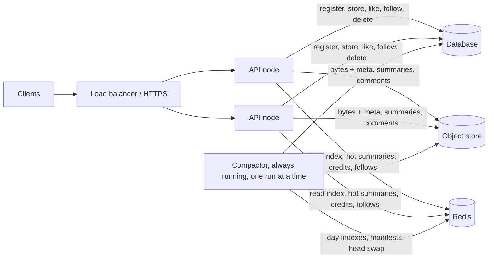
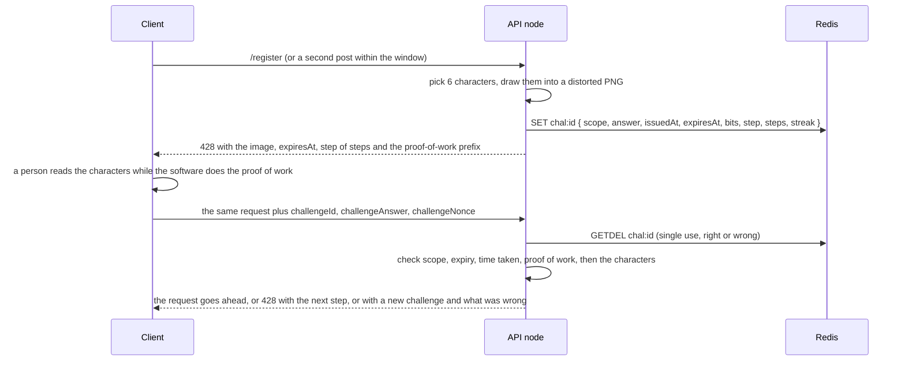
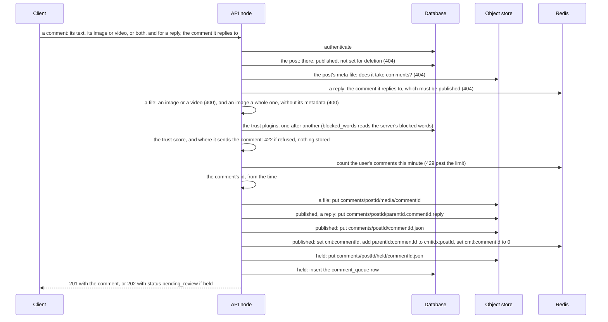
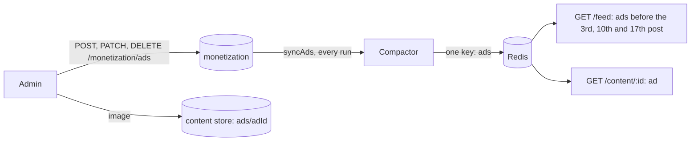
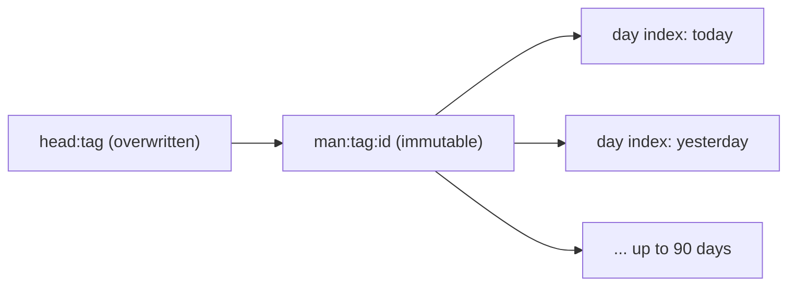
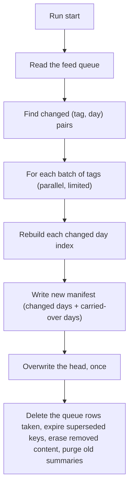

# How Evieverse works

WARNING: This file is updated by AI

This document explains the application end to end: what each part does, how a request moves through the system, how the feed is built, and why it's built that way. For setup and configuration, see [README.md](../README.md). For what each endpoint takes and returns, see [API.md](API.md), and for the command-line tool, [CLI.md](CLI.md). Every setting, with its default, is in [`.env.example`](../.env.example). For cloud deployment, see [DEPLOY.md](DEPLOY.md).

## Contents

1. [What it is](#1-what-it-is)
2. [The core idea](#2-the-core-idea)
3. [Architecture](#3-architecture)
4. [Code map](#4-code-map)
5. [Data model](#5-data-model)
6. [Request flows](#6-request-flows)
7. [The feed index](#7-the-feed-index)
8. [The compactor](#8-the-compactor)
9. [How a feed is built](#9-how-a-feed-is-built)
10. [Pagination and cursors](#10-pagination-and-cursors)
11. [Consistency, failure and recovery](#11-consistency-failure-and-recovery)
12. [Performance and scale](#12-performance-and-scale)
13. [Deployment topology](#13-deployment-topology)
14. [Known limits](#14-known-limits)

---

## 1. What it is

Evieverse is an open-source social media server, written in TypeScript on Fastify (Node 22).

- **Publishers** register, get an API key, and post. A post is one of five types: an image, a video or an audio file, each with an optional caption; text, of up to 40,000 characters; or a link, which is how any other file (a PDF, a web page) is shared. Everything they publish is credited to their username. With each piece of content, they declare whether it was created with AI. They can update content, which writes over it, and delete it.
- **Hashtags** come from the publisher: any they like, or only ones from the list the server's operator allows, as the server's tagging mode says ([section 6](#post-store)).
- **Users** like content. A like is permanent, and each user can like a piece of content once.
- **Users comment** on the posts whose publishers turned comments on: a text of up to 2,000 characters, an image or a video, or a text with one of the two. A comment is on the post or replies to another comment, to any depth; its author can edit its text; and any user can like it, once. Deleting a comment deletes that comment alone: the replies to it stay ([section 6](#comments)).
- **Users follow** other users, up to 1,000 of them. Whom a user follows, and who follows them, are two lists that only they can read until they choose to show either ([section 6](#following)).
- **Readers** ask for a feed of one or more hashtags over the past hour up to the past 90 days, most liked first or newest first, optionally with the hashtags related to those (the ones that tend to be on the same posts), or a feed of the posts of the users someone follows, newest first. Either can be limited to content created with AI or content that wasn't. Feeds come in **pages** of 50 posts by default (up to 100 when the reader asks), with a cursor for the next page.
- **Challenges** keep robots out: registering, and posting again within a minute, need a person to read a distorted image while their software does a proof of work. No user posts more than 3 times a minute, however many they solve ([section 6](#challenges)).
- **Moderation** is done by the server's admins, who can delete anything, by server moderators, who work through the moderation queue, and by moderators of each hashtag. The server refuses posts containing the admins' blocked words, and drops a hashtag from posts containing its moderators' blocked words or written by users muted on it. A post left with no hashtag isn't published. Every post gets a trust score, which has it refused, held in a moderation queue until a server moderator or an admin accepts it, or published. Every published post is also in the queue of each of its hashtags until a moderator of that hashtag approves it there, or removes the hashtag from it. Comments get the same trust score and wait in the same moderation queue, and so do edits of them; a comment that users report waits in the report queue ([section 6](#comments)).
- **Ads** are optional, and off unless the operator turns them on. The server's admins keep them: text or an image, each on a schedule, shown all the time or only under the hashtags it's targeted at. Where they're on, each page of a hashtag feed comes with ads to show before its 3rd, 10th and 17th post, and a post comes with one to show at its end, each marked "Sponsored" ([section 6](#monetization)).
- **A command-line tool** for all of that is shipped by the server itself: anyone downloads it from there, it signs in with their API key, and the server holds it to its own build ([section 6](#the-cli)).

The server is designed for a read-heavy workload: many more feed reads than posts, many tags per feed request, and many API nodes behind a load balancer.

## 2. The core idea

**A hashtag feed never touches the database, and almost never leaves RAM.** A following feed reads what's in it the same way, and asks the database one thing first: who may read it.

Each hashtag has a small **index in Redis**: per UTC day, the post ids worth showing with their like counts, AI flags and whether a moderator approved them, packed into 25 bytes each. Each publisher has one too, of their newest posts, which following feeds read, and whom each user follows and each hashtag's related hashtags are copied to Redis as well. A post's **summary** (its feed record, with the start of the post) is stored once, Brotli-compressed plain text, in an object store for the whole retention period, and also in Redis while the post is younger than 8 days. A feed request plans the whole response from the indexes alone, then fetches the summaries it picked: posts from the last 8 days, which are most of what feeds return, come from Redis in one round trip; older posts come from the object store.

Everything else follows from that rule:
- **A write is stored at once and queued for the index.** A post's bytes, meta file and summary are written in the request, so it can be read the moment the request returns. The same commit puts one row in a queue in the database for each of its hashtags' indexes, and one for its publisher's. Nothing else writes to the index: not a deletion, a dropped hashtag or a moderator's decision either, which are rows in the database too.
- **Content has one version.** An update writes over the post's bytes, its meta file and its summary, and the last write wins. What a post was before isn't kept.
- **A background compactor,** one process that's always running, is the only writer of the index. Every few seconds it takes what the queue holds, new like counts and what tag moderators decided from the database, rebuilds the sorted, immutable day indexes they touch, and swaps each hashtag's head once. It also trims old days and carries out deletions, removing content from the index, the summaries and storage together. So a new post is in feeds `COMPACT_INTERVAL_SECONDS` (5) after it was stored at most, plus the run.
- **Feeds render from summaries,** which is what makes some changes show before the compactor runs: an update shows as the post now is wherever an index already lists it, a hashtag an update dropped stops listing it (its summary no longer carries the hashtag), and an update held for moderation takes the post out of every feed (its summary is erased).
- **Readers see a consistent snapshot.** They follow a tiny per-tag head to an immutable manifest, so a reader is never blocked or shown a half-written index.
- **The database** holds identity, ownership, like counts, moderation rules, the moderation queue and what tag moderators decided. What a post is (its content type, size, text and hashtags) is in a meta file beside its bytes, not in the database. Writes (moderation is decided when a post is written), API-key checks, the compactor, and the lookup endpoints (`/content`, `/users/:id`, `/tags`) use it. Hashtag feeds never do. A following feed shows whom a user follows, which is theirs to hide, so it reads the user's row to learn who may read it, and nothing else ([section 6](#get-feedfollowinguseridlimitaigeneratedcursor)).
- **Whom a user follows and what they liked** are rows in the database: one per follow, and one per like. Feeds read neither table. Like counts reach the index through the compactor, and whom each user follows is copied to Redis whenever it changes ([section 6](#post-like)).
- **Comments aren't in the database either.** Each is one object in the content store, with Redis as a cache over them: a post's comments are read without a query, and a comment is written, edited and liked without a row. Which comment a reply is to, who liked a comment, and the image or video a comment came with are objects in the content store too. Only a comment that waits in the moderation queue, or that was reported, has a row ([section 6](#comments)).

## 3. Architecture



| Component | Role | Backends |
|---|---|---|
| API nodes | Stateless Fastify servers. Any number of them behind a load balancer, which can check `GET /health` (`{ "ok": true }`). | Containers or VMs, or one function per group of routes ([below](#as-functions)) |
| Database | Users (whether they're an admin or a server moderator, and their settings), API keys, content rows (owner, likes, AI flag, when it was created), hashtags, who liked what, who follows whom, moderators, mutes and blocked words, the moderation queue and tag moderators' decisions, the queue of writes for the feed index, the comments that wait in the moderation queue or were reported (their ids, not their text), the server's ads, and the compactor's lease. | SQLite, Postgres, MySQL (via Kysely) |
| Content store | Each content's bytes, `content/<id>`, plus `content/<id>.meta.json` beside them, which says what they are. Each comment, `comments/<postId>/<commentId>.json`, and beside it what says which comment a reply is to, each like of a comment, and the image or video a comment came with. The image of each image ad, `ads/<adId>`. | Any Apache OpenDAL backend: fs, S3, GCS, Azure Blob, SFTP, WebDAV, Drive, OneDrive, Dropbox, HDFS, ... |
| Summary store | Every summary for the retention period, `summaries/<day>/<id>.br`. | Any OpenDAL backend; the content store unless `SUMMARY_SCHEME` is set |
| Redis | Per-tag and per-publisher heads, manifests and day indexes; summaries of the last 8 days; publisher credits; whom each user follows; each hashtag's related hashtags; the ads that feeds and posts show, where the server shows any; the comments of the last day, how many likes each has, and each post's index of them; open challenges, each user's post window and posts of the last minute, and the counts behind the limits on upload links and comments; how far the compactor has got. | Any Redis-protocol server with a single primary: Redis, Valkey, ElastiCache, Memorystore, Azure Managed Redis. Without `REDIS_URL`, an in-process store (single node only), rebuilt on every start. |
| Compactor | One background process that maintains the index, and runs for as long as it's up: pass after pass, never two at once, and never more than one in `COMPACT_INTERVAL_SECONDS` (5). A lease in the database keeps two copies of it from overlapping. | In-process (`COMPACT_IN_PROCESS=true`), or standalone (`npm run compact`, which needs `REDIS_URL`): one container that's always up |

Everything in Redis but the open challenges, what users posted in the last minute and the counts behind rate limits can be rebuilt from the database and the content store's meta files (`--rebuild`, [section 8](#8-the-compactor)). What Redis has of comments needs no rebuild: whatever it lacks is read from the content store when a post's comments are next asked for ([section 6](#comments)). A lost challenge is simply answered with a new one, a user whose recent posts are lost posts as if they hadn't posted lately, and a lost count starts again from nothing.

**Configuration.** Settings are read and validated with zod (`src/config.ts`) when the process starts, so a bad one stops it there. [CONFIG.md](CONFIG.md) lists them all with their defaults and says how to deploy a change, and [`.env.example`](../.env.example) is the same list as a file to copy. Both the API and the compactor apply the database migrations when they start, unless `DB_MIGRATE_ON_START=false` (then run `npm run migrate` when you deploy). Functions never do.

### As functions

The same server also runs split up: one function per group of routes, each scaling with its own traffic, with one address in front that sends each request to its group ([section 13](#13-deployment-topology)). The groups are a table in `src/functions/groups.ts`:

| Group | Routes | Opens the database |
|---|---|---|
| `feed` | `GET /feed` | No |
| `content` | `GET /content/:id`, `GET /content/:id/raw`, `GET /content/:id/comments`, `GET /content/:id/comments/:commentId`, `GET /content/:id/comments/:commentId/replies`, `GET /content/:id/comments/:commentId/raw` | Yes |
| `store` | `POST /uploads`, `POST /store` | Yes |
| `api` | Everything else, `GET /feed/following` included | Yes |

The following feed is in `api`, not `feed`, though it's a feed: it asks the database who may read it ([section 6](#get-feedfollowinguseridlimitaigeneratedcursor)), and it's one reader's own, so it gets far fewer requests than hashtag feeds do. Keeping it out leaves the `feed` group with no database to open.

- **A function is the same app with one group's routes.** `buildApp` registers the groups it's given: all of them for `src/server.ts`, one for a function. A request is therefore handled by exactly the code that handles it on a node. On AWS Lambda the request is passed into the app without a socket (`app.inject`); on platforms that run containers behind HTTP, the app listens as usual.
- **An instance is built once and reused.** The app, its Redis connection and its database pool are made when an instance starts and serve every request it gets. A start that fails is tried again on the next request.
- **Nothing a request relies on lives in a process.** The feed index, challenges, the counts behind rate limits and follow lists are in Redis, so functions need `REDIS_URL` and refuse to start without it. Caches are per instance, as they are per node.
- **Functions don't migrate the database** when they start, as many start at once. They keep a small pool (`DB_POOL_SIZE` 2, closed after 10 idle seconds), and the feed group opens no database at all.
- **A request finishes its work before it answers,** including removing its temp file, because a function can be frozen the moment it has answered.
- **The compactor isn't a function.** A function runs when it's called, and the compactor has to keep running, so it stays one process beside them: a container that's always up ([section 8](#8-the-compactor)).

## 4. Code map

```
src/
  server.ts            entry point: the API, with the in-process compactor if it's on
  app.ts               Fastify app: error handler, CORS, multipart, /health, routes
  config.ts            every setting (env vars or evieverse.config.json), validated with zod
  release.ts           the release of Evieverse the code is: the version in package.json
  deps.ts              wiring: content store, Redis, summary store, publisher credits, follows, feed readers;
                       bootstrap() opens the database and builds them all for an entry point, bootstrapStores() all but the database
  time.ts              HOUR and DAY, UTC days, whole seconds, ISO timestamps
  auth/apiKey.ts       API key issue/verify (sha256 hash, looked up by user and hash)
  http/
    errors.ts          HTTP errors as JSON: 400 for invalid requests, 413 for uploads too large, Retry-After on 429, 422 with extra fields
    schemas.ts         request fields several routes share: credentials, hashtags in paths, boolean flags, list queries
    mime.ts            the MIME type: the client's, else from the file extension
    listCursor.ts      keyset pages of the database, and their cursors: the lists of follows and mutes, among others
  challenge/
    image.ts           challenge images: random characters, stroke glyphs, distortion, a PNG encoder
    challenges.ts      issuing and checking challenges (single use, proof of work), the post window and runs, the limit on posts a minute
  db/
    index.ts           Kysely setup for SQLite, Postgres and MySQL; unique-violation detection, the upserts that differ by database,
                       and the lock on a user's row that their follows, and their key replacements, take turns with
    schema.ts          table types
    migrator.ts        applies the portable SQL migrations (on start; migrate.ts is `npm run migrate`)
    migrations/        0001_initial.sql: the whole schema
  storage/
    hotStore.ts        the Redis client (and the in-process stand-in)
    summaryStore.ts    summary text format, Brotli, the Redis and object-store tiers
    publisherStore.ts  publisher credits in Redis
    followStore.ts     the copy of whom each user follows that following feeds read, in Redis
    relatedTagStore.ts each hashtag's related hashtags, which feeds asked to add them read, in Redis
    adStore.ts         the ads feeds and posts show, in Redis: every ad that hasn't ended, as the compactor last published them
    contentStore.ts    bytes and meta files, presigned links to read and to upload, making an upload a content's bytes,
                       and the same for the image or video of a comment, and for the image of an ad
    commentStore.ts    comments as objects in the content store, held ones apart, with which comment each replies to and who liked it,
                       the cache of them in Redis (each post's index, each comment and its number of likes),
                       deleting a comment's image or video with it, and the placeholder left where a comment was
    opendal.ts         OpenDAL operators (atomic overwrites on local disk)
    spool.ts           upload spooling: a temp file and its size limit
  posts.ts             the post types, link URLs, cutting previews, and reading stored previews as feeds show them
  upload.ts            reading a post from a request: multipart or JSON, the fields its type allows, its bytes spooled;
                       and the image or video of a comment, the same way
                       or already in the content store (uploadId)
  content.ts           loading content with its publisher and meta file, for whoever may read it, and its feed record (summary)
  comments.ts          what a comment is: its id (a UUIDv7), its record in responses, publishing one that waited, and removing one
                       alone: its rows in the queues with it, and its replies left where they are
  monetization.ts      the server's ads: which are shown where and when, the places a feed's page has for them and whose turn each is,
                       and an ad as responses carry it
  follows.ts           writing whom users follow to Redis, from the `follows` table: after a follow or unfollow, and by the compactor; who may read a user's follow lists and following feed
  tags.ts              hashtag normalisation, parsing publishers' hashtags, the hashtags the tagging mode allows, "touch" on use, counting a write's hashtags and their pairs
  write.ts             writing content, new or over what's there: bytes, summary, meta, the commit that queues it for the index, counting its hashtags; the checks every update passes
  deletion.ts          setting content for deletion: marking the row (DELETE /content, and removing the last hashtag)
  accounts.ts          deleting an account: closing it (DELETE /users/:id), sweeping its late content, and purging the row once its content is gone
  moderation/
    words.ts           normalising blocked words, and the streaming whole-word and phrase scanner
    policy.ts          who moderates a hashtag, who works through the moderation queue, setting admins, and the rules a new post, an update or a comment is held to
    trust.ts           a post's or a comment's trust score: loading the trust plugins, running it through them, and where a score sends it:
                       refused, the moderation queue, or published
    queues.ts          what the moderation queue and the report queue have in common: posts and comments in one list, and what an item of either is
    tagDecisions.ts    what a hashtag's moderators decide about content under it: approving it, or removing the hashtag (a deletion if it was the last)
    admin.ts           the operator's tool for admins, straight against the database (`npm run admin -- grant|revoke|list`)
    bootstrap.ts       the admin account a deployment is set up with (BOOTSTRAP_ADMIN), which the migration step creates
  plugins/
    trust/             the trust plugins, one folder each: an algorithm every post and comment goes through, which may lower its trust score
      blocked_words/   no trust for a post or a comment with a word or phrase of the server's list
  cli/                 the CLI the server ships, bundled into one file by scripts/build-cli.mjs; it imports nothing else from src/
    bin.ts             the bundle's entry point: the terminal, the CLI's own file, running it again after an update
    main.ts            arguments to a command, exit codes, and what a 426 sets off
    commands.ts        the table of commands, each with who it's for, and the help
    client.ts          requests with a profile's key and the CLI's build; the errors a command can end with
    profiles.ts        saved servers and keys (~/.evieverse/profiles)
    update.ts          downloading the server's build, checking it, and replacing the CLI's own file
  util.ts              LRU and TTL caches, bounded-concurrency map
  tagfeed/
    layout.ts          index layout: Redis keys, publisher index names, packed day entries, manifest types, sort orders, quotas
    read.ts            reading heads and JSON keys from Redis, for the reader and the compactor
    reader.ts          head -> manifest -> day indexes, with caches; day indexes on demand for following feeds
  feed/
    plan.ts            the page planner: the algorithms and windows a feed can ask for, the window's posts by likes or by time, turns between tags, fresh slots
    related.ts         which related hashtags a feed adds to the ones it was asked for
    following.ts       the following-feed planner: newest first across publishers, loading only the days a page needs
    render.ts          loads the picked summaries and credits, streams the JSON response, with the page's ads where the server shows any
    cursor.ts          pagination cursors encode/decode (hashtag feeds and following feeds)
  compact/
    compactor.ts       the compactor: a pass, and the loop that makes one after another
    lease.ts           the database lease that keeps the runs of two compactor processes from overlapping
    main.ts            the compactor as a process of its own (--once, --all, --rebuild)
  functions/
    groups.ts          the route groups: the routes each function serves, and whether it opens the database
    handler.ts         a route group as a function (the app built once per instance), functions' default settings
    lambda.ts          the AWS Lambda entry point: a route group, or the migrations (FUNCTION_GROUP)
    lambdaRuntime.ts   the Lambda runtime loop, and API Gateway HTTP API requests and responses
    http.ts            the entry point for containers that scale with traffic (Cloud Run, Container Apps): a route group
    edge.ts            the secret a CDN in front of the functions sends, and refusing requests without it
  routes/              register (and /users, /users/:id/key, /whoami), uploads, store, like, follow, content (and delete), comments, moderation (and /admins, /moderators), feed (and /feed/following), tags,
                       rules (the server's rules, and its modification disclosure),
                       monetization (the server's ads, which its admins keep, and their images, which anyone reads),
                       cli (the CLI's download, its install scripts, and the check that holds a CLI to the server's build)
scripts/build-cli.mjs  bundles src/cli into dist/cli/evieverse.mjs, with the manifest that names its build (part of `npm run build`)
test/                  vitest: API, feed index, the compactor as a process, planners, follows, moderation, the moderation queues and trust scores, comments, related hashtags, trust plugins, challenges, formats, migrations, CORS, functions, uploads, rate limits, admins, the server's rules, monetization and the CLI; helpers.ts has the test server and the requests they share
testbed/               a seeded Docker stack with a web page, for trying the server out (section 13)
deploy/terraform/      AWS, GCP and Azure (section 13)
compose.base.yml       the services the three compose files share (section 13)
```

## 5. Data model

### Database

The portable SQL migrations in [`src/db/migrations`](../src/db/migrations) work on all three databases. Every timestamp is UTC epoch milliseconds, and every id is a UUID.

| Table | Holds | Notes |
|---|---|---|
| `users` | `id`, `username` (unique), `created_at`, `updated_at`, `admin`, `moderator`, `language`, `messages`, `show_following`, `show_followers`, `banned_at`, `banned_by`, `ban_reason`, `deleted_at` | `updated_at` changes only when the username actually changes. `banned_at` is set while a server moderator or an admin has the user banned, with who (`banned_by`, which is null if that account is later deleted) and why (`ban_reason`); `deleted_at` is set once the user has deleted their account, or an admin has, until the row is purged ([section 6](#account-deletion-and-bans)). What a user posted lately, which the challenges and the limit on posts a minute go by, is in Redis, not here ([section 6](#challenges)). `admin` is 1 for the server's admins, set by an admin, a deployment or the operator, and `moderator` is 1 for its server moderators, set by an admin ([section 6](#moderation)). The rest are the user's own settings (`PATCH /users/:id`): `language` is the one the server answers them in, `messages` is 1 while they take part in messages between users, as they do to begin with, and `show_following` and `show_followers` are 1 once they let anyone list whom they follow and who follows them, which nobody does to begin with; `show_following` covers their following feed too ([section 6](#following)). |
| `api_keys` | `id`, `user_id`, `key_hash`, `created_at`, `revoked_at` | Keys look like `tu_<12 hex>_<43 chars>`. Only the sha256 of the whole key is stored, and a key is looked up by its user and that hash. |
| `content` | `id`, `user_id`, `ai_generated`, `like_count`, `created_at`, `delete_requested_at` | One row per piece of content: whose it is, how liked, and when it was created. What it is (content type, size, text, hashtags, when it was last written) is in its meta file in the content store, which an update writes over. `ai_generated` is 1 if the publisher declared the content created with AI, else 0. `created_at` never changes. `delete_requested_at` is set by `DELETE`, and the compactor deletes the row later. |
| `tags` | `name`, `created_at`, `last_appended_at` | The hashtags posts have used, and when a write last published under each, which is the order `/tags` lists them in. Publisher indexes have rows too, named `@<userId>`, which `/tags` leaves out. |
| `tag_pairs` | `(tag_a, tag_b)` primary key, `posts`, `updated_at` | How many posts each hashtag has been on (`tag_a = tag_b`) and how many each pair of hashtags has been on together (`tag_a < tag_b`), counted as posts are stored ([section 6](#post-store)). Related hashtags are worked out from it ([section 8](#8-the-compactor)). `updated_at` is when the row was last counted, and an index on it finds the rows changed since a compactor run. An index on `tag_b` finds a hashtag's pairs where it's the second of the two. Counts only go up. |
| `likes` | `(user_id, content_id)` primary key, `created_at` | One row per like, for as long as the content is there: likes are permanent, and the rows go with the content row. The primary key is what makes a like once per user. An index on `created_at` finds the likes made since a compactor run, which is how their counts reach the feed index ([section 8](#8-the-compactor)). |
| `follows` | `(follower_id, followee_id)` primary key, `created_at` | One row per follow, which an unfollow deletes. The primary key finds whom a user follows, and counts them against `MAX_FOLLOWING`. An index on `(followee_id, created_at)` lists who follows a user, most recent first, and one on `created_at` finds the users who followed someone since a compactor run ([section 6](#following)). |
| `tag_moderators` | `(tag, user_id)` primary key, `created_at` | Who moderates which hashtag. An index on `user_id` lists a user's hashtags for their profile. |
| `tag_mutes` | `(user_id, tag)` primary key, `created_at` | Users muted on a hashtag. The primary key finds a publisher's mutes on a post's hashtags; an index on `(tag, created_at)` lists a hashtag's. |
| `blocked_words` | `(tag, word)` primary key, `created_at` | Normalised words and phrases (lowercase, without accents, words separated by one space). The list of tag `*`, which no hashtag can be, is the server's. |
| `moderation_queue` | `content_id` primary key, `trust_score`, `created_at` | The content that's stored but not published: its last write's trust score sent it to the moderation queue ([section 6](#moderation)). This is the only place a trust score is kept. `created_at` is since when it waits, which orders the queue; an update that's held too keeps it. The row goes when a server moderator or an admin accepts the content, when an update of it is published, or with the content row. |
| `comment_queue` | `comment_id` primary key, `content_id`, `trust_score`, `created_at` | The comments that are stored but not published: their trust score sent them to the moderation queue ([section 6](#comments)). It holds a comment's id and its post's, not its text, which is in the content store. `created_at` is when the comment joined the queue (when it was sent, or when the edit that sent it there was made), which orders it among the posts of `moderation_queue`. The row goes when a server moderator or an admin accepts or rejects the comment, when its author deletes it or edits it into one the server publishes, or with the content row. A reply that waits keeps its row when the comment it replies to is deleted. A published comment never has one. |
| `comment_reports` | `(comment_id, user_id)` primary key, `content_id`, `reason`, `created_at`, `accepted_at` | Users' reports of published comments: one per user and comment. `accepted_at` is null until a server moderator or an admin accepts the comment, and the comments with such a row are the comments in the report queue. The rows go with the comment when it's deleted, and with the content row; the reports of a reply stay when the comment it replies to is deleted, as the reply does. A comment nobody reported has none. |
| `tag_moderation` | `(content_id, tag)` primary key, `decision`, `moderator_id`, `decided_at`, `applied_at` | What a hashtag's moderators decided about content under it: `approved` or `removed`. `applied_at` is null until a compactor run has applied the decision to the index ([section 8](#8-the-compactor)), and an index on it finds those. An update of the content deletes its `approved` rows; `removed` rows stay for as long as the content does, which is what keeps the hashtag off it. |
| `feed_queue` | `(content_id, tag)` primary key, `token`, `committed`, `created_at` | The queue of writes for the feed index: content whose entry in a hashtag's index (or a publisher's own) is to be built again, because a write published it there, changed it, or took it out. The primary key is what makes several writes of one post between two compactor runs one row. `token` is the write that last stamped the row, so a run deletes only the rows it read. `committed` is 0 for the rows an update adds before it writes anything, which a run leaves alone for `COMPACT_GRACE_SECONDS`, and 1 once the write's commit has stamped them ([section 6](#post-store)). An index on `token` serves the deletes. The rows go with the content row. |
| `server_rules` | `id` primary key, `sort_order`, `body`, `created_at`, `updated_at` | The server's rules, one row each, which its admins keep and anyone reads ([section 6](#get-rules)). `body` is the rule's text, at most 2,000 characters. `sort_order` is where it comes among the others, lowest first; only the order of the values means anything, and a response gives the rule's place in the list instead, counted from 1. Adding a rule or moving one numbers the rows 1, 2, 3 … again, and removing one leaves a gap until then. It isn't unique, so two admins who change the list at once can leave two rows with one number, which reads settle by `created_at` and the next add or move renumbers. `updated_at` changes when the rule's text or its own place is changed, not when another rule's move renumbers it. A server has at most 100. |
| `monetization` | `id`, `kind`, `text`, `url`, `image_type`, `tags`, `starts_at`, `ends_at`, `created_by`, `created_at`, `updated_at` | The server's ads, which its admins keep ([section 6](#monetization)). `kind` is `text` or `image`, and an ad keeps it. `text` is a text ad's text or an image ad's caption, at most 500 characters, and `url` where the ad leads, if anywhere. An image ad's image is in the content store, at `ads/<id>`, and `image_type` is its content type, read from its bytes. `tags` is null for an ad that appears all the time, else the hashtags it's targeted at, at most 10, normalised and separated by spaces. The ad is shown from `starts_at` until `ends_at`, or for good where that's null. `created_by` is the admin who created it, null once that account is gone. Nothing shows an ad from this table: the compactor copies the ones that haven't ended to Redis ([section 8](#8-the-compactor)), and an index on `ends_at` finds those. |
| `compactor_lease` | `id` (one row, `compactor`), `holder`, `expires_at` | The compactor run allowed to publish heads and delete, so the runs of two compactor processes never overlap ([section 8](#8-the-compactor)). |

### Content store

```
content/<contentId>             the post's bytes: its file unchanged, a text post's text, or a link's URL
content/<contentId>.meta.json   { contentId, mimeType, size, aiGenerated, comments, preview, text?, tags, updatedAt }
comments/<contentId>/<commentId>.json        a comment on the post: { commentId, contentId, parentId?, userId, text, media?, createdAt, editedAt? },
                                             or the placeholder left where one was: the same, with gone ("deleted" or "held") and nothing of the comment
comments/<contentId>/<parentId>.<commentId>.reply   says the comment is a reply, and to which comment; one byte
comments/<contentId>/held/<commentId>.json   a comment, while it waits in the moderation queue
comments/<contentId>/likes/<commentId>/<userId>     a user's like of the comment; one byte
comments/<contentId>/media/<commentId>       the bytes of the image or video the comment came with
uploads/<userId>/<uploadId>     a file sent with an upload link, until /store posts it or the store expires it
ads/<adId>                      the image of an image ad, stored as an image post's bytes are, without its metadata
```

Content has one version: an update writes over the bytes and the meta file, and nothing of what was there is kept. The meta file is where the content's description lives, rather than in the database: `/content` reads its content type, size, text, hashtags and `updatedAt` from it, and the compactor and `--rebuild` restore summaries and index entries from it. Its `text` is a text post's whole text, or a caption, which `GET /content` returns; the preview holds only its start. Its `size` is that of the bytes as stored. Its `updatedAt` is when the content was last written: posted, updated, or a hashtag removed from it (the content's creation time is in the database). The bytes are stored with their content type where the backend keeps one (S3, GCS and Azure Blob do), which is what a signed link to them serves. On a local disk (`fs`), writes go to a temp directory and are renamed into place, so a reader never sees half a file. The meta file's `comments` is whether the post takes comments; a meta file written before there were comments has none, which reads as off.

A comment is one object, the only record of a published comment: the database has no table of them. An edit writes the object again, with `editedAt`. Its name is its id, a UUIDv7, which starts with the time the comment was sent, so the names under a post's prefix are in the order its comments were sent, and one list of the prefix is the post's comments in order. A comment that waits in the moderation queue is under `held/`, where no list of the post's comments finds it; accepting it moves it out.

A reply is a comment with a `parentId`, and has a second object beside it, `<parentId>.<commentId>.reply`, whose name says all it has to say. That is what lets the one list of the prefix give the whole tree, without reading a comment: every `.json` is a comment, and it's a reply to the comment a `.reply` names, or a comment on the post itself if none does. A like is an object of the same kind, under `likes/<commentId>/`, named for the user: writing it twice leaves one, which is what makes a like once per user, and a comment's likes are counted with one list of its prefix. Both hold one byte, since not every backend takes an empty object. How they're read is in [section 6](#comments).

A comment goes alone: the replies to it stay when it's deleted, and when an edit takes it back to the moderation queue. What keeps them where they are is a **placeholder**, written over the comment's object, under the same name: `{ commentId, contentId, parentId?, userId: "", text: "", createdAt, gone }`, where `gone` is `"deleted"` or `"held"`. It keeps the comment's place in the tree, so a list of the prefix still finds a comment there and the replies to it are still replies to something, and it holds nothing of what the comment was: not its author, its text or its file. A deleted comment leaves one only if something replies to it, and the placeholder is deleted once nothing does; one that an edit took back to the queue always leaves one, which the comment is written over when it's published again ([section 6](#comments)).

A comment that came with an image or a video says so in its JSON (`media: { kind, mimeType, size }`), and the file's bytes are one more object, `media/<commentId>`, stored as a post's bytes are: with their content type where the backend keeps one, and for an image, without its metadata. The object is in the same place whether the comment is published or waits in the moderation queue, so publishing a comment, or holding an edit of it, never moves a file. A comment with no text has `text: ""`.

### Summaries

One per piece of content, shared by all of its hashtags; an update writes over it. Stored as plain text rather than JSON, since JSON repeats its keys and escapes in every record, which compresses worse, and Brotli-compressed in text mode at quality 11 (`SUMMARY_BROTLI_QUALITY`):

```
<createdAtMs> <updatedAtMs> <aiGenerated: 1 or 0> <comments: 1 or 0>
<userId>
<mimeType>
<hashtags, space-separated>
<preview kind: text, image, video, audio or link>
<the first 100 words of a text post or caption, or a link's URL: everything after the five lines above>
```

An image's, video's or audio's link to its bytes isn't stored: it's built when read. `comments` is whether the post takes comments, which is how a feed record says so without reading anything else; a summary written before there were comments has three numbers on its first line, and reads as a post that takes none. A summary doesn't hold the like count or the publisher's name, which change: the feed adds them when it renders the record. A text summary with a full 100-word preview, about 710 bytes, compresses to about 310, against 405 for the same record as compressed JSON.

| Tier | Key | Kept |
|---|---|---|
| Object store | `summaries/<UTC day of createdAt>/<contentId>.br` | the retention period (`FEED_TAG_RETENTION_DAYS`, 90 days). The compactor deletes whole days past it. |
| Redis | `sum:<contentId>` (same bytes) | until the post is `SUMMARY_HOT_DAYS` (8) days old: written with that TTL. |

An update writes the object store, then Redis. A node that read an older post's summary from the object store keeps it in memory for `SUMMARY_CACHE_SECONDS` (60), so a post older than 8 days can show on that node as it was for that long after an update. A summary read from the object store is copied back to Redis only where Redis has none, so a read that started just before an update never puts the old summary over the new one.

### Feed records

The feed builds each record from the summary, the like count in the index and the publisher's current credit:

```json
{ "contentId": "…",
  "publisher": { "userId": "…", "username": "alice" },
  "mimeType": "text/plain",
  "aiGenerated": false,
  "comments": true,
  "preview": { "kind": "text", "text": "first 100 words…" },
  "tags": ["news", "mumbai"], "likes": 17, "moderated": false,
  "createdAt": "2026-11-06T12:00:00.000Z", "updatedAt": "2026-11-06T12:00:00.000Z" }
```

`moderated` comes from the index too, like the like count: it's the entry's flag in the index of the hashtag the record is listed under ([section 7](#layout)). Records that aren't read from a hashtag's index (the following feed's, the moderation queue's) have no `moderated`.

`preview` follows the post's type:
- a text post: `{ "kind": "text", "text": … }`, its first 100 words, at most 1,000 characters of them;
- an image, video or audio post: `{ "kind": "image", "url": …, "text": … }` (or `video`, `audio`), linking to the raw bytes, with the caption's first 100 words, cut the same way. Without a caption there's no `text`;
- a link post: `{ "kind": "link", "url": … }`.

`aiGenerated` is the publisher's declaration about the content itself. `comments` is whether the post takes comments, from the summary; a record doesn't say how many it has ([section 14](#14-known-limits)). A typical text record is about 1 KB; an image, video or audio record without a caption, or a link, about half that.

## 6. Request flows

What each endpoint takes and returns is in [API.md](API.md). This section is what the server does with a request, and why.

### Authentication

Write endpoints check a user id and an API key (`src/auth/apiKey.ts`). Verification hashes the presented key and looks for a key of that user with that hash. Only the whole key gives the hash, so a row found is the key, and there's nothing left to compare. The same lookup reads whether the user is an admin or a server moderator, and the moderation endpoints check their roles after it ([below](#moderation)). Each user gets one key, at registration, and can replace it ([below](#post-usersidkey)); the admin account a deployment creates gets its key from the deployment instead ([below](#moderation)). `GET /whoami` answers a key with its account and roles, which is how the CLI checks one. A gateway that signs in to the server with its own `Authorization` header (Google's API Gateway does) passes the client's on as `X-Forwarded-Authorization`, so that header is read first. Reads (`/feed`, `/content`, `/users/:id`, `/tags`) need no key, so they never look one up. Neither does a list of a user's follows that the user shows, or their following feed if they show whom they follow; what they don't show is read with their key alone ([below](#following)). `/register` is rate limited per IP.

Every error leaves through one handler (`src/app.ts`, `src/http/errors.ts`), as JSON. A request that fails its zod schema becomes a `400` carrying zod's issues, and anything unexpected is logged and becomes a `500`.

### Challenges

To keep robots out, registering, and posting less than `CHALLENGE_POST_WINDOW_SECONDS` (60) after your previous post or challenge, need solved challenges: one to register, and for a post, one or two, depending on how many posts came in a row before it. [API.md](API.md#challenges) describes what clients send. This is how the server handles it (`src/challenge/`), with no third-party service:



- **The image.** Six characters, chosen with `crypto.randomInt` from 24 that can't be mistaken for each other (no `0`/`O`, `1`/`I`, `5`/`S`, and so on), drawn as strokes rather than from a font: no font file sits on the server for a robot to match against. Each character gets its own size, rotation and shear and overlaps its neighbours. Curves as thick as the strokes run through them, so they can't be filtered out by thickness. The image is then bent by a sine wave, a band of it is inverted and noise is added. `src/challenge/image.ts` rasterises it and encodes the PNG itself (zlib and a CRC32); a 240×80 image takes about 5 ms and 21 KB of base64.
- **The proof of work.** The client must find a nonce that makes `sha256("<id>:" + nonce)` start with `CHALLENGE_POW_BITS` (18) zero bits: about 2^18 hashes on average (about 1.5 seconds in a desktop browser), which the client's software does while the person types. The server checks it with one hash. It doesn't stop a determined robot, but it makes every attempt cost CPU time, which a person never notices.
- **One answer per challenge.** The answer takes the challenge out of Redis with `GETDEL`, so it can be used once, whether the answer is right or wrong, and two requests racing with the same answer can't both pass. Every guess therefore costs a new image to read and a new proof of work.
- **The order of the checks.** The challenge must have been issued for this request (`register`, or `post:<userId>`), be at most `CHALLENGE_TTL_SECONDS` (120) old, and be at least `CHALLENGE_MIN_SOLVE_MS` (2,000) old, since no person reads and types it faster. The proof of work comes next, and the characters last (uppercased, spaces and hyphens removed, compared in constant time). A robot that answers too fast or skips the work never learns whether its characters were right.
- **Failures.** Any failed check is `428` with a new challenge, and an `error` saying what was wrong. The key lives a minute past its expiry, so a late answer is told it was late rather than unknown.

**The post window and runs.** Each user's posts through `/store` have one window and one run, kept in Redis as `run:<userId>`: `<last> <streak>`, where `last` is when the user last posted or was challenged to. The key lasts one window, and a user without one hasn't posted within it. Nothing here touches the database. Every change is a compare-and-set (`HotStore.swap`, one Lua script on the one key): read the value, work out the new one, and set it only if the key still holds what was read; if another post changed it in between, that's tried again (up to 20 times, after which the post gets `429`).
- A post first claims the window: if there's no run, or `last` is a whole window ago, it sets `last` to its own time and `streak` to 0. The post then needs no challenge, and the run starts over. Of several posts sent at once, only one can pass this way.
- Otherwise the post is in a run, and moves `last` forward to its own time. Every challenge therefore starts the window again, and a run only ends after a whole window with no post and no challenge.
- `streak` counts the posts in the run that passed with challenges, and sets how many challenges the next one needs (`postSteps`): one after none or one of them, then two. That gives 1, 1, 2, 2, 2, …: two is the most anyone solves one after another, however long the run. `streak` keeps counting past that, because it's also the place in the run that a chain is solved for (below).
- The post gets a chain of that many challenges, one at a time. Each is stored with its `step`, the chain's `steps` and the `streak` it was issued at. A right answer before the last step gets `428` with the next challenge, and a wrong one gets a new challenge at the same step. Each step is its own single-use key, so a step can't be replayed or skipped.
- The last right answer claims the post's place in the run: it sets the run's `streak` to one more, but only if it's still what its chain was issued at. Only one chain can do that at each point of the run. A robot that solves several chains at once gets one post through, and the others are told another post went through, with a new chain to solve.
- The check comes after authentication and the request's own checks, and before anything is stored, so a challenged post stores nothing.
- If a post then fails (storage is down, a `409`), its claim is given back, so trying again costs no more than before. A post that passed without a challenge deletes the run it started; one that passed with challenges sets `streak` back. The challenges it used aren't given back.
- Only posts that change something count. A `/store` of a text or link post that changes nothing (the same text or URL and flag as the content has, and the same hashtags when the publisher's are used, in any order) returns before the check. A file is never compared: sending one is an update.

**The limit on posts a minute.** Runs make every post in a row cost a challenge or two, but that's all they cost, so by themselves they don't cap how often anyone posts. So no user posts more than `POST_RATE_LIMIT_PER_MINUTE` (3) times in any 60 seconds, however many challenges they solve. It's a sliding window, not a counter that resets every minute, so no burst across the turn of a minute gets more through.
- `posts:<userId>` in Redis holds the times of the user's posts in the last minute (epoch milliseconds separated by spaces, oldest first), and lasts a minute from its last change. It's changed by the same compare-and-set as the run: read it, drop the times more than a minute old, add or remove one, and set it only if it still holds what was read.
- The check comes first, before the post window: a post with the limit used up gets `429`, with a `Retry-After` header and `retryAfterSeconds` for when the oldest of those posts is a minute old. It's refused before any challenge, and before a sent solution is checked, so nobody solves challenges for a post that can't go through, and a step of a chain isn't used up by a refusal. A refused post doesn't move the run's `last` either, so it doesn't extend the run.
- A post that passes the window or its challenges then adds its time with the compare-and-set, which can't add more than the limit allows. Of several posts sent at once, only that many get through. A post that finds the last place taken in between (only possible when posts go at the same time) gets `429` and gives its claim in the run back. The challenges it used aren't given back.
- If the post then fails, its time is removed again, so it doesn't count.

`CHALLENGE_POST_WINDOW_SECONDS=0` turns off the post window, and `POST_RATE_LIMIT_PER_MINUTE=0` the limit. No setting turns off the registration challenge: only an admin's request is spared it ([below](#post-register-get-usersid-and-patch-usersid)).

### `POST /register`, `GET /users/:id` and `PATCH /users/:id`

- **Register** creates the user and issues an API key, of which only the sha256 is kept, so it can be returned only once. A username already taken is refused before any challenge, so nobody solves one for a name they can't have; the unique index refuses a duplicate that races past that check. Then it needs a solved challenge ([above](#challenges)), which is all that slows registrations: nothing limits how many one address makes. Only an admin's request needs none: one sent with an admin's credentials (`authenticateIfNamed`) creates the user at once, since the challenge tells people from robots and an admin's key already says who is asking. Any other user's credentials spare the request nothing, and wrong ones are `401`.
- **GET** reads the user's row, and their hashtags from `tag_moderators`.
- **PATCH** changes the user's row in one statement: their username, their language, whether they take messages, and whether they show whom they follow and who follows them ([below](#following)), or whichever of those the request names. It bumps `users.updated_at` only if the username actually changed, since nothing else is part of their credit.

Register and PATCH also write the user's **publisher credit** to Redis (`pub:<userId>`), and every post rewrites it. Feeds look credits up when they render, so a changed username shows on every record at once, with nothing to rewrite. If that write fails, the compactor rewrites the credit of every user whose `updated_at` changed since its last run.

A user can post as soon as they've registered: everything published is credited to their username. They can delete the account again ([below](#account-deletion-and-bans)).

### `POST /users/:id/key`

Replaces an account's API key: the caller's own, or for an admin, any user's. Which it is goes by the id in the path: the caller's own id is the first, and any other is the second, which takes an admin (`403` otherwise).

**A user's own** (`reissueApiKey` in `src/auth/apiKey.ts`), for a key that may have leaked. In one transaction it revokes the key the request was sent with, revokes any other key the account has, and inserts a new one, so the account always has exactly one key that works, and the old one stops working as the transaction commits. Keys are checked against the database on every request and cached nowhere, so there's nothing else to clear. Revoked rows stay in `api_keys`, with when they were revoked.

The transaction starts by locking the user's row (`lockUser`), so a user's replacements take turns, and revoking the presented key is what checks it: the update changes the row only if the key is still live, and the request gets `401` if it changed none. Two requests sent at once with the same key can both pass the route's first check, but the second waits for the first, then finds the key revoked. Without that, each would insert a key, and someone holding a leaked key could keep the account by replacing the key at the moment its owner does. The lock is on the user's row and not the key's because on MySQL two transactions that each lock the key through the index on `(user_id, key_hash)` and then insert a key for the same user deadlock. SQLite's one connection runs one transaction at a time, which does the same.

**Another user's, by an admin** (`reissueApiKeyFor`), for a user who lost their key, which they can't replace themselves, or whose key someone else holds. The user can be anyone, another admin included. In one transaction it revokes every key that user has and inserts a new one, which is returned to the admin, once, to pass on: the server has no other way to reach a user. The admin's own key isn't touched. A user who isn't there is `404`, and so is one whose account is closed and not purged yet.

The transaction locks both users' rows first (`lockUser`), in the order of their ids, as revoking an admin and deleting one lock theirs, so two admins replacing each other's keys at once can't deadlock. Then it checks the caller again: that the key the request was sent with is still live (`401`) and its user still an admin (`403`). The route has checked both already, but before the lock. Every request that ends an admin's key or role locks that admin's row (replacing their key, revoking their role, deleting their account), so it comes wholly before this transaction or wholly after it. Without the second check, a request sent with an admin's leaked key that had passed the route's check could still go through after that admin replaced the key, and take another admin's account with it.

The user isn't told: a notice in their inbox would wait behind the key they don't have yet. The request is in the audit log like any other that changes something, with the admin as its user and the account in its path, and the application log has a line for it.

`ensureAdmin` ([below](#moderation)) works against this for the one account a deployment owns: every run makes the deployment's key that account's only one, so a key replaced here, by the account or by another admin, is revoked at the next deploy and the deployment's key, revoked here, works again. That account's key is replaced through the deployment.

### Account deletion and bans

**`DELETE /users/:id`** is the user's, or an admin's (`closeAccount` in `src/accounts.ts`). The `users` row can't just be deleted: `content.user_id` cascades, so the content rows would go while their entries are still in the feed index and their bytes in the content store, and a feed would show what the database no longer has. Content is deleted in two steps ([`DELETE /content/:id`](#delete-contentid)), and so is the account:
1. **Close.** The request marks the user deleted (`users.deleted_at`), and from then on the user is gone, as far as anything that reads the database can tell. In one transaction (`retire`) it:
   - sets `deleted_at`, and clears `admin` and `moderator`;
   - revokes the user's keys, so authentication, which reads `deleted_at is null` with the key, fails with `401`;
   - deletes the user's follows in both directions, blocks, mutes, `tag_moderators` rows, reports and comment reports, and sets `inbox.sender_id` null on what they sent;
   - marks all their content for deletion in one statement (`delete_requested_at`), so it's `404` at once.
   
   Then, outside the transaction, it forgets the user's credit in Redis, and writes the follows of the users who followed them again (`syncFollowing`). Their posts leave feeds on the compactor's next run, which deletes them. Every lookup of a user by id or name (profile, follow, message, block, ban, appoint) says `where deleted_at is null`, so the row, which is still there, is nobody.
2. **Purge.** `purgeAccounts` deletes the row once the user has no content row left, with a conditional `delete … where not exists (content of the user)`. What still cascades goes with it: likes, the user's inbox, keys, and the `banned_by` of those they banned (set null). The request does it at once for a user with no content, and the compactor does it after its deletions loop otherwise (`settleAccounts`), so the account goes with its last post: `200` for the first case, `202` for the second.

Three things make this safe against what runs at the same time:
- **A post being written as the account closes.** A `/store` that authenticated before the close can insert its content row after it. `settleAccounts` first sweeps (`sweepContent`) each closed account's content that isn't marked yet and marks it, for the next run to delete, and only purges accounts with none left. The conditional delete is what makes the sweep enough: a row inserted between the sweep and the purge makes the purge skip the account until the next run.
- **The last admin.** Deleting an admin's account takes the same locks as revoking the role (`revoke` in `src/routes/moderation.ts`): it updates its own row and a keeper admin's row to themselves, in id order, then re-reads both. If the keeper isn't one any more it picks another, up to `KEEPER_ATTEMPTS` (3) times, and answers `409` when there is none. A deployment's admin (`ensureAdmin`) that was deleted and not yet purged fails with a message saying so, as its username is still taken.
- **A repeated request.** The user of a closed account has no key left, so only an admin can repeat it: they get `202` and the first `requestedAt`.

**Bans** are two columns and a check. `PUT /banned/:userId` sets `banned_at`, `banned_by` and `ban_reason` with an `update … where banned_at is null and admin = 0 and moderator = 0 and deleted_at is null`, so a first ban is never overwritten and a role that landed meanwhile isn't banned; `DELETE /banned/:userId` clears them. Each sends a notice (`user_banned`, `user_unbanned`), by `notify` ([above](#moderation)). Authentication reads `banned_at` with the key (`AuthUser.banned`), so the check costs no query: `refuseBanned` (`src/moderation/policy.ts`) is the first line after `authenticate` in `POST /store`, `POST /content/:id/comments`, `POST /messages` and `POST /uploads`, and throws `403`. Everything else a banned user does is as before. The rest of `GET /banned` is a left join from `users` to its banner, for a page of the `users_banned_idx`.

### `POST /store`

```mermaid
sequenceDiagram
  participant C as Client
  participant A as API node
  participant OS as Object store
  participant DB as Database
  participant R as Redis
  C->>A: a post (JSON or multipart): its type, and its file, text or link
  A->>A: check the fields fit the type (400); spool the file, text or link to a temp file, size limit
  A->>DB: authenticate
  A->>A: the publisher's hashtags (400 if missing or unusable, or in server tagging mode not the server's)
  A->>DB: if contentId given: check owner, not set for deletion
  A->>OS: if contentId given: read its meta file; same MIME type (400)
  A->>A: a text or link post with the same text or URL, flags and hashtags as the content? answer unchanged, store nothing
  A->>DB: the trust plugins, one after another (blocked_words reads the server's blocked words)
  A->>DB: moderation rules: blocked words of the post's hashtags, the publisher's mutes on them, hashtags moderators removed from this content
  A->>A: with blocked words: scan the text, caption or link, the filename and the hashtags
  A->>A: the trust score the plugins left, and where it sends the post: 422 if deleted, or no hashtag left, nothing stored; else held or published
  A->>A: the hashtags left are the content's, on the same text or link post going where the content is? answer unchanged
  A->>R: refuse past the posts a minute (429, nothing stored)
  A->>R: claim the post window, or else the run's challenges (428 with the next one, nothing stored)
  A->>A: the preview: the first words of the text or caption, the file's link, or the link
  A->>DB: on update: add a feed_queue row, not yet committed, for each hashtag, kept and dropped, and the publisher's index
  A->>OS: put bytes content/id (over the ones there, on update)
  A->>OS: put the Brotli summary (held: none; a held update erases the one there)
  A->>R: put the same summary with a TTL of createdAt + 8 days
  A->>OS: put content/id.meta.json
  A->>DB: transaction: insert the content row (or check it's still live and set its AI flag), put it in or take it out of moderation_queue, on update delete its approvals, touch tags, add or stamp the feed_queue rows as committed
  A->>R: after the commit: rewrite the publisher credit
  A->>DB: count the post's hashtags, and each pair of them, in tag_pairs (on update: the ones it adds)
  A-->>C: 201 (200 on update, 202 with status pending_review if held) with contentId, tags, preview, aiGenerated, comments (and removedTags)
  Note over DB,R: the compactor's next run takes the feed_queue rows and rebuilds the indexes they name
```

Details:
- **Post types.** `src/posts.ts` defines the five types, and `src/upload.ts` checks a request has the fields its type allows and no others. A link's URL is stored as the URL parser writes it. There's no type for other files: a PDF or a web page is posted as a link to wherever it's hosted.
- **The upload.** However a file arrives (a multipart part, or base64 in JSON), it's streamed to a temp file under `STORAGE_TMP_PATH`, and refused with `413` past `MAX_UPLOAD_BYTES`. A text post's text and a link's URL are spooled the same way, as the post's bytes, so every type is stored alike. The temp file is removed before the response is sent.
- **A file sent ahead (`uploadId`).** A request to a server run as functions carries a few megabytes at most, so a larger file goes to the content store itself first.
  - `POST /uploads` authenticates, checks the file's declared type and size as `/store` would, and returns a presigned link to `uploads/<userId>/<uploadId>` in the content store, valid for `CONTENT_SIGNED_URL_SECONDS`. The client sends the file there; it never passes through the server. A content store that can't sign links (local disk, SFTP, WebDAV) answers `501`.
  - `/store` with the `uploadId` looks for the upload under the authenticated user's id, so nobody posts another user's upload. A missing or empty one gets `400`, and one past `MAX_UPLOAD_BYTES` gets `413` and is removed.
  - The link can't limit what's sent to it, and whoever holds it can send again until it expires. So nothing measured beforehand is relied on. The upload's size is checked again before anything is written, then it's copied to `content/<id>` (within the store where it can, otherwise through the server), and the size the meta file records is that of the copy, where no client can write. A copy that turns out too large is removed and refused: only a client that swapped its upload for a larger one in that moment gets there, and on an update what it loses is its own post's bytes.
  - The upload is removed once the post is stored. A request that ends any other way (a challenge, a `409`) leaves it, so the client sends `/store` again with the same `uploadId`, not the file. Uploads nobody posts are the content store's to expire, with a lifecycle rule on `uploads/` (the Terraform modules set one day).
  - A user can ask for `UPLOAD_LINKS_PER_MINUTE` (10) links in a minute, counted in Redis, since each lets them put a file in the store.
- **The MIME type** of a file is the client's `contentType` (or the file part's type), unless that's missing or `application/octet-stream`, in which case the filename's extension decides it (`.png`, `.mp4`, `.mp3`, and so on). It must be of the post's type (`image/*` for an image, and so on), otherwise `400`. A text post's is `text/plain`, and a link's `text/uri-list`.
- **A post within a minute of the last post or challenge needs challenges,** more for each post in a row, checked before anything is stored ([above](#challenges)).
- **An unchanged text or link post stores nothing.** A `/store` with a `contentId` whose text or URL, AI flag and comments flag are the content's (read from its meta file), and whose hashtags are too (in any order), returns `{ contentId, unchanged: true }`. It needs no challenge and doesn't count as a post. A file is never compared with the one stored, since the server keeps no hash of it: an image, video or audio post that's sent again is written again.
- **The preview** follows the type: a text post's first `FEED_PREVIEW_WORDS` words, at most `FEED_PREVIEW_CHARS` characters of them; an image's, video's or audio's link to its bytes, with its caption cut the same way; or a link's URL. The whole text or caption goes in the meta file, as `text`.
- **Which hashtags a post can have** is the [tagging mode](API.md#hashtags) (`allowedTags` in `src/tags.ts`): any, or only those of `TAGGING_SERVER_TAGS`. The publisher picks a post's hashtags in both modes, and the post gets the ones it was sent with: in `server` mode the list is what they pick from, not what every post is given. A post sent with a hashtag that isn't on it is refused with `400`, not stored without that hashtag. In that mode the server refuses to start without at least one usable hashtag in the list, which can be longer than the 10 hashtags a post can have. The list is read from the configuration when the server starts, so changing it takes a restart, and checks only what's written from then on.
- **The publisher's hashtags** are normalised (`#Central-Mumbai` becomes `centralmumbai`) and checked before the post window, so nobody solves a challenge for a post that can't go through.
- **Moderation** comes next, also before the post window and the limit on posts a minute, so a refused post costs no challenge and doesn't count ([below](#moderation)). The post gets a trust score from the trust plugins, of which the server's blocked words bring it to 0, and the score has it refused with `422`, held in the moderation queue, or published. Hashtags its publisher is muted on, hashtags a moderator removed from this content, and hashtags whose blocked words it contains, are dropped; a post left with none gets `422`, with `removedTags`. The post is then written with the hashtags left, and the response lists the dropped ones in `removedTags`.
- **A held post is written like any other,** but for its summary, and its commit also puts it in `moderation_queue` with its score. New content that's held gets no summary and no `feed_queue` row, so no index has it and no feed shows it; the response is `202` with `status: "pending_review"`. A held update of published content erases the content's summary from both tiers instead of writing it, which takes the content out of every feed at once, since feeds leave out a record with no summary ([section 7](#reading)). It queues a row for every hashtag the content had or now has, and for the publisher's index, and the compactor's next run takes the entries out. An update that isn't held takes the content out of the moderation queue in its commit, and is queued as ever ([below](#moderation)).
- **AI disclosure.** The publisher says whether the content was created with AI (`aiGenerated`); nothing detects or checks it.
  - It defaults to `false` for new content. An update that leaves it out keeps the content's value, so a client that doesn't know about the flag can't drop a disclosure by editing.
  - It goes into the content row, the meta file, the summary and every index entry built for the content. Changing only the flag is therefore an update, like changing only the publisher's hashtags.
- **Whether the post takes comments** (`comments`) is the publisher's to say, and to change with an update ([below](#comments)).
  - It defaults to `false` for new content, and an update that leaves it out keeps the content's value, as for the AI flag.
  - It goes into the meta file and the summary, and nowhere else: not the content row, and not the index entries, since no feed filters on it. The meta file is what the comment routes go by, and the summary is how a feed record says it. Changing only the flag is an update, which writes both again.
- **The summary is written once per write,** whatever the number of hashtags, before the commit. If either summary tier can't be written, the request fails before the commit.
- **The order of a write.** The bytes go first, then the summary, then the meta file, then the database, whose commit queues the write for the index. The meta file is last of the three in the stores because it's what says what the content is: `/content`, the compactor and `--rebuild` all go by it.
- **Updates.** Passing `contentId` writes over the content. Content has one version, so nothing of what it was is kept: no old bytes, meta file or summary remain to be erased later. Only the publisher can update their content. Every update passes the same checks (`assertUpdatable` in `src/write.ts`): the content isn't set for deletion, and keeps its original MIME type, and so its type. `createdAt` stays the same, so the post keeps its place in its original day (and its summary sits under the original day's prefix); the write's own time is `updatedAt`, in the meta file, the summary and the index entry.
  - **The last write wins.** Nothing orders two updates of the same content sent at once: each writes its bytes, summary and meta file over the other's, and the content ends up as the last of each to be written. From one publisher's own two requests, that can be the bytes of one with the meta file of the other. Sending the update again puts it right. This is deliberate: only the publisher can update their content, so two updates at once are one client's doing, and guarding against them cost a version number, a reservation and a table.
  - **Where an index already lists the post, it shows as it now is at once,** because feeds render from its summary, which has been written over. Its index entry holds nothing an update of the text changes, so the compactor's next run finds the day as it was and publishes nothing.
  - **A hashtag the update dropped stops showing the post at once.** Its index still holds the entry until the compactor's next run, but a feed leaves out any record whose summary doesn't carry the hashtag it's listed under ([section 7](#reading)), on a new session and on the later pages of one under way alike.
  - **A hashtag the update added shows the post after the compactor's next run,** as for new content.
  - The update queues a row for the dropped hashtags as well as the kept ones, so the compactor rebuilds the content's day in each, which is where a dropped hashtag's index loses the entry for good ([section 8](#8-the-compactor)).
- **The queue.** A write reaches the feed index through `feed_queue`, and in no other way.
  - **A row means "build this content's entry in this index again".** It carries no entry: the compactor builds one from the content's row and its meta file as they are when it runs, or finds the content gone, held or without the hashtag, and leaves it out. So rows never go stale, and it doesn't matter in which order writes queued them.
  - **Queued by the commit.** The rows are written in the transaction that writes the content row, one per hashtag and one for the publisher's index. So the index only ever gets content the database holds, and a write is queued if and only if it committed: there's no step after the commit that could fail.
  - **One row per content and index.** The primary key is `(content_id, tag)`, and a write that finds a row there stamps it again. A post updated ten times between two runs is one row per index, and one entry built.
  - **Each write stamps its rows with a token of its own** (a random UUID). A compactor run deletes the rows it read by their tokens, so a row a write stamped again while the run was under way has another token, stays, and is taken by the next run. Without that, a run that read the post before the update could delete the row the update relied on.
  - **New content** the database doesn't take is removed from the stores, and nothing is queued. A commit can report an error yet still have been applied (for example, if the connection drops while committing), so the server looks for the row: if it's there, the request carries on as a success, and the rows were committed with it; if it can't tell, the bytes are kept in case the row points at them.
  - **An update can't be taken back,** since it wrote over what was there. One that fails in the stores is reported as failed. If the meta file hadn't been written yet, the summary is put back to what the meta file still describes, so feeds go on showing the post as it was; the bytes may already be the new ones. One whose commit fails (the content was set for deletion meanwhile, or the database is down) is reported as failed too, with the stores already holding the update. Either way, sending the update again completes it.
  - **So that the index follows whatever the stores end up holding,** an update adds its rows before it writes anything, outside any transaction, marked as not committed (`committed = 0`): one per hashtag kept or dropped and one for the publisher's index. Its commit stamps them as committed. If the update stops half way, the rows stay as they are, and the compactor takes them once they're `COMPACT_GRACE_SECONDS` (30) old, by when the update has finished or never will. It leaves them until then because the meta file may not have been written yet: a run that took the rows at once would rebuild the entry from the old meta file, delete the rows, and never look again.
- **The publisher's own index** (`@<userId>`, [section 7](#layout)) gets a row, and then an entry, exactly as a hashtag does. It's in `tags` with the post's hashtags.
- **The write path** is `src/write.ts`, from the bytes on. It also publishes what is accepted from the moderation queue (`publish`), which is the last step of a held write, made later: the summary, and the rows in `feed_queue` ([below](#moderation)).
- **The write's hashtags are counted last,** in `tag_pairs`, for [related hashtags](#related-hashtags) (`countTagPairs` in `src/tags.ts`). New content adds one to the row of each of its hashtags and of each pair of them: a post with 3 hashtags touches 6 rows, and one with the most a post can have, 10, touches 55, in one upsert. An update counts only the hashtags it adds, each with the ones the post now has. A held post is counted like a published one, when it's stored, and accepting it counts nothing more.
  - It's one statement after the commit, outside the transaction: the rows of a busy hashtag are counted by every post under it, and a transaction would hold their locks while it did everything else. So a count that fails is logged and lost, and the write stands. Nothing depends on a count being exact.
  - Counts never go down. A post that's deleted, rejected from the queue, or loses a hashtag to an update or a moderator stays counted, and a hashtag an update drops and a later one gives back is counted again.
- **An update makes the content unmoderated again.** Its commit deletes the content's `approved` rows in `tag_moderation`, so the entries the compactor then builds aren't flagged: what the hashtags' moderators approved was the content as it was.

### `POST /like`

A like is a row in `likes`, and the table's primary key, `(user_id, content_id)`, is what makes a like once per user. One transaction:
1. checks the content exists, isn't set for deletion and isn't waiting in the moderation queue (`404`);
2. looks for the user's row for the content in `likes`. If there's one, the like is a repeated one, and nothing more happens;
3. inserts the row and increments `content.like_count`.

- **Two likes of the same content sent at once** by one user count once. Both can get past step 2, but the primary key refuses the second row, which rolls that transaction back, its increment included, and the request is answered as a repeated like.
- **The count** stays in the database until the next compactor run copies it into the day indexes, which is when feeds show it. That run finds the content by the `likes` rows made since the run before it ([section 8](#8-the-compactor)).
- **Likes are permanent.** Nothing takes one back, so a row stays for as long as its content does.
- **With `commentId`, the like is of a comment** on the content, and none of the above applies: a comment's likes are objects in the content store, as comments are, and the database isn't written ([below](#comments)).

### Following

A follow is a row in `follows`: who follows whom, and since when. Following feeds don't read the table: whom each user follows is copied to Redis for them.

- **A follow** is refused with `400` if it's of the user themselves, and with `404` if the other user isn't there. One the user already has changes nothing. Otherwise one transaction locks the follower's `users` row (`lockUser` in `src/db/index.ts`: `SELECT … FOR NO KEY UPDATE` on Postgres, `FOR UPDATE` on MySQL; SQLite runs one transaction at a time anyway), counts their follows, refuses the new one with `409` if there are `MAX_FOLLOWING` (1,000) of them, and else inserts the row.
- **The limit holds** because the follows are counted with the lock held: of several follows sent at once, each counts the rows the one before it committed, and only as many get through as the limit allows. Two follows of the same user sent at once make one row: the primary key refuses the second, which is answered as a follow that was already there.
- **An unfollow** deletes the row, and answers whether there was one. It takes no lock, as it can only make room under the limit.
- **Copying to Redis.** Following feeds don't read the table, so every request (one that changed nothing too) then reads the user's follows from the table and writes the whole list to `fol:<userId>`, one user id per line (`syncFollowing` in `src/follows.ts`). A user who follows nobody has no key.
- **If that write fails,** a follow still succeeds, with a warning logged: the compactor rewrites the list of every user who followed someone since its last run, which it finds by `follows.created_at` ([section 8](#8-the-compactor)). An unfollow leaves no row to find its user by, so one whose write fails is answered `503`, though the row is gone: sending the request again rewrites the list.
- **The lists** (`GET /users/:id/following` and `GET /users/:id/followers`) are keyset pages of `follows`, joined to `users` for the names: ordered by `[followedAt, userId]`, most recent first, starting after the row the cursor names (`src/http/listCursor.ts`, whose pages the list of a hashtag's muted users shares). Whom a user follows is found by the primary key, at most `MAX_FOLLOWING` rows. Who follows them is found by the index on `(followee_id, created_at)`, which is in the list's order already, however many they are.
- **Who can read a list** is its user's to say: `users.show_following` and `users.show_followers`, both 0 until the user sets them with `PATCH /users/:id`, each on its own. The request reads the two with the user's row, which it reads anyway to answer `404` for a user who isn't there. A list that's shown is returned without looking a key up. One that isn't is returned only to a request with its user's own id and key (`authenticateIfNamed`): anyone else gets `403`, with a key of their own or without one, admins included, and a wrong key gets `401`. This is `requireShownFollows` in `src/follows.ts`.
- **A list goes by its own user's setting alone.** A user who shows who follows them shows those users, whether or not they in turn show whom they follow, and the same the other way round. Hiding a list keeps it from being read as a list; it doesn't keep each follow in it from being seen from its other side.
- **The following feed goes with the list of whom a user follows.** Each of its records is credited to its publisher, so it shows whose posts the user follows, of the users who posted within its reach. `GET /feed/following` therefore makes the same check as the list, by `users.show_following`: anyone's to read if the user shows whom they follow, and theirs alone, by their key, if they don't ([below](#get-feedfollowinguseridlimitaigeneratedcursor)).

### `GET /content/:id` and `/content/:id/raw`

- `GET /content/:id` reads the content's row with its publisher's (`loadContent` in `src/content.ts`), which gives the credit, the like count, the AI flag and `createdAt`, and its meta file, which gives the content type, the size, the preview, the whole text or caption, the hashtags, whether it takes comments and `updatedAt`.
- `/raw` asks the content store for a presigned URL and redirects to it. Stores that can't presign (a local disk) have the bytes streamed through the server instead, with the size the store gives for them (so a half-finished update never sends a wrong length) and the content type the store keeps, or the meta file's where it keeps none.
- The link to a post's bytes is `/content/<id>/raw` for as long as the post exists, whatever updates it gets. Nothing in it changes with an update, so how long a copy is good for is up to whatever caches in front of the server.
- Content set for deletion is treated as gone by both, though its row is still there.
- Content waiting in the moderation queue is unpublished, so both answer `404` for it as well, unless the request's headers authenticate as its publisher, a server moderator or an admin. These are the only reads that look at credentials, and only for such content: a request for published content never looks a key up. Missing or wrong credentials get the same `404` as anyone, so nothing says the content is there.
- Where the server shows ads at the end of posts (`MONETIZATION_POST_ADS`), `GET /content/:id` ends with `ad` ([below](#monetization)): one of the ads Redis holds (`AdStore`) that are being shown now and that appear all the time or are targeted at one of the post's hashtags, picked at random for each request. That's one more `GET`, cached per node for `FEED_HEAD_CACHE_MS`, and no query. A post with no such ad has no `ad`, and neither has one that waits in the moderation queue. If the ads can't be read, that's logged and the post is returned without one.

### `DELETE /content/:id`

Only the publisher and the server's admins can delete content. The request sets `content.delete_requested_at`, once: repeating it keeps the first time. The same steps (`src/deletion.ts`) take content down when a moderator removes its last hashtag ([below](#moderation)).

The content can't be read from then on, and leaves feeds on the compactor's next run:
- `/content` and `/raw` return `404`, and `/like` returns `404`. So do the content's comments, to read, to add to and to report, and their images and videos: every comment route loads the content first.
- `/store` refuses updates with `409`. The update's transaction also checks `delete_requested_at` in its `WHERE` clause, so a deletion that lands while an update is being stored still wins: the update is refused, and queues nothing as committed.
- Feeds, which don't consult the database, return the content until the compactor has run: `COMPACT_INTERVAL_SECONDS` (5) at most, plus the run.

Nothing is removed at request time, and nothing is written but the one column. The compactor does all the removal in one run ([section 8](#8-the-compactor)): each run looks for content set for deletion, rebuilds the indexes of its hashtags and its publisher without it, then deletes its comments, the row, the bytes, the meta file and the summary from both tiers. Later pages of feed sessions that started earlier read the indexes as they are by then, without the content ([section 10](#10-pagination-and-cursors)).

### Comments

[API.md](API.md#comments) says what the endpoints take and return. A comment is a text (at most 2,000 characters), an image or a video, or a text with one of the two: it needs a text or a file, and takes one file at most. It's on the post, or it replies to another comment on it, so a post's comments are a tree, of any depth. Its author can edit its text, and any user can like it, once. A comment goes alone: deleting it, rejecting it in the moderation queue, or holding an edit of it acts on that comment and on none of the comments that reply to it, which stay where they are under a placeholder left in its place. The design follows from keeping comments out of the database: a comment is an object in the content store ([section 5](#content-store)), and so are what says which comment a reply is to, each like of a comment, and the image or video a comment came with; Redis is a cache over those objects; and the database is asked only what it's asked for `GET /content/:id`: whether the post is there. The code is `src/comments.ts`, `src/storage/commentStore.ts`, `src/routes/comments.ts` and, for likes, `src/routes/like.ts`.

| Endpoint | What it does |
|---|---|
| `GET /content/:id/comments` | A page of the comments on the post itself (`order`, `limit`, `cursor`), and `count`: every comment the post has, replies and placeholders included. |
| `GET /content/:id/comments/:commentId/replies` | A page of the replies to a comment, with the same query, and `count`: the replies to that comment, not to its replies. It works under a placeholder as under a comment. `404` for a comment that isn't there, or was never published. |
| `GET /content/:id/comments/:commentId` | One comment, or the placeholder in its place. |
| `GET /content/:id/comments/:commentId/raw` | The bytes of the image or video the comment came with. `404` for a comment that is only text, and for a placeholder. |
| `POST /content/:id/comments` | `{ text?, parentId? }` and, for an image or a video, the file: a comment, or with `parentId`, a reply to that comment, which must be published and on the same post (`404`). The file comes as a post's does to `/store`: a multipart part named `content`, inline in `content` (with `contentEncoding: "base64"`), or as an `uploadId`; `contentType` and `filename` say what it is. |
| `PATCH /content/:id/comments/:commentId` | `{ text }`: its author edits its text. `200` with the comment, or with `{ unchanged: true }` for the text it has; `202` with `status: "pending_review"` if the edit is held, which takes the comment off the post and leaves its replies there. |
| `POST /like` with `commentId` | `{ contentId, commentId }`: likes the comment. `201`, or `200` with `alreadyLiked` for a like that was already made; both with `likes`. |
| `DELETE /content/:id/comments/:commentId` | Deletes the comment, and nothing else: the comments that reply to it stay, under a placeholder. |

A comment's record in every response is `{ commentId, contentId, parentId, author, text, media, likes, replies, createdAt, editedAt }`: `parentId` is null for a comment on the post itself, `text` is empty for a comment that is only its file, `media` is `{ kind, url, mimeType, size }` for a comment that came with an image or a video (`kind` says which, and `url` is its `/raw` route, built when read, as a post's is) and null for one that didn't, `replies` is how many comments reply to it (to it, not to its replies), and `editedAt` is null for one that was never edited.

**A placeholder** is given as a comment is, in the lists and by its id, in the place the comment had: the same record with `author: null`, `text: ""`, `media: null`, `likes: 0`, `editedAt: null`, its `replies`, and a `status` that a published comment's record doesn't have. `status: "deleted"` is a deleted comment that something replies to, and `status: "pending_review"` a comment that an edit took back to the moderation queue. A client shows it as a gap with the replies under it. It isn't a comment: replying to it, liking it, reporting it, editing it or deleting it is `404`, as for a comment that isn't there. `status: "pending_review"` is also on a comment that waits in the queue as its author and the queue's moderators read it, which is the whole comment (`toCommentRecord` in `src/comments.ts`).

**The flag.** A post takes comments if its meta file says so (`takesComments` in `src/content.ts`), which `/store` writes ([above](#post-store)). Every comment route but `DELETE` reads the meta file after loading the post, and answers `404` for a post that doesn't take them; so does a like of a comment. Turning the flag off deletes nothing: the objects stay, and are listed again when it's turned back on. A deletion works either way, so what was written while the post took comments is still its author's, and the publisher's, to delete.

**Ids are the order.** A comment's id is a UUIDv7 (`newCommentId`): 48 bits of the time it was made, then 12 bits that count the ids the process made in that millisecond, then random bits. So a post's comment ids sort in the order the comments were sent, and the id is at once the object's name, the end of its member in the post's index and the cursor of a page. An edit changes none of it. There's no sequence to allocate and no counter to keep. A process whose clock goes back, or that makes more than 4,096 ids in a millisecond, goes on from its last id's time, so its own ids never go down. Two nodes order their comments by their clocks, and two comments of the same millisecond from different nodes by their random bits: an order nobody chose, but the same for every reader.

**Writing a comment** (`POST /content/:id/comments`):



- **A published comment writes no row.** The database is read (the key, the post's row, the server's blocked words) and not written. The comment is one `PUT` to the content store, or two for a reply, one more for a file, and three writes to Redis.
- **The file is a post's file,** read by the code that reads one for `/store` (`readCommentFile` in `src/upload.ts`, over `readMultipart`, `readUploaded` and `readPost`; [above](#post-store)). It arrives the same three ways, is spooled to the same temp directory, and is held to `MAX_UPLOAD_BYTES` (`413`). An `uploadId` is one `POST /uploads` gave, asked for as an image's or a video's, and is looked for under the authenticated user's id.
  - What kind it is isn't a field: it's the file's content type, the one it was sent as or the one its name says. `image/*` is an image and `video/*` a video; anything else is refused (`400`), audio included.
  - An image is checked by its bytes and stored without its metadata, exactly as an image post is, so it's a JPEG, PNG, GIF or WebP, and its `mimeType` is the one its bytes are of. A video is stored as it came, with the type it was sent as.
  - A request with no text and no file is refused (`400`), and so is one with a file from two places.
- **The file is stored before the comment,** at `comments/<postId>/media/<commentId>`, where it stays whether the comment is published or held: so a comment anyone can read never lacks its file. The size the comment records is that of the bytes as stored. If the comment then can't be stored, the file is deleted again. Nothing is written for a comment the gate refuses or the limit stops, since both come first.
- **An upload is kept until the comment is stored,** as `/store` keeps one: a request that's refused or limited leaves it, to be sent again with the same `uploadId`, and a comment that's stored, published or held, removes it.
- **A reply is to a published comment of the same post,** at any depth: the comment it names is read as any comment is, from Redis or the store, and `404` if it isn't there, waits in the moderation queue, or is a placeholder. The reply's second object is written before the comment itself, so a list of the post's prefix made between the two finds no comment yet, rather than a reply it would take for a comment on the post. Once the reply is stored, published or held, the comment it replies to is looked for again: if it was deleted meanwhile, before the reply was there to be seen, and so left nothing in its place, the new reply is removed too and the request answers `404` ([below](#comments)). Nobody is told of a reply to their comment.
- **The gate is the posts'** (`moderateComment` in `src/moderation/policy.ts`): the same plugins, through the same `trustOf`, and the same two thresholds through `routeOf` ([below](#moderation)). A plugin is passed `commentOn`, the post's id, in place of a post's `contentId`, with no hashtags, and as its texts the comment's text and the name of its file, as a post's caption and filename are, so one that should treat comments differently can. The file's bytes aren't passed, as a post's aren't. `blocked_words` treats them alike, with its own wording for the refusal. What isn't the posts' is everything about hashtags: a comment has none, so no hashtag's blocked words or mutes are read, and a hashtag's moderators have no say over it.
- **The limit** is `COMMENTS_PER_MINUTE` (10) a user, a counter in Redis (`comments:<userId>`, one atomic increment that lasts a minute from its first count), checked after the gate, so a refused comment doesn't count. An edit counts as a comment does. There's no challenge.
- **The object first, then Redis.** If the comment can't be put in the post's index, the object is removed again and the request fails: a comment the store had and a complete index lacked would be hidden until the index was next built.
- **A held comment** is written under `held/`, and then gets its `comment_queue` row with its score. The object goes first so the queue never lists a comment the store doesn't have. If the row can't be inserted (the post's row went meanwhile, say), the object is removed again and the request fails. A held reply has no second object and is in no index until it's published: what it replies to is in its JSON.

**Redis, a cache over the store.** Three kinds of key, all written with a TTL of `COMMENTS_HOT_HOURS` (24):
- `cmtidx:<postId>` is the post's **index**: a sorted set with a member for each published comment, all at score 0, which Redis therefore keeps in the order of the members themselves. A member is `<parentId>:<commentId>`, or `:<commentId>` for a comment on the post itself. So the replies to one comment are together in the set, in the order they were sent, and so are the comments on the post: each is the range between `<parentId>:` and `<parentId>;` (`;` is the character after `:`). A page is a part of that range (`ZRANGEBYLEX` after the cursor's member, or `ZREVRANGEBYLEX` before it), a comment's number of replies is `ZLEXCOUNT` of its range, and the post's count is `ZLEXCOUNT` of the whole set. It holds one more member, `~`, once it holds every comment the store has: that's what says the index is **complete**. `~` sorts after every other member, so ranges and counts stop before it.
- `cmt:<commentId>` is a comment's JSON, or its placeholder's, read for a page with one `MGET`.
- `cmtl:<commentId>` is the comment's number of likes, read for a page with one `MGET` too.

Any of them can be missing at any time, since Redis evicts and expires, and nothing is done to prevent it:
- **An index that isn't complete is built from the store.** A reader that doesn't find `~` lists the post's prefix, which is one `LIST`, not a recursive one, so it doesn't go into `held/` or `likes/`. Every `.json` in it is a published comment, and every `.reply` says which comment one of them replies to ([section 5](#content-store)), so the list gives every member of the index without reading a comment. A placeholder is a `.json` like any other, so it's a member too. A `.reply` with no comment says nothing: the comment is being written, or was removed by a removal that stopped there. The reader answers from the list, and adds the members to the index, then `~`. Building only adds members, so a comment sent while it's under way isn't lost from the index, and `~` goes in last, so the index is never called complete before it is. Readers of one post in one process share one list.
- **An index begun by a new comment isn't mistaken for the whole.** A comment on a post whose index expired adds its member to an empty set, with no `~`. The next reader builds the rest.
- **The TTL is set when the index is created, and not extended** by the comments added or the pages read since. So every index is rebuilt from the store at least once every `COMMENTS_HOT_HOURS`, and one that came to differ from the store (a Redis that lost writes in a failover) is right again by then.
- **A comment Redis doesn't have is read from the store,** and kept, only where Redis has nothing by then (`SET NX`).
- **A number of likes Redis doesn't have is counted from the store,** with one `LIST` of the comment's likes, and kept, also only where Redis has nothing by then. A new comment is given the number 0 as it's written, so its first readers list nothing.

**Reading.** The tree is read a level at a time, and each level is a list with pages of its own: `GET /content/:id/comments` is the comments on the post itself, and `GET /content/:id/comments/:commentId/replies` the replies to one comment, which a reader asks for when a comment's `replies` says it has some. Either is: the post's row and meta file, as for `GET /content/:id`; then for a post whose comments are in Redis, a few small commands on the index for the page and its count, one `MGET` for the comments, one for their likes, one `ZLEXCOUNT` each (in one round trip) for their numbers of replies, and the authors' credits (`pub:<userId>`, as feeds read publishers'). The replies route reads the comment first, or the placeholder in its place, to answer `404` where there's neither. Nothing walks the tree to read it: a comment is listed if its member is in the range asked for. A placeholder is a member like any other, listed where its comment was and counted in the post's `count`; its record needs no author and no number of likes, so neither is read for it. It's what keeps a reply from being under nothing: a comment that something replies to is never removed without one.

`GET /content/:id/comments/:commentId` gives a published comment to anyone. For one that waits in the moderation queue, its author and the queue's moderators get the whole comment, with `status: "pending_review"`, by the credentials in the request's headers. Anyone else gets what is in its place: the placeholder, if the comment was published before an edit took it back to the queue, and `404` if it never was. The read routes are in the `content` route group, and the write routes in `api` ([section 3](#as-functions)).

**Reading a comment's image or video** (`GET /content/:id/comments/:commentId/raw`) is `GET /content/:id/raw` for another object ([above](#get-contentid-and-contentidraw)): the post's row and meta file, the comment, and then a `302` to a signed link where the content store signs them, or the bytes streamed from the server with the size the store gives, the content type it keeps (or the comment's `mimeType` where it keeps none), and the headers that make a user's file something to show and nothing more (`rawHeaders` in `src/routes/content.ts`). Whoever may read the comment may read its file: anyone for a published one, and for one that waits in the moderation queue, its author and the queue's moderators, by the credentials in the request's headers. A placeholder has no file: `404`, to those who can't read the comment it stands for, and for a deleted one, to everyone. `ContentStore` writes, signs and streams both kinds of bytes by one type, `BytesOwner`: a post's id, or a comment's and its post's.

**Editing a comment** (`PATCH /content/:id/comments/:commentId`) is its author's alone: not the post's publisher's, nor an admin's (`403`). A banned user is refused, and so is an edit on a post that doesn't take comments, as a new comment is. The text the comment already has changes nothing and is answered `{ unchanged: true }`, before the gate and the limit. An edit is of the text alone: the image or video a comment came with is neither replaced nor taken away, and a comment that came without one is given none. A comment that has a file can be left with no text; one that hasn't needs one (`400`). Otherwise the new text goes through `moderateComment` as a new comment's does, counts towards `COMMENTS_PER_MINUTE`, and what an update of a post does to the post, the edit does to the comment:
- **Refused** (`422`): nothing is written, and the comment stays as it was.
- **Published, of a published comment** (`CommentStore.update`): the object is written again, with `editedAt`, and `cmt:<commentId>` replaced. Its id, its place in the index, its replies and its likes aren't touched. The value in Redis is replaced only if it's still what the edit read (`swap`, a compare-and-set), so a deletion or a hold that came meanwhile keeps what it left there, a tombstone or a placeholder ([below](#comments)); the edit then undoes what it wrote to the store (it deletes the object, or writes the placeholder back) and answers `404`, rather than bring the comment back.
- **Held, of a published comment** (`CommentStore.hold`): the comment is taken back to the moderation queue, as a published post is by an update that's held, and nothing else is. Its `comment_queue` row is written first, then the comment is written under `held/` as edited, and a placeholder (`gone: "held"`) is put in its place: in `cmt:<commentId>` first, then over the published object. Its member stays in the index, and its `.reply` object, its likes and its image or video stay where they are. From then on the comment itself is a held comment like any other: read only by its author and the queue's moderators, and not to be replied to, liked or reported. Everyone else finds the placeholder where it was, in the lists and by its id, with `status: "pending_review"` and the replies it has, which are listed and read as before. The text it had before the edit isn't shown meanwhile.
- **Held, of a comment that waits:** the held object is written again and the row's score updated. The row keeps its `created_at`, so the comment keeps its place in the queue.
- **Published, of a comment that waits:** the comment leaves the queue as an accepted one does (`publishComment`), its row deleted first, in a transaction the store's work is done inside. One that was published before is written over its placeholder. Nobody decided on it, so its author gets no notice.

**Liking a comment** (`POST /like` with `commentId`, `CommentStore.like`) has no row either. The comment must be one anyone can read: published, on a published post that takes comments (`404`).
1. The request says in Redis that the like is being made: `cmtlk:<commentId>:<userId>`, set only if it's missing, for 10 seconds. A request that finds it there is a repeated like.
2. Otherwise it asks the store whether the like's object, `comments/<postId>/likes/<commentId>/<userId>`, exists. If it does, the like is a repeated one too.
3. Otherwise it writes the object, and adds one to `cmtl:<commentId>` if Redis has it (`bump` in `src/storage/hotStore.ts`: an increment that leaves a missing key missing, and keeps the TTL of one that's there). If Redis doesn't have the number, the request counts the likes from the store, which now include this one, and keeps that.

- **Once per user** is the object's name: writing it again leaves one object. Step 1 is what keeps two of the same like sent at once from both adding one to the number; the object is what makes the like permanent once the 10 seconds are over.
- **The number is a cache,** and the objects are the likes. A number that came to differ (two likes of a comment whose number wasn't in Redis can each count the store before the other's object is there) is right again once it expires and is counted again, at most `COMMENTS_HOT_HOURS` later.
- **Likes are permanent,** as a post's are: nothing takes one back. They go with the comment when it's deleted, and with the post.
- Unlike a post's likes, they don't reach feeds and the compactor does nothing for them: they're read with the comment.

**Deleting a comment** (`removeComment`) deletes that comment: its object, its likes, its image or video, and the rows it has in the two queues' tables. It deletes none of the comments that reply to it, whoever wrote them: they stay where they are, with their own replies, likes and reports. Rejecting a comment in the moderation queue and deleting one from the report queue are the same removal.
- **Whether something replies to it** is asked first (`hasReplies`): a member in its range of the index, or a reply that waits in the moderation queue. One that waits is in no index, so those are found by the post's rows in `comment_queue`, which are few: each one's held object says what it replies to.
- **If something does, a placeholder is left** (`CommentStore.remove` with `keepPlace`): `cmt:<commentId>` is set to the placeholder (`gone: "deleted"`), then the placeholder is written over the comment's object, and the comment's likes, its image or video and its held object, if it waited, are deleted. Its member and its `.reply` stay, so the replies are listed under what's left, which everyone reads as `status: "deleted"` ([above](#comments)).
- **If nothing does, nothing is left:** `cmt:<commentId>` is set to an empty value, which is a tombstone, and then the objects are deleted (the JSON, then its `.reply`, its likes, and its image or video), the member is taken out of the index and the number of likes out of Redis. A reader that finds a member in the index and a tombstone, or no object, treats the comment as gone and takes the member out. So an index built from a list made just before the deletion doesn't bring the comment back.
- **Redis goes first either way,** so a reader that had read the object just before the deletion, and writes it to Redis only if nothing is there, doesn't put the comment back over what the deletion left. If the store then can't be written, the key is deleted from Redis again, so that Redis says nothing the store doesn't, and the deletion fails and can be made again.
- **Then it looks again** (`commentRemoval`'s `finish`), since the store has no transactions. A comment that left nothing may have got a reply meanwhile: it's given a placeholder after all, from the comment as it was read before the removal. And a comment that left nothing may have been the last reply to a placeholder of a deleted comment, which then keeps a place for nothing: that placeholder is removed too, and so on up the tree, until a comment that is there, a placeholder that still has replies, or one of a comment that waits in the queue. So a thread deleted from the bottom up leaves nothing behind.
- The rows are deleted first, so neither queue lists a comment that is gone. A rejection deletes the `comment_queue` row in a transaction that the store's removal is done inside ([below](#comments)), so whether something replies to the comment is asked before that transaction and the second look comes after it: both read the database on their own.
- Who may delete is checked first: the author, an admin, or the post's publisher for a published comment. A placeholder is nobody's to delete (`404`). Its author gets a notice unless they did it themselves. Nobody else is told: the replies are where they were.

**The two queues.** Only here does a comment have a row, and the row holds the comment's id and its post's, never its text (`comment_queue`, `comment_reports`, [section 5](#database)). `src/moderation/queues.ts` is what the queues share.
- **`GET /moderation/queue` and `GET /moderation/reports`** each read a `UNION ALL` of the posts' table and the comments', as one list in one order (since when each waits, then its id), paged by one keyset cursor. A column of the union says which kind a row is. Each row is then read from where it lives: a post's meta file, or the comment's object, held or published.
- **Accepting a held comment** (`publishComment`, `CommentStore.publish`) writes it where published comments are, with its `.reply` if it's a reply, adds it to Redis, and deletes the held object. Its id is the one it was sent with, so it takes its place among the post's comments, or among the replies to its comment, by when it was sent. A comment that an edit took back to the queue is published as edited, over the placeholder it left, and since its replies and likes never moved, it has them still. Nor does a comment's image or video move: it's where it was put when the comment was sent. **Rejecting** removes it as a deletion does ([above](#comments)): that comment, and none of the replies to it, which a comment that an edit took back to the queue may have. They stay, and its placeholder now says `deleted`. Either deletes the `comment_queue` row first, in a transaction the store's work is done inside: of two decisions on one comment only one finds the row, and a decision that fails puts the row back, to be decided again. Publishing can be repeated safely, since each step writes over what the last attempt left.
- **A held reply outlives the comment it replies to.** Deleting that comment, or rejecting it, leaves the reply in the queue and a placeholder for it to be published under ([above](#comments)): accepted, it's listed there like any other reply. So is a reply to a comment that itself waits, after an edit. Only a reply whose comment left nothing at all isn't published, which takes a reply sent in the very moment its comment was being deleted, each missing the other. Accepting it finds no comment and no placeholder, removes the reply, takes its row out, and answers `404`.
- **A report** inserts a `comment_reports` row, once per user and comment, after checking the comment is published. Accepting stamps the rows that wait, as for a post's reports, and deleting removes the comment as above. A post's reports and its comments' are in different tables and decided on apart, but one limit (`REPORTS_PER_HOUR`) counts both.
- A comment in either queue whose post is set for deletion isn't listed: both queries leave out content with `delete_requested_at`.

**With the post.** When the compactor deletes a post, it first removes everything under `comments/<postId>/`, published and held, replies, likes, images and videos with them, and the post's index ([section 8](#8-the-compactor)). The rows in `comment_queue` and `comment_reports` go with the content row, by their foreign keys. What Redis still has of each comment expires.

### Moderation

[API.md](API.md#moderation) lists the endpoints. Underneath, moderation follows the same rule as everything else: feeds never read the database for what's in them. So every rule is applied when a post is written, and what an admin or a moderator decides about a post is put where feeds do read, by the compactor's next run: the day index, and for a removed hashtag the summary.

**Roles.** There are three, and authentication reads the first two with the key (`AuthUser.admin` and `AuthUser.moderator`), so checking them costs no query:
- **Admins** (`users.admin`) can do everything below, and everything the other two roles can.
- **Server moderators** (`users.moderator`) work through the moderation queue, and nothing else: `moderatesServer` (`src/moderation/policy.ts`) is true for them and for admins, and it's the check on `GET /moderation/queue`, on accepting and rejecting there, and on reading content that waits there. Admins appoint them with `PUT` and `DELETE /moderators/:userId`, which set the column, and list them with `GET /moderators`. The two columns are independent: an admin doesn't need `moderator`, and a user who has both keeps it when they stop being an admin. Rejecting is the only way the role takes content down, and only content in the queue: `DELETE /content/:contentId` still takes the publisher or an admin.
- **Tag moderators** (`tag_moderators`) are appointed by admins to a hashtag. A user may act on a hashtag if they're an admin or have a row there for it, which is one primary-key lookup after authentication. A server moderator has no say over a hashtag without such a row.

**Who sets `users.admin`.** Three things do:
- **An admin,** over the API: `PUT` and `DELETE /admins/:userId` (`src/routes/moderation.ts`). No request from anyone else can make an admin.
- **A deployment,** for the first one. With `BOOTSTRAP_ADMIN` set, the migration step (`npm run migrate`, or the `migrate` function) runs `ensureAdmin` (`src/moderation/bootstrap.ts`) after the migrations, in one transaction: it creates the account if its id is new, sets the flag, and makes the given key the account's only one, revoking any other. With the same value it changes nothing, so every deploy can run it, and a deploy with a new key replaces the old one. The variable holds the key's SHA-256, which is what `api_keys` stores, so the key itself stays with whoever made it. An account that exists keeps its name, since its owner may have changed it; one that has to be created fails the step if another user has the name.
- **The operator,** with `npm run admin -- grant|revoke <username or userId>`, or `list` (`src/moderation/admin.ts`), against the database in the server's configuration. It needs no key, so it's the way back in when no admin's key is at hand.

**The server always has an admin,** as far as the API goes: `DELETE /admins/:userId` never revokes the last one. Counting the admins first wouldn't be enough, as two admins revoking each other at once would each count two. Instead, every revocation names an admin it leaves in place (the caller, or for an admin stepping down, any other admin) and locks both rows before it reads them, with an update that changes nothing, as the first statements of its transaction. It revokes only if the one left in place is still an admin:
- Two revocations that share a row wait for each other, and both take their locks in the order of the ids, so they can't deadlock.
- Each revocation that commits held the row of an admin it left, so no set of them can remove every admin.
- A caller revoked while their own request was waiting gets `403`. An admin stepping down, whose chosen other admin was revoked meanwhile, picks another, up to 3 times, then gets `409`. With no other admin, it's `409` at once.

**Rules for a new post or update** (`moderatePost` in `src/moderation/policy.ts`). `/store` calls it after its own checks and before the limit on posts a minute and the post window. It runs the post through the trust plugins and, in parallel with them, reads:
- the blocked words of each of the post's hashtags;
- the publisher's mutes on those hashtags;
- for an update, the hashtags moderators removed from this content (`tag_moderation`).

When no hashtag's list applies, nothing is scanned for them. Otherwise the post's text (a text post's text, a caption, or a link's URL) goes through a `WordScanner`, and then its filename and each hashtag, as separate texts. The filename is read from the request for this and for the MIME type, and isn't stored.

**The trust score** (`src/moderation/trust.ts`) is a number from 0 to 100 that serves one purpose: saying where the post goes. Trust plugins work it out.
- **A plugin** is a folder of `src/plugins/trust`, whose `index.ts` exports an object with an `assess(post, ctx)` function as its default. `loadTrustPlugins` reads the folders when the app is built (`buildApp`, for the apps that have the database), imports each, and names each plugin after its folder. They're kept in `RouteDeps.trustPlugins`, in the order of the folders' names, and logged. A folder with no index file, or whose default export has no `assess`, is an error there, so a server never starts without a plugin it was meant to have. The build compiles the folders to `dist/plugins/trust` with the rest of `src`, where the loader finds `index.js`; run from source (`npm run dev`, tests) it finds `index.ts`. Adding a plugin is adding a folder, and nothing else changes.
- **`trustOf`** gives a post its score, and a comment its score ([above](#comments)). It starts at 100 and calls each plugin in turn with the post (`userId`, `contentId` for an update, `commentOn` for a comment, `tags` as sent, before any is dropped, and `texts`) and a context (`db`, `config`, `now`, and `score`, the score so far). A plugin answers `{ set }`, `{ reduce }`, or nothing.
- **The score only goes down.** The new score is the lower of the current one and what the plugin asked for: a `set` above the current score changes nothing, and a `reduce` takes that much off. It's then kept at 0 or more and rounded down to a whole number, since `moderation_queue.trust_score` is a small integer. So a plugin can't undo what another did, and where they disagree, the lower score wins. An answer that's neither a `set` nor a `reduce`, or a negative `reduce`, is an error.
- Every plugin runs, even once the score is 0, so that each sees every post. Order only matters when sets and reductions mix: set to 50 then reduce by 20 leaves 30, and the other way round leaves 50.
- A change can carry a `reason`. `trustOf` keeps the one that came with the last change that lowered the score, and it's what the publisher is told if the post is refused. Without one, they get a general message.
- A plugin that throws fails the request (`500`), before anything is stored. The post isn't published unscored.
- **`blocked_words`** (`src/plugins/trust/blocked_words`) is the plugin the server comes with. It reads the server's list (tag `*`), scans the post's texts and hashtags with a `WordScanner`, and sets the score to 0 on a match, with the reason "the post contains a word or phrase this server doesn't allow", or for a comment, "the comment contains…". With an empty list it scans nothing. Hashtags' own lists aren't a matter of trust, and stay in `moderatePost`.
- `routeOf` compares the score with two thresholds from the configuration (`trust.deleteBelow` and `trust.allowFrom`, the variables `TRUST_SCORE_DELETE_BELOW` and `TRUST_SCORE_ALLOW_FROM`). Under the first, the post is deleted on arrival: `moderatePost` throws `422` before anything is stored, so there's nothing to delete. Under the second, it's held in the moderation queue. Otherwise it's published. The configuration refuses a first threshold above the second.
- The score isn't stored with the content, sent to the publisher or put in the index. `/store` passes it to the write only for a held post, which records it in `moderation_queue` for whoever decides.
- With the defaults (25 and 75) and only `blocked_words`, whose scores are 0 and 100, nothing is ever held: a post with a blocked word is refused, as before trust scores existed, and the rest are published.

Each hashtag is then dropped if the publisher is muted on it, otherwise if a moderator removed it from this content, otherwise if its own list matched, and that's its `reason` in `removedTags`. With none left, the post gets `422`. A `/store` of a text or link post whose hashtags left are exactly the content's, with the same text or URL and flag, and which is going where the content already is (held or published), is answered as unchanged, so a muted publisher re-sending the hashtag they're muted on writes nothing.

**The scanner** (`src/moderation/words.ts`) finds whole words and phrases in text that arrives in chunks of any size:
- Text is folded as hashtags are: NFKD, Latin accents stripped, lowercased. A word is a run of letters, combining marks and digits. Entries are folded the same way, and stored with their words separated by one space.
- A word cut by a chunk boundary is carried into the next chunk. The carry is capped at 101 characters, one more than the longest entry, so a word longer than any entry is never matched, and a text that's one endless word costs no memory.
- Phrases match the last N words seen, for each phrase length N among the entries (at most 8), whatever was between them. Each text ends separately, so a phrase never spans the end of a post's text and its filename.
- The text is the post's whole text or caption, not just the preview. What's in an image, video or audio file isn't scanned.

**The moderation queue** is the table `moderation_queue`: the content that's stored and not published. Being in it is what "unpublished" means everywhere:
- **No index has the content, and it has no summary.** The write that was held queued no entry for new content, and wrote no summary. The compactor never adds one either: every day index it builds, for whatever reason (a like, a queued write, `--rebuild`), leaves out content with a row there, and it writes no summary for such content ([section 8](#8-the-compactor)).
- **Readers don't see it.** `loadContent` reads the row with the content, and `/content`, `/raw` and `/like` treat held content as they treat content that isn't there, except that its publisher, server moderators and admins can read it ([above](#get-contentid-and-contentidraw)). A hashtag's moderators get `404` for it too: they decide on what's published.
- **`GET /moderation/queue`** reads the table oldest first, a page at a time (`src/http/listCursor.ts`), and each post's meta file, which is where the hashtags, the preview and the whole text are. It's for server moderators and admins, so it reads the database as the other moderation endpoints do. The comments that wait are in the same list, from `comment_queue` ([above](#comments)).

**Accepting** (`ContentWriter.publish` in `src/write.ts`) does what the held write didn't. In one transaction it locks the content's row with an update that changes nothing, checks the content isn't set for deletion, deletes its `moderation_queue` row (no row: `404`, so two people can't both publish it), reads the meta file, touches its hashtags and queues a committed `feed_queue` row for each of them and for the publisher's index. After the commit it writes the content's summary from the meta file, to both tiers, which a held write didn't write and a held update erased. The compactor's next run then puts the post in its indexes, as for any write. `createdAt` is the content's, so the post sits in the day it was sent. A summary that can't be written is logged, and the request still succeeds: the compactor restores a missing summary of the content whose entries it rebuilds, so the post is in feeds with that run all the same.

**Rejecting** sets the content for deletion (`src/deletion.ts`), as `DELETE /content` does. Its `moderation_queue` row goes with the content row.

**An update of held or published content** decides again where the content is, in its own commit:
- Held: the row is inserted, or kept with its `created_at` and the new score. The summary is erased before the commit, which hides the content at once, and the rows queued have the compactor take its entries out. The run that takes those rows erases the summary again (`eraseHeld`): a run that was rebuilding an entry of the content as the update went through read it as published, and may have restored it.
- Not held: the row is deleted, the summary written and the write queued. So a publisher who fixes a held post publishes it, with nobody's decision, because the fixed post is one the server trusts.
- Updates and acceptances lock the content's row first, so they take turns, and whichever commits last decides whether the content is in the queue.

**A hashtag's queue** isn't a table. Every post is published unmoderated, and each entry in a hashtag's index carries a flag saying whether a moderator of that hashtag approved the post there ([section 7](#layout)). The queue is the hashtag's feed with `moderated=false`, read from the index like any feed ([section 9](#9-how-a-feed-is-built)); a feed is of its window alone, so the CLI asks for the widest one (`hours=2160`), which holds everything the index does. What takes a post out of it is a moderator's decision, recorded in `tag_moderation`, one row per content and hashtag (`src/moderation/tagDecisions.ts`):

**Approving** (`PUT /content/:id/tags/:tag`):
1. The content must be published and carry the hashtag, without a removal recorded for it (`404` otherwise).
2. An `approved` row is inserted. If one is there, the answer is `alreadyApproved`. If another moderator removed the hashtag meanwhile, the removal stands, and the answer is `404`.
3. The compactor's next run sets the flag in the day index from the row, and stamps the row's `applied_at`. That's when the post leaves the queue: the request itself writes nothing but the row.

**Removing a hashtag** (`DELETE /content/:id/tags/:tag`):
1. The same check as for approving.
2. A `removed` row is written, over an approval if there was one, with `applied_at` null.
3. If the content is left with no hashtag (counting the removals not yet applied), it's set for deletion, as `DELETE /content` does (`src/deletion.ts`), and the response is `202`.
4. With `mute`, the publisher is muted on the hashtag too.
5. The compactor's next run takes the hashtag off the content: it writes the summary and the meta file again without it, and builds the hashtag's day index without the content ([section 8](#8-the-compactor)). Until then the content is in the hashtag's feeds, and `GET /content` and the content's records under its other hashtags still list the hashtag. The summary goes first of the three, and feeds leave out a record whose summary lacks the hashtag it's listed under, so the content is out of the hashtag's feeds, sessions under way included, from that write on.

**The request doesn't write the meta file,** and that's deliberate. The publisher may be updating the content at the same moment, and a moderator's request writing the meta file would race that update for the last word on what the content is. Leaving it to the compactor, which is one process, means the removal is applied to whatever the meta file then says, and again if it has to be (below).

**A removal stays.** `moderatePost` drops the hashtag from every later update of that content, with the reason `removed`, so no update gets the hashtag back. The publisher's other content isn't affected: what keeps a hashtag off all of a publisher's content is a mute on it, which `mute` sets in the same request, or the hashtag's blocked words.

**An approval lasts until the content changes.** An update deletes the content's `approved` rows in its commit and queues the content, so the compactor's next run builds its entry again, finds no row to flag it by, and the post is back in the hashtag's queue.

**Racing the publisher.** An update that read its rules just before a removal can still write the hashtag to the meta file and the summary, and queue the content for it, after the compactor has taken it off. When the compactor takes that row, it finds the content carrying a hashtag with an applied removal, leaves it out of the index, and marks the removal as not applied, so the next run takes the hashtag off the meta file and the summary again. The content is never in the hashtag's index meanwhile, so no feed shows it there. An approval can race an update the same way: one made as the update is being written, of the post as the moderator last saw it, can end up flagging the updated post, until its next update. Nothing detects that; a moderator who sees it can remove the hashtag.

### Monetization

The server can show ads in two places, each turned on by a setting of its own, and both off by default: in hashtag feeds (`MONETIZATION_FEED_ADS`) and at the end of a post (`MONETIZATION_POST_ADS`). An ad is text or an image, has a schedule, and either appears all the time or is targeted at up to 10 hashtags. Every ad is sent with `label`, the word "Sponsored" in the language the request is answered in (the message `ad.sponsored`), which is what a client shows beside it to say what it is.



It follows the rule everything else does: feeds read no database. So ads are kept in a table, which only admins write, and shown from Redis, where the compactor puts them.

- **Admins keep the ads** (`src/routes/monetization.ts`, in the `api` group): `POST /monetization/ads`, `GET /monetization/ads` and `/monetization/ads/:adId`, and `PATCH` and `DELETE /monetization/ads/:adId`. Each checks `AuthUser.admin`, as the admins' own routes of [moderation](#moderation) do, and anyone else gets `403`. The CLI has no command for them. They work whether or not the server shows ads, so ads can be set up before either setting is turned on.
- **An ad is a row of `monetization`** ([section 5](#database)). `kind` never changes. `tags` is null for an ad that appears all the time, else its hashtags, normalised as a post's are (`parseTagList`). `starts_at` is the time of the request unless it says another, and `ends_at` is null unless it says one. A request gives times as ISO 8601 with their offset from UTC. An update changes what it names and leaves the rest: null, or an empty string, which is all a form field can send, clears the link, the hashtags, the end, or an image ad's caption.
- **`status`** in the admins' responses (`scheduled`, `live` or `ended`) is worked out from the schedule when the ad is read (`adStatus` in `src/monetization.ts`), and stored nowhere.
- **An image ad's image** is sent as `/store` takes a post's file: as a multipart file part, or inline in base64. It goes through the code an image post's does (`readPost` in `src/upload.ts`), so it's a JPEG, PNG, GIF or WebP by its bytes, whatever it was sent as, and it's stored without its metadata. It's kept at `ads/<adId>` in the content store, and can be at most 10 MiB, or `MAX_UPLOAD_BYTES` if that's less. The image is written before the row, and removed if the row can't be. An update writes a new one over it, and deleting the ad deletes it.
- **`GET /monetization/ads/:adId/image`** is the one route here that takes no credentials: it's what `imageUrl` names wherever an ad is shown. It redirects to a presigned URL, or streams the bytes where the store can't presign, with the headers a post's bytes get ([above](#get-contentid-and-contentidraw)). It reads the ad's row by its primary key, for its kind and content type, and serves the image of any ad the server holds, whatever its schedule.
- **At most 100 ads that haven't ended** (`MAX_OPEN_ADS`), counting the ones yet to start: one more gets `409`, and so does an update that brings an ended ad back. Ended ads take no room, and are kept until an admin deletes them. That bounds the one key every feed reads. The count and the write are two statements, so admins racing each other can go a few over.
- **The compactor publishes them** on its next run ([section 8](#what-it-does-each-run)). So an ad that was created, changed or deleted shows as it now is within `COMPACT_INTERVAL_SECONDS` (5), plus the run and the second a node caches the key for. A deleted image ad's image is gone at once, so until that run its `imageUrl` answers `404`.
- **A schedule needs no run.** Each ad is published with when it starts and ends, and whoever shows ads holds each to that by its own clock (`eligibleAds`). An ad therefore starts and ends on time, however long ago the compactor last ran.
- **Where they're shown:** in a hashtag feed, as [section 9](#ads) describes, and at the end of a post ([above](#get-contentid-and-contentidraw)). The following feed has none.
- **The audit log,** where there is one, names the ad in the record of each change (`adId`), and keeps a description of an image that was sent, not its bytes, as for a post's file.

### The CLI

[CLI.md](CLI.md) covers installing and using it. It's a client like any other: each command is one request to an endpoint above, with the user's id and key (`src/cli`). It holds no permissions of its own. The table of commands says who each is for, which sorts the help and marks there what the key in use may do (from `GET /whoami`), but a request is allowed or refused where it arrives, by the same checks as from any client. So there's one tool for admins, server moderators, tag moderators and everyone else.

**One file, shipped by the server.** `npm run build` bundles `src/cli` into `dist/cli/evieverse.mjs` (`scripts/build-cli.mjs`, with esbuild): one ES module with no dependencies, which Node 20 or newer runs on any OS. The server reads it once when it starts and serves it from memory, with two install scripts generated around its address and the bundle's SHA-256 (`src/routes/cli.ts`). These routes are in the `api` group. A server run from source has no bundle, and answers them `404`.

**The build.** The bundle is named by a build id: the first 16 hex characters of the SHA-256 of the bundle as it comes out with an empty id in it. The script then bundles again with the id written in, and records `{ version, build, sha256, size }` in `dist/cli/manifest.json`, where `sha256` is of the file as shipped. The id is a hash of the CLI's code and of the version in `package.json`, and of nothing else, so the same source always gives the same build, and a release that changes neither keeps it.

**Holding the CLI to the server's build** (`requireCliBuild`). The CLI sends its build with every request, in `X-Evieverse-CLI`. An `onRequest` hook, on every route group, answers a request that names another build than the server's with `426` and the manifest, before anything else looks at it. Requests without the header pass, so no other client is affected, and the `/cli` routes are exempt, since that's where a CLI of any build gets the server's.

On a `426`, the CLI (`src/cli/main.ts`, `src/cli/update.ts`):
1. Downloads the bundle and checks its SHA-256 and size against the manifest in the `426`. Both come from the same server, so the check tells a whole download of that build from a cut-off one, or one from a node still running the previous build. It doesn't vouch for the server, which the user already trusts with their key.
2. Writes it beside its own file and renames it over it, so the file is never half of each.
3. Runs the new file with the same arguments, and exits with its exit code. That run is marked (`EVIEVERSE_UPDATED`), so a second `426` ends it with an error instead of a loop. That happens when nodes disagree during a deploy.

A copy run from source (`tsx src/cli/bin.ts`) has the build `dev` and no file to replace, so it works only with a server that's also run from source.

**Keys on the user's machine.** A profile is a JSON file, `{ server, userId, username, apiKey }`, in `~/.evieverse/profiles` (or `$EVIEVERSE_HOME`), written with mode `0600` in a directory of mode `0700`. That's the same file the Terraform modules write for a deployment's admin ([section 13](#13-deployment-topology)). `login` reads the key from a prompt that doesn't echo, or from `EVIEVERSE_API_KEY`, never from an argument, where it would be left in the shell's history. `key rotate` replaces the key ([`POST /users/:id/key`](#post-usersidkey)) and writes the new one over the old in the profile, without printing it. If the file can't be written, the command fails with the new key in its error, since by then the server has revoked the old one and the key is nowhere else. `register` does print a key: the new account's, which is its admin's to pass on and is kept nowhere on the machine. So does `users rotate-key <userId>`, with which an admin replaces another user's key (the same endpoint): the key it prints is that user's, to pass on. It refuses the profile's own id before it asks the server, since the server would replace the profile's key and the command saves the new one nowhere; that's what `key rotate` is for.

### `GET /rules`

[API.md](API.md#rules) says what the endpoints take and return. The code is `src/routes/rules.ts`.

Answers anyone, with a key or without, so a client can show a server's rules to someone before they register. It gives two things:

- **The rules:** the rows of `server_rules` ([section 5](#database)) in their order, each with its `ruleId`, its `position` (its place in the list, from 1), its text, and when it was added and last changed. The server gives them and does nothing else with them: no post or comment is checked against a rule. What the server enforces is the trust score, the blocked words and the moderators' decisions ([above](#moderation)).
- **The modification disclosure:** `modificationDisclosure`, which is `{ modified, release, sourceUrl }`. It's what the additional terms Evieverse is licensed under ([LICENSE.md](../LICENSE.md), under section 7 of the AGPLv3) have a modified version state at this endpoint: that it is one, the release it's based on, and where its source code can be obtained. A server that runs a release says so the same way.
  - `modified` is `EVIEVERSE_MODIFIED`: `true` once the operator says the instance runs a modified version, as those terms define one, and `false` unless set.
  - `sourceUrl` is `EVIEVERSE_SOURCE_URL`, an `http` or `https` address, or `null` where none is set. A modified version has to give one, so a server set as modified without it doesn't start (`src/config.ts`), and neither does one whose address isn't an `http` or `https` URL. That check covers every process that reads the settings, the compactor included.
  - `release` is the version in `package.json`, read once when the server starts (`src/release.ts`). It's not a setting: a modified version reports the release its code came from without its operator doing anything, and a fork that changes that version changes what it reports.
  - No request changes any of it, and the server checks none of it against its own code: it's the operator's statement.

The rules are kept by admins, with three more routes. A request from anyone else is refused (`403`), a server moderator included.

| Route | What it does |
|---|---|
| `POST /rules` | `{ text, position? }`: adds a rule, at the end of the list, or at `position`, which moves the rules from there on down by one. `201` with the rule. `409` on a server that already has 100 (`MAX_RULES`). |
| `PATCH /rules/:ruleId` | `{ text?, position? }`: changes the rule's text, moves it to `position`, or both. `400` with neither, `404` for a rule that isn't there. One that's already what the request asks for is left alone, `updatedAt` included. |
| `DELETE /rules/:ruleId` | Removes the rule, and answers `{ ruleId, wasThere }`. The rules after it move up by one. |

- **A position past the end is the end,** so a client can append without counting the rules first.
- **Adding and moving renumber the list in one transaction:** the route reads the rules in order, puts the rule in its place, and writes `sort_order` for the rows whose number changed (`arrange`). At most 100 rows, on a route admins call now and then. A removal doesn't renumber: it leaves a gap, which reads don't show, since `position` is counted from the order and not read from `sort_order`, and which the next add or move closes.
- **All four are in the `api` group** ([section 3](#as-functions)): the read needs the database, which the `feed` group doesn't open. Every gateway sends the paths it has no route for to `api`, so the routing tables under `deploy/terraform` are as they were.
- **The audit log** records the three that change something, like every such request, with the `ruleId` from the response.

The CLI has a command for each (`rules list`, `rules add`, `rules update`, `rules remove`; [CLI.md](CLI.md)).

### `GET /tagging`

Answers from the configuration alone: the tagging mode, the hashtags a post can have in `server` mode (`null` in `user` mode), and the most one post can have. It reads nothing, so it lists every allowed hashtag, including the ones no post has used, which have no row in `tags`. A client reads it to offer people the hashtags `/store` will accept.

### `GET /tags?prefix=…`

Reads the `tags` table, ordered by `last_appended_at`, leaving out the publisher indexes' rows (`@<userId>`), which aren't hashtags. These are the hashtags posts have used, not the ones a post can have.

### `GET /feed?tags=a,b&hours=24[&algorithm=…][&addRelated=…][&aiGenerated=…][&moderated=…][&cursor=…]`

This is described in [section 9](#9-how-a-feed-is-built). It reads only Redis, plus the object store for summaries of posts older than 8 days. With `addRelated=true` that's still so: the related hashtags are in Redis too (`rel:<tag>`). With `moderated=false` it's a hashtag's moderation queue ([above](#moderation)), which therefore costs what a feed costs. Where the server shows ads in feeds, the page's ads are read from Redis as well (the key `ads`, [section 9](#ads)).

### `GET /feed/following?userId=…[&limit=…][&aiGenerated=…][&cursor=…]`

The posts of the users `userId` follows, newest first, described in [section 9](#following-feeds). It reads whom they follow from `fol:<userId>`, and the posts from Redis and the object store, as `/feed` does.

Unlike `/feed`, it reads the database first, to learn who may read it. Its records name their publishers, so it shows whom the user follows, and it's read by the rule of [the list of them](#following) (`requireShownFollows` in `src/follows.ts`, which both call):
- The request reads the user's row by its primary key: `404` if there's none.
- If the user shows whom they follow (`users.show_following`), the feed is returned, without looking a key up.
- If they don't, it's returned only to a request with the user's own id and key, sent in the headers: anyone else gets `403`, with a key of their own or without one, admins included, and a wrong key gets `401`. That's the key lookup every authenticated request makes: one more read.

So a page costs one database read, or two, on top of what the feed itself reads. That's why the route is in the `api` group and not in `feed` ([section 3](#as-functions)), and it's affordable because a following feed is one reader's own: it's asked for far less often than hashtag feeds, which stay as they were. The request is validated first (`400`), so a bad one costs no read.

## 7. The feed index

### Layout

All keys are relative to `REDIS_KEY_PREFIX` (`tu:` by default):

```
head:<tag>                  JSON { v: 5, manifest, compactedAt }                   overwritten by the compactor
man:<tag>:<id>              JSON: every UTC day's index key, quota and count       immutable
day:<tag>:<gen>             packed binary: one UTC day's posts, best first          immutable
sum:<contentId>             Brotli summary, until the post is 8 days old            see section 5
pub:<userId>                publisher credit: the username
fol:<userId>                whom the user follows: user ids, one per line          see section 6
rel:<tag>                   the hashtag's related hashtags, most related first, separated by spaces   see section 9
cmtidx:<postId>             sorted set of the post's published comments, each as <parentId>:<commentId>, and "~" once it holds them all, for 24 hours   see section 6
cmt:<commentId>             a comment's JSON, or its placeholder's, or an empty value for one that was deleted and left nothing, for 24 hours   see section 6
cmtl:<commentId>            how many likes the comment has, for 24 hours                          see section 6
cmtlk:<commentId>:<userId>  the user's like of the comment is being made, for 10 seconds           see section 6
comments:<userId>           how many comments the user sent, for a minute                         see section 6
chal:<id>                   JSON { scope, answer, issuedAt, expiresAt, bits, step, steps, streak }   one challenge, a minute past expiry
run:<userId>                "<last> <streak>": the user's run of posts, for one post window        see section 6
posts:<userId>              the times of the user's posts in the last minute, for a minute         see section 6
uploads:<userId>            how many upload links the user asked for, for a minute                 see section 6
compactor:state             JSON { through, relatedThrough, summariesPurgedBefore }
```



- **Publisher indexes.** Each publisher also has an index of their own, named `@<userId>` in place of a tag (`head:@<userId>`, `day:@<userId>:<gen>`, and so on), which holds all of their posts whatever their hashtags. It's written, read and compacted like a hashtag's, except that its day indexes are sorted newest first and keep a fixed quota ([below](#retention-and-quotas)). Following feeds read it; `/feed` refuses `@` in a hashtag, and `/tags` doesn't list it.
- **The head** is the only index key that's ever overwritten. It names the current manifest, and the compactor is the only thing that writes it.
- **A manifest** lists each UTC day's index key, the post quota it was trimmed to, and its entry count.
- **A day index** holds that day's posts sorted by likes, then recency, as fixed 25-byte big-endian entries:

  | Bytes | 0–15 | 16–19 | 20–23 | 24 |
  |---|---|---|---|---|
  | Field | contentId (binary UUID) | likes (u32) | createdAt, whole seconds (u32) | flags (u8) |

  That's everything the planner needs: a reader can plan an entire feed from the day indexes alone. Flag bit 0 (created with AI) is what `aiGenerated` filters on, and bit 1 (approved by a moderator of this hashtag) is what `moderated` filters on. Only the compactor sets bit 1, from `tag_moderation`, and never in a publisher's index.

**Keys that must not be evicted have no TTL**: heads, manifests and day indexes in use, publisher credits, follow lists, related hashtags and the compactor state. Hot summaries, comments, their numbers of likes and posts' indexes of them, challenges, users' post runs and recent posts, the counts of upload links and of comments, and index keys the compactor has superseded, have one. Redis must therefore run with a `volatile-*` eviction policy (`volatile-lru` in the bundled setups): under memory pressure it then drops hot summaries and comments, which are read from the object store instead, never the feed index. (An evicted challenge is answered with a new one. A user whose post run or recent posts were evicted posts as if they hadn't posted lately, and an evicted count starts again from nothing.)

### Retention and quotas

Each tag keeps one day index per UTC day for `FEED_TAG_RETENTION_DAYS` (90 by default). Each day keeps its best posts (most liked, then newest) up to a quota that halves with age, with a floor:

| Day age | 0 (today) | 1 | 2 | 3 | 4+ |
|---|---|---|---|---|---|
| Quota (posts) | 400 | 200 | 100 | 50 | 40 (floor) |

The quotas are `FEED_TAG_DAY_MAX_POSTS` and `FEED_TAG_DAY_MIN_POSTS`. A post only ever competes with posts from its own day. A flood of new posts today can't push out a popular post from three weeks ago. At the defaults, a busy tag indexes about 4,200 posts across its 90 days: about 105 KB of day indexes and a manifest of about 9 KB.

A publisher's index keeps days for as long, but each day keeps the newest `FEED_AUTHOR_DAY_MAX_POSTS` (1,000) posts, whatever their age or likes, sorted newest first. A following feed wants every post of the users followed in order of time, not the best ones. Likes still decide nothing there, but they're refreshed like a hashtag's, so records show the same count in both feeds.

Every day index entry's `createdAt` is in whole seconds. Publisher indexes and following feeds order by the whole second, then by content id (`compareRecent`), which is a total order, and the one a following feed's cursor names a place in.

### Writing: the queue

Day indexes are immutable, and only the compactor writes them. A request that changes what an index should hold writes none of the index's keys. It leaves a row in the database, in its own commit, and the compactor's next run rebuilds the entries.

- **`feed_queue`** has one row per content and index: `(content_id, tag)`, where the tag is a hashtag or `@<userId>`. A write queues a row for each hashtag the content has, for each one an update dropped, and for the publisher's index ([section 6](#post-store)). A row says "rebuild this content's entry here", not what the entry is: the compactor builds it from the database and the meta file as they are when it runs.
- **The queue deduplicates.** A post written ten times between two runs has one row per index, stamped by the last write, and its entry is rebuilt once.
- **Queued if and only if committed.** The rows are written in the transaction that commits the write. So there's no moment when the database holds a post nothing will index, and none when an index holds a post the database refused.
- **Each write stamps its rows with a token.** A run deletes the rows it took by the token it read, so a row a write stamped again while the run was under way stays for the next one.
- **Deletions and moderators' decisions aren't in the queue.** They're rows of their own (`content.delete_requested_at`, `tag_moderation`), which the compactor reads each run ([section 8](#what-it-does-each-run)).
- **Recording activity:** `tags.last_appended_at` is set in the same commit for every hashtag the write publishes under, and for the publisher's index. `/tags` lists hashtags by it.

So the index is written once per tag per run, however many writes the run took, and a write reaches feeds within `COMPACT_INTERVAL_SECONDS` (5), plus the run itself and the second a node caches a head for. The post itself can be read at `/content/:id` as soon as `/store` returns.

### Reading

For each requested tag, the reader (`src/tagfeed/reader.ts`):
1. reads the head (cached per node for `FEED_HEAD_CACHE_MS`, 1 second by default);
2. reads the manifest it names, and its day indexes in one `MGET` (both cached per node in an LRU, since they never change);
3. produces candidates: every day index's entries in index order, each with its likes, its AI flag and its moderated flag as the compactor last wrote them.

That's all an index read is. Everything but the head is immutable, so a node reads a tag's manifest and day indexes once, and again only after the compactor has swapped the head. For a tag nobody has posted to or liked since, a feed costs no index read beyond the cached head.

Every request reads the index its tag's head names at that moment. That goes for the later pages of a feed session too: a cursor says where the feed has got to, not which index it read ([section 10](#10-pagination-and-cursors)).

**What the index doesn't know yet, the summary does.** Between two runs an index can list content that's no longer what it was. The renderer (`src/feed/render.ts`) settles that from the summaries it loads anyway ([section 9](#step-4-loading-and-streaming)). It leaves a record out if:
- its content has no summary: it was deleted for good, or an update of it is held in the moderation queue, which erases the summary;
- its summary doesn't carry the hashtag the record is listed under: an update dropped it, or a moderator removed it.

Content that's only set for deletion still has its summary, and stays in feeds until the run that deletes it. A following feed's records are listed under no hashtag, so only the first rule applies to them.

All requested tags load in parallel. ioredis pipelines concurrent commands automatically, so parallel requests share round trips.

A following feed reads publisher indexes in two steps instead. It first opens every followed publisher's index (the head and the manifest, but no day index), then loads only the day indexes the page needs ([section 9](#following-feeds)). Publisher indexes have their own reader, with its own cache of `FEED_AUTHOR_CACHE_SIZE` (5,000) manifests and day indexes, so following feeds never push hashtags out of the cache.

## 8. The compactor

The compactor is the only writer of day indexes, manifests and heads.

**It's one process that keeps running,** not a job something starts on a schedule (`Compactor.start` in `src/compact/compactor.ts`). For as long as it's up it makes pass after pass, which this document calls runs:
- A run starts `COMPACT_INTERVAL_SECONDS` (5 by default) after the previous one started, or as soon as that one ends if it took longer.
- So there are never two runs at once, since the next isn't started until the last has ended, and never more than one in `COMPACT_INTERVAL_SECONDS`.
- A run that fails is logged, and the next starts on time.
- Told to stop (`SIGTERM`, `SIGINT`), it finishes the run it's making, then exits.
- A run with nothing to do costs a few small database queries and one Redis read: the feed queue, tag moderators' decisions not yet applied, the likes, the follows, the profile changes and the hashtag counts made since the last run, and the content and accounts set for deletion. Where the server shows ads, it also reads the ads that haven't ended, and the key they're published as.

It runs inside one API node (`COMPACT_IN_PROCESS=true`), or as its own process (`npm run compact`), which is how a deployment of several nodes or of functions runs it: one container that's always up ([section 13](#13-deployment-topology)).

**Two compactors never overlap either.** There can be two for a while: a deploy that starts the new container before the old one has gone, a `--rebuild` started by hand beside the one that's running, or several nodes with `COMPACT_IN_PROCESS=true`. A run that publishes its heads after a newer run has published would bring back content the newer run deleted (whose row, bytes and summary are already gone), and roll back its like counts. So each run first takes the `compactor_lease` row in the database, and releases it when it ends. A run that finds the lease held by a live run skips.
- The lease lasts `COMPACT_LEASE_SECONDS` (60 by default). Before every write that publishes a head or deletes anything (rows, bytes, summaries), the run checks it still holds the lease, renewing it once a third of that time has passed.
- If another run has taken over (for example, this one stalled until its lease expired), the run stops without writing anything more, and deletes the day indexes and manifest it wrote but never published. Every such write therefore starts with at least two thirds of the lease left, so a single write would have to stall for 40 seconds for two runs' writes to overlap.
- A run that stops without releasing the lease (a crash, a killed container) delays the next run until the lease expires.

**A killed run leaves nothing behind.** Keys without a TTL are never evicted, so a day index written by a run that died before publishing it would stay in Redis for good. Day indexes and manifests are therefore written with a TTL (an hour). Just before the heads are pointed at them, the run removes the TTL from each (`PERSIST`) and checks each is still there; only then does it overwrite the heads, and not that of a tag whose keys weren't all there. A run killed before that leaves keys that expire by themselves.

### What it does each run



**1. Find changed days.** The compactor collects a set of UTC days per tag:
- **Queued writes:** every `feed_queue` row a write committed, with no cutoff: a row committed a millisecond before the run is taken by it. The content's day is marked under the row's tag, and the content is flagged to be **rechecked** there: its entry is rebuilt from the database and the meta file whether the day holds it or not, and dropped if the content no longer carries the hashtag. That one rule adds a new post, replaces an updated one, and takes a post out of a hashtag an update dropped.
  - **The queue is read first,** in one statement, before the run reads any meta file. A write stores its meta file before it commits its rows, so what the run then reads of a row's content is that write's, or a later one's, and never an earlier one's. A later write stamps the row with its own token, which keeps it for the next run.
  - **Rows that aren't committed wait.** An update queues its rows before it writes anything, marked as uncommitted, and its commit stamps them again ([section 6](#post-store)). A run takes an uncommitted row only once it's `COMPACT_GRACE_SECONDS` old: by then the update stopped half way, and the index is brought into line with whatever the meta file says.
- **New likes:** the content, still within retention, of every `likes` row made since the previous run started and before this one did, which the index on `likes.created_at` finds. The content's day is marked under each of its hashtags, read from the meta file, and the content is flagged for **re-admission**.
- **Deletions:** all content set for deletion (`delete_requested_at`). No write of it commits once the deletion is set, and an index holds no entry a run can't rebuild, so there's nothing to wait for: content deleted a moment ago goes with this run. Its day is marked under its hashtags, read from its meta file, and under any tag it has a `feed_queue` row for (a hashtag an update dropped, or one of an update that stopped half way), whether this run took the row or not.
- **Moderators' decisions:** the `tag_moderation` rows no run has applied yet (`applied_at` is null), decided before the run started. The content's day is marked under the decision's hashtag. For a removal, the hashtag is first taken off the content (below).
- **Quota aging:** for any tag being compacted, days whose stored quota is larger than their current quota. Days past retention are dropped.

New likes and deletions also mark the day under the publisher's own index, `@<userId>`. Queued writes mark it through its own rows, like any tag's.

It also rewrites the Redis credit of users whose `updated_at` falls since the last run, which repairs a credit write that failed during `/register` or `PATCH`. Follow lists are repaired the same way, for the users who followed someone since the last run: the index on `follows.created_at` finds them, and each one's whole list is written again from the table. That mends a follow whose Redis write failed, or landed after a later one's. An unfollow leaves no row to find its user by, so one whose Redis write fails says so instead ([section 6](#following)).

**Related hashtags** are kept the same way (`syncRelatedTags`). Feeds asked to add them read `rel:<tag>`, never `tag_pairs`, so each run works out again the related hashtags of every hashtag with a count made since the last run, which the index on `tag_pairs.updated_at` finds, and writes them to Redis, or deletes the key of a hashtag left with none.
- For a hashtag, that's three small queries: its own count, and its pairs from either side of the primary key. The related ones are the hashtags on the most posts with it, of those on at least `FEED_RELATED_MIN_POSTS` (5) such posts that are at least `FEED_RELATED_MIN_PERCENT` (20) percent of the hashtag's own posts, and at most `FEED_RELATED_TAGS` (3) of them ([section 9](#related-hashtags)).
- A count is stamped by the node that makes it, when its statement runs, so a run only takes the counts older than `COMPACT_GRACE_SECONDS`, and records how far it got in `compactor:state` (`relatedThrough`). The ones after that are the next run's. Until a first run has recorded that, or after Redis lost it, a run works out every hashtag's.
- If it fails, the run logs it and carries on: the mark doesn't move, so the next run takes the same counts again.

**Ads** are published on every run too (`syncAds`), where the server shows any: with `MONETIZATION_FEED_ADS` and `MONETIZATION_POST_ADS` both off, the step is skipped and nothing is read for it. Feeds and posts read the key `ads`, never the `monetization` table ([section 6](#monetization)), so each run reads every ad that hasn't ended at its start, the ones yet to start among them, and publishes them as that one key: a JSON document of the ads, each with its hashtags and its schedule (`AdStore`).
- It's all of them, every run, as there are about 100 at most: one small query, with nothing to say which ad changed. An ad that was deleted, or has ended, is simply no longer among them.
- The key is written only if what it holds isn't what the table says, and deleted when there are no ads. The ads are read in the same order every run, so the same ads are the same bytes.
- If it fails, the run logs it and carries on, and the next run tries again. Until then ads are shown as they were last published, each still held to its schedule.
- The compactor needs the two settings as the API has them: one with both off publishes nothing for an API that shows ads. The compose files and the Terraform modules give both the same settings.

**Taking a removed hashtag off content** (`untag`) comes straight after the queue is read, and before anything else reads a meta file, since it writes them. For each piece of content with a removal to apply, the compactor reads its meta file and every removal recorded for it, and writes the summary and then the meta file again without those hashtags, with `updatedAt` set to the run's start.
- The bytes aren't touched, and the content's other hashtags' indexes aren't rebuilt: they show the summary as it now is.
- The summary is also what takes the content out of the hashtag's feeds until the hashtag's index is published without it, later in the run ([section 7](#reading)).
- Content that waits in the moderation queue has no summary, and gets none here: only its meta file is written.
- Content left with no hashtag is set for deletion instead, which happens when two moderators each remove one of its last two at once. The same run then deletes it.
- A removal that can't be applied (the content store is down) is left for the next run.

**Tags are compacted in batches,** not one by one (`compactBatch`), so that what a run costs in round trips goes by its batches and not by its tags. A run that took a post from each of 1,000 publishers has 1,000 publisher indexes to rebuild, each a few entries long, and making every read and write for each on its own would take about a dozen round trips an index.
- **A batch is 200 tags,** in the order of their names. Their heads are read in one `MGET`, and the manifests those name in another. From its manifest, each tag's days to rebuild and to carry over are worked out.
- **A batch is rebuilt a chunk at a time:** as many of its tags as have about 25,000 entries between them in the days to rebuild, which bounds what a run holds in memory. 200 publisher indexes are one chunk; a busy hashtag rebuilt whole (`--all`) is a few tags to a chunk.
- **A chunk is read, rebuilt and published as one.** One `MGET` reads its day indexes. The rows of all the content they hold or may come to are read 500 to a query, and so are the moderators' decisions about it. Redis is asked in one round trip which of the rebuilt posts' summaries it has. The new day indexes and manifests are written in one pipeline and made to last in another, the heads are swapped in a third, and what they replace is given its expiry in a fourth.
- `COMPACT_CONCURRENCY` (4) batches are compacted at a time.
- **A tag still fails on its own** where what went wrong is its own: its manifest or a day index is missing, a meta file or a summary it needs can't be read or written, or part of its new index was evicted before its head was swapped. The rest of its chunk is published without it. A round trip that fails takes its chunk with it, or its batch if it's the read of the heads or manifests. The tags that failed keep their heads, and what waited on them waits for the next run.

**2. Rebuild a day index.** For one (tag, day), from what its chunk read, the compactor:
1. takes the day's current index, and sets aside its entries of the content to be rechecked;
2. refreshes every other entry's `likes` and AI flag from the database, and its moderated flag from `tag_moderation`: set if the hashtag's moderators approved the content, clear if not. It drops entries whose content is gone, set for deletion, past retention, waiting in the moderation queue, or has a removal of this hashtag recorded;
3. rebuilds entries from the database (likes, creation time, AI flag, publisher, the moderated flag) and the meta file (hashtags, and the summary's content): for every content flagged to be rechecked, and for liked content missing from the index. Content that no longer carries the tag gets no entry, and nor does content set for deletion, in the moderation queue, or with a removal of this hashtag. So after a run, an index holds a queued post if and only if the database and its meta file put it there. A rebuilt entry's summary is checked in both tiers and written to whichever lacks it, once a run however many indexes the post is in;
4. sorts by likes, then recency (a publisher's index: by recency alone), and keeps what fits in the day's quota. If that's byte for byte what the day's index already holds, under the same quota, the day keeps its key. Otherwise it's written as a new immutable day index under a new key.

**3. Publish.** For each tag it writes a new manifest listing the rebuilt days and every unchanged day carried over as-is, then overwrites the head: once per tag per run, however many writes the run took. A chunk's day indexes and manifests are written together, and its heads swapped together, after one check of the lease. A tag none of whose days came out any different keeps its head, and nothing is written for it. That's an update that changed a post's text and nothing an index holds.

Once every tag is done, it:
- erases the summary of any queued content that waits in the moderation queue (`eraseHeld`). The update that sent it there erased it already, but a run that was rebuilding an entry of the content at that moment read it as published, and may have restored it;
- deletes the `feed_queue` rows it took whose tag compacted successfully, by the token it read, which leaves any that a write has stamped again since;
- for each deletion whose tags all compacted, deletes the post's comments (everything under `comments/<id>/` in the content store, and the post's index of them in Redis), then the `content` row (its `likes` and `feed_queue` rows cascade, and so do the `comment_queue` and `comment_reports` rows of its comments), the summary (both tiers), the bytes and the meta file. The comments go while the row is still there, since only the row says the post is to be deleted: a run that fails between the two finds the post again. A deletion whose tag failed is retried on the next run.

Then it **settles deleted accounts** (`settleAccounts`, [section 6](#account-deletion-and-bans)): for each user with `deleted_at` set, it marks for deletion any content they have that isn't yet (a post whose request was under way when the account closed), and deletes the `users` row of each that has no content left, which the deletions just above may have made so. The rest wait for a later run.

**4. Clean up.**
- Day indexes the new manifest no longer uses, and the previous manifest, aren't deleted: they get a TTL of `FEED_HEAD_CACHE_MS` plus a minute (61 seconds by default), so a request that read the previous head, from a node's cache or just before the swap, still finds everything it names, and Redis removes them afterwards.
- Once per UTC day, it deletes the summary store's days that have left the retention period (`summaries/<day>/`, one prefix per day).
- Each moderator's decision whose hashtag this run compacted gets its `applied_at` stamped, so the next run doesn't apply it again. A decision made over it since (an approval turned into a removal) isn't the one this run applied, and stays unapplied. If content turned out to be under a hashtag whose removal an earlier run had applied (the day holds an entry of it, or its meta file carries the hashtag when its entry is rebuilt), a write that was under way gave the hashtag back to the meta file: the entry is left out, and the removal's `applied_at` is cleared, so the next run takes the hashtag off again.

Progress is recorded in `compactor:state` (`{ through, relatedThrough, summariesPurgedBefore }`), so each run only looks at the likes, the follows, the profile changes and the hashtag counts made since the previous run. It's written as soon as the hashtags are done, and again after a purge. A run that fails before then doesn't advance it, so the next run looks at the same changes again. A hashtag whose compaction fails doesn't hold it back: the mark moves on with the run, so a like that was to be applied to that hashtag's index is applied when its day is next rebuilt, from the count in the database.

A run that did anything logs how many queue rows it took and how long the oldest had waited (`queued`, `lagMs`): that's what feeds lag behind writes by, and the number to watch.

### Why readers are never blocked

Day indexes and manifests are immutable and are written before the head points to them. A reader holding an old head keeps a fully consistent view: the old manifest and the old day indexes. Those keys expire only `FEED_HEAD_CACHE_MS` plus a minute after the head moved on: longer than any node serves the old head from its cache, and than a request takes to read what it names. No feed session holds on to them, since each of its pages reads the head again ([section 10](#10-pagination-and-cursors)).

### Rebuilding

`npm run compact -- --once --rebuild` (in a container: `node dist/compact/main.js --once --rebuild`) rebuilds everything Redis holds from the database and the content store's meta files: every piece of content within retention is re-admitted under its hashtags and its publisher's index, each summary is written to whichever tier lacks it, every publisher credit is rewritten, every hashtag's related hashtags are worked out again from `tag_pairs`, and every user's follow list is written again from the `follows` table. A manifest or day index that's missing counts as empty instead of failing the tag. Moderation survives it, since it's all in the database: content in the moderation queue is left out, content under a hashtag a moderator removed from it gets no entry there, and what moderators approved is flagged. Run it after Redis has lost data. `--all` only rebuilds every day of every tag from the existing index, and works out every hashtag's related hashtags again. The ads need neither: every run publishes them from the `monetization` table.

The standalone compactor (`npm run compact`) keeps running as described above, after a first `--all` or `--rebuild` pass if asked. `--once` runs a single pass and exits, which is how to run a rebuild by hand beside the compactor that's already up: the two share the lease, so a rebuild that finds the compactor mid-run waits for it to end, and the compactor's runs are skipped while the rebuild is going. Both need `REDIS_URL`, since without it the index lives inside each API process. An API node with `COMPACT_IN_PROCESS=true` and no `REDIS_URL` runs a `--rebuild` pass when it starts, because its in-process store starts empty.

## 9. How a feed is built

A request names tags (up to 20, comma-separated or repeated; each letters, digits and `_`, with or without `#`, and lowercased), `hours` (the window: the past 1, 2, 4, 8, 12 or 24 hours, which is the default, or 2, 3, 7, 14, 21, 30, 60 or 90 days, given in hours; `FEED_HOURS` in `src/feed/plan.ts`, and any other value gets `400`), a `limit` (posts in the page: `FEED_PAGE_SIZE`, 50, when left out, and at most `FEED_MAX_PAGE_SIZE`, 100) and an `algorithm`:
- **`popular`** (the default): the window's most liked content first. This is the view for showcasing the latest and greatest.
- **`chronological`**: the window's newest content first, whatever its likes or its hashtag ([below](#chronological-feeds)).

With **`addRelated=true`**, the feed is also of the hashtags related to the ones asked for ([below](#related-hashtags)). To the planner they're more tags: everything below applies to them as to the others.

It can also set **`aiGenerated`**: `true` for only content its publisher declared created with AI, `false` for only content declared not. The planner drops every other candidate in step 1, using the flag in the index entries, so the feed still reads only Redis. Everything below then works on the matching content alone: the page, the turns between tags and the fresh pool. A cursor carries a feed on with the filter it began with ([section 10](#10-pagination-and-cursors)).

**`moderated`** filters the same way, on the other flag: `false` for only the posts no moderator of the hashtag has approved, which is that hashtag's moderation queue ([section 6](#moderation)), and `true` for only those one has. The flag is per hashtag, so a post under two requested hashtags is a separate candidate in each, and with `moderated=false` it's returned under one it isn't approved in. Each record carries the flag of the entry it was picked from, as `moderated`.

The planner (`src/feed/plan.ts`) works only from index entries. Bodies are fetched afterwards. Steps 1 to 3 describe a `popular` feed; a `chronological` one differs in steps 2 and 3, as [its section](#chronological-feeds) says. Pagination is the same for both.

### Step 1: the window

The feed is of the posts created in the `hours` up to the request's **anchor** (now, or the cursor's anchor), and of no others. From each tag's candidates the planner keeps those created after `anchor − hours` and no later than the anchor, and drops those a filter leaves out.

The window is one span of time. It isn't cut into days, and no part of it gets a share of the page: a post's place depends on its likes (in a `chronological` feed, on when it was created) and never on which day that was. Nor does the feed reach back past its window. A page the window can't fill is left short, and a reader who wants older posts asks for a wider window.

### Step 2: ordering each tag

Each tag's posts of the window are sorted by likes (most first), then recency, then content id (`compareRecords`). The index holds a tag's posts a day at a time, each day in this order ([section 7](#layout)), so the planner sorts the window's as one list. That's at most about 4,200 entries for a busy tag over 90 days ([section 7](#retention-and-quotas)).

### Step 3: filling the page

The page holds at most `limit` posts.

- **Equal turns per tag.** The requested tags take turns picking one record each, their most liked first, so every tag gets an equal share of the page. A tag that runs out lets the others continue.
- **No duplicates.** Content that appears in several requested tags is returned once.
- **Fresh slots.** Each tag's 2nd pick on a page, and every 4th after that (`FEED_FRESH_EVERY`), comes from a pool of the tag's 200 newest posts in the window with 0 likes (`FEED_FRESH_POOL`, `FEED_FRESH_MAX_LIKES`).
  - The pool has an order of the session's own: a post's place in it is a hash of its id and of a seed generated per feed session (`freshKey`). So different viewers see different new posts, and a post keeps its place whichever others join or leave the pool, which is what lets a cursor name a place in it.
  - A fresh slot is skipped when the likes order has already reached unliked posts.
  - This is how new content gets seen, and so gets the chance to earn likes, on busy tags.

`truncated` is true when the window still has records that weren't returned.

The page is counted in posts rather than bytes because what a page costs grows with its posts: each needs its summary read, and one older than `SUMMARY_HOT_DAYS` is an object-store read. Its size in bytes stays bounded anyway, since a preview is at most `FEED_PREVIEW_CHARS` characters.

### Chronological feeds

`algorithm=chronological` works the same way, in order of time instead of likes: it's of the same posts, those of the window, newest first. The planner changes three things, and nothing else:
- **Order by time** (step 2). Each tag's records are ordered by recency alone (`compareRecent`: the whole second of `createdAt`, then content id, as following feeds order theirs).
- **No turns between tags** (step 3). The next pick comes from whichever tag's next record is the newest. So a page is the newest `limit` posts of the tags together, the next page carries on from there, and a tag whose posts are all older than the others' gets none until those are used up.
- **No fresh slots.** They exist to lift new posts out of a likes order.

Either order is total and goes by nothing but the records themselves, which is what lets a cursor name a place in it ([section 10](#10-pagination-and-cursors)). The response has the same shape for both, by tag: in a `chronological` feed each tag's list is newest first, and a client that shows one list merges the lists by `createdAt`.

It reads the same index as a `popular` feed, so it's of the posts the index keeps: each day's quota of most liked posts, and among those with as many likes, the newest ([section 7](#retention-and-quotas)).

### Related hashtags

`addRelated=true` adds, to the tags asked for, the hashtags that tend to be on the same posts.
1. **Counting** happens as posts are stored: `tag_pairs` holds how many posts each hashtag, and each pair of hashtags, has been on ([section 6](#post-store)).
2. **Working out** which are related is the compactor's ([section 8](#8-the-compactor)). `#pets` is related to `#dogs` once at least `FEED_RELATED_MIN_POSTS` (5) posts carry both, and those are at least `FEED_RELATED_MIN_PERCENT` (20) percent of the posts that carry `#dogs`. The first keeps a couple of posts from relating two rare hashtags, and the second keeps a hashtag that's on everything from being related to all of them only by its size. It's one-sided: `#dogs` isn't related to `#pets` unless a fifth of the posts under `#pets` are under `#dogs`. Each hashtag keeps its `FEED_RELATED_TAGS` (3) most related, in `rel:<tag>`.
3. **The feed** reads `rel:<tag>` for each tag asked for: one `GET` each, cached per node for `FEED_HEAD_CACHE_MS` (`RelatedTagStore`). It adds them after the tags asked for (`relatedTo` in `src/feed/related.ts`): every requested tag's most related first, then every one's second, and so on, leaving out tags already asked for or already added, up to the 20 tags a feed reads. The plan is then made over all of them, and the response names the added ones in `related`.

So in a `popular` feed, the added hashtags take turns with the ones asked for, and get the same share of the page; a post under several of them is returned once. In a `chronological` feed they're more places for the newest posts to come from.

The cursor names the hashtags the first page added, and later pages read those, whatever has been counted since ([section 10](#10-pagination-and-cursors)).

### Ads

Where the server shows ads in feeds (`MONETIZATION_FEED_ADS`), every page of a hashtag feed comes with a list of them, `ads`, beside its records ([section 6](#monetization)). The records are exactly what they'd be without: ads take no place in the page, aren't counted in `count`, and change nothing in the plan or in the cursor. A server that doesn't show ads in feeds sends no `ads` at all, and one that does sends an empty list for a page with none.

1. **Reading.** The feed reads the key `ads` (`AdStore`): one `GET`, cached per node for `FEED_HEAD_CACHE_MS`, of every ad that hadn't ended at the compactor's last run ([section 8](#what-it-does-each-run)).
2. **Choosing** (`eligibleAds` in `src/monetization.ts`). The page chooses from the ads that are being shown now, by their schedule and the node's clock, and that appear all the time or are targeted at one of the hashtags the feed reads: the ones asked for and, with `addRelated`, the ones it added.
3. **Placing** (`placeAds`). A page has a place for an ad before its 3rd, its 10th and its 17th post (`AD_POSITIONS`), as far as it has that many: a page of 12 posts has two places, and a page of 2 has none. Each ad in `ads` has the `position` of the post it goes before, counted from 1 among the page's posts in the order the client shows them. Every page has its own places, so a position counts the page's posts, not the session's. The posts counted are the records the page really has, which is why the renderer asks for the ads once it knows which records it left out ([below](#step-4-loading-and-streaming)).
4. **Taking turns** (`orderAds`). The ads are put in an order of the page's own: by a hash of each ad's id with the session's seed and the cursor the page was asked with. The places take the ads in that order, and start again from the first where there are fewer ads than places, so a single ad takes all three.
   - With at least as many ads as places, a page shows no ad twice.
   - Each session, and each page of it, has another order, so over many pages every ad gets its share, though nothing counts what was shown.
   - A page asked for again with the same cursor has the same ads. A first page has no cursor and a new seed each time, so asking for it again is a new session, with another order.
   - The cursor carries nothing for this: the seed was in it already, for the fresh slots ([above](#step-3-filling-the-page)).

An ad in `ads` is `{ adId, label, kind, imageUrl?, text?, url?, position }`. `label` is "Sponsored", in the language the request is answered in, which for a feed is the one its `Accept-Language` header asks for. `imageUrl` is where an image ad's image is read, made absolute with `PUBLIC_BASE_URL` as a post's is.

### Step 4: loading and streaming

`src/feed/render.ts` loads the bodies of every picked post, then streams the response:
- **Summaries of posts younger than `SUMMARY_HOT_DAYS`** come from Redis in one `MGET`. One Redis has lost (evicted, or lost in a restart) is read from the object store instead, and its Redis copy restored.
- **Older posts' summaries** come from the object store, up to 32 reads in parallel. Each node keeps the last `SUMMARY_CACHE_SIZE` (20,000) it read in memory, each for `SUMMARY_CACHE_SECONDS` (60), since an update writes over a post's summary ([section 5](#5-data-model)).
- **Publisher credits** for all of them come from one more `MGET`.
- Each record is then built from its summary, the like count in the index and the credit, and written in pick order. A post with no summary (deleted, or held in the moderation queue by an update), or whose summary doesn't carry the hashtag its record is listed under (an update dropped it, or a moderator removed it), is left out, and not counted ([section 7](#reading)).

The response groups the records by tag, as [API.md](API.md#get-feed) shows. It's written as a stream, so the server never holds the whole page as one string.

### Following feeds

`GET /feed/following?userId=…` returns the posts of the users someone follows, newest first. It takes a `limit`, `aiGenerated` and a `cursor` as `/feed` does, but no tags, hours or algorithm: there's no window, and there are no turns or fresh slots, only time. It reaches back `FEED_MAX_LOOKBACK_DAYS` (90).

Before anything is planned, the request is held to what the user shows of whom they follow, which is the one thing a following feed asks the database ([section 6](#get-feedfollowinguseridlimitaigeneratedcursor)). Everything after that reads Redis and the object store alone.

The planner (`src/feed/following.ts`) works on the followed publishers' own indexes:
1. **Whom they follow** comes from `fol:<userId>`: one `GET`. A user who follows nobody gets an empty page.
2. **Open every index.** For each followed publisher, the reader reads the head and the manifest, but no day index ([section 7](#reading)).
3. **Group the days.** Every manifest's day indexes are grouped by UTC day, newest first, leaving out days newer than the cursor's post or older than the lookback.
4. **Load days until the page is settled.** A candidate is settled once every day index at least as new as it has been loaded, since nothing still unloaded can come before it. While fewer than `limit + 1` candidates are settled, the planner takes the next days, newest first, until their entry counts in the manifests add up to the posts still missing. It loads all of them in one round trip (day indexes the per-node cache lacks come in one `MGET` per publisher) and keeps the entries that pass the filters (newer than the lookback, the `aiGenerated` filter, after the cursor). Those can leave fewer posts than the counts promised, which only costs another round trip.
5. **Pick.** The candidates are sorted newest first (`compareRecent`: the whole second of `createdAt`, then content id), and the first `limit` are the page. `truncated` is true when there's one more.

The cost grows with the number of users followed. For each of them, a page reads the head (cached per node for `FEED_HEAD_CACHE_MS`), all in parallel, which ioredis pipelines into a few round trips. Manifests and day indexes come from the per-node cache. Day indexes are loaded only for the days the page reaches: one or two days for a reader whose follows post every day.

Bodies are loaded as in step 4 above. The response is `{ count, truncated, nextCursor, records: [record, ...] }`, with records shaped as in `/feed`.

## 10. Pagination and cursors

When `truncated` is true, the response includes `nextCursor`, an opaque token (version 13) that encodes:
- the **anchor** time, which ends the window, so every page is of the same window;
- the `hours`, the `algorithm`, the `aiGenerated` and `moderated` filters and the tag list, which must match on later pages (otherwise `400`), since the cursor names places in the algorithm's order over the filtered lists;
- with `addRelated`, the **related hashtags** the first page added, which later pages read instead of looking them up again: the places are per tag, in the order of these. A later page must ask for `addRelated` if and only if the first did (otherwise `400`);
- a **place** per tag, the added ones included: the last record the feed took from that tag's list, or passed over because it had shown it under another tag. It's the record's likes, its `createdAt` and its content id, which is all the order goes by ([section 9](#step-2-ordering-each-tag));
- the **fresh seed**, and per tag the place in its fresh pool: the key of the last post taken from it ([section 9](#step-3-filling-the-page)).

**A cursor says where the feed has got to, not what it read.** Every page reads the indexes as they are when it's asked for ([section 7](#reading)), orders each tag's records of the window as the first page did, and starts each list after its place: every record at or ahead of the place counts as shown, and so does every record of the tag's fresh pool whose key is at or before the pool's place. Nothing is kept for a session, in Redis or anywhere else. So a cursor doesn't expire, a session costs the server nothing between its pages, and the compactor keeps the indexes it replaces for a minute, not for as long as a session might last ([section 8](#why-readers-are-never-blocked)). A cursor from an older format gets `410`, and the client starts over.

**What was shown isn't shown again, and nothing else shifts.** A post's likes only go up and its `createdAt` never changes, so a post only ever moves towards the front of a list: one the feed has passed stays passed. A post that leaves a list (deleted, or the hashtag taken off it) is just not there on the next page. The place is a record, not a count of records, so the page starts where it would have. If the record itself is gone, the page starts where it was.

**What a session can miss** is a post that comes to be ahead of its place after it got there:
- a post liked past it between two pages. That's in a `popular` feed: likes move nothing in a `chronological` one;
- a post that reaches the index late, with a `createdAt` the session is already past: its upload was still under way, or its index failed to compact for a while;
- a post that joins a fresh pool as others leave it, with a key the session is already past. It counts as shown, so it doesn't come from the likes order either.

A feed isn't a complete list of the window, and isn't meant to be: such a post is there when the reader starts over. Posts newer than the first page aren't in the session's window at all.

**What changes mid-session shows on the next page:**
- An update doesn't move a post: later pages show it as it now is, since its summary was written over.
- Content taken out of a hashtag, by an update or by a moderator, is left out of that hashtag's records at once, since its summary no longer carries the hashtag ([section 7](#reading)). The compactor's next run takes it out of the list.
- Content that an update sent to the moderation queue is left out at once, since it has no summary. Deleted content is out once the compactor has run: until then it's only set for deletion.
- New like counts, approvals and removals show once the compactor has applied them. So with `moderated=false`, a post approved since isn't on later pages: a moderator working through a hashtag's queue reads on through what's left to decide.

**Two things make a session show a post twice.** Both take a change to the post between two of its pages:
- A post shown in a fresh slot, and liked afterwards, has left the pool, which was what marked it as shown, and it isn't ahead of the feed's place in the likes order. The session shows it again if it gets as far as the post's new place there.
- In a `popular` feed of several hashtags, a post shown under one of them that then loses that hashtag is in no list the session is past it in. It's shown again under another requested hashtag it still carries, when that one's turn reaches it. A `chronological` feed doesn't do this: once a post is shown, every tag's place is past it.

Between an update that drops a hashtag and the compactor's next run, the opposite can happen: the planner picks the post under the dropped hashtag, where the renderer leaves it out, and counts it as shown. A later page shows it under another requested hashtag it still carries, unless the session had passed it there too before the run came.

**Following feeds** use the same kind of cursor, and a simpler one. Theirs is one list in order of time, so the cursor only names the last post the page returned: its `createdAt` in whole seconds and its content id (`{ fv: 1, t, c }`, base64url JSON). The next page reads the current indexes and returns what comes after that post. So:
- pages never repeat a post, or skip one that was there when the previous page was read, however the compactor has rebuilt the indexes since. The order uses whole seconds, as day indexes store them;
- a follow or unfollow takes effect on the next page;
- new posts show when the reader starts over, and a post that arrives with an older date is seen only then too;
- the cursor never expires. One that doesn't decode, including a `/feed` cursor, gets `400`.

## 11. Consistency, failure and recovery

| Situation | Behaviour |
|---|---|
| The bytes, summary or meta file can't be written during `/store` (object store or Redis unavailable) | The request fails before the commit. New content: what it stored is removed. An update: the meta file is still the one before, and the summary is put back to match it, so feeds show the post as it was; the bytes may already be the new ones. Sending the update again completes it. |
| Database transaction fails during `/store` | Nothing is queued for the index, and the request fails. New content: the bytes, meta file and summary are removed, unless the commit actually went through despite the error, in which case the request continues as a success. An update: the stores already hold it, and it can't be taken back, so the post shows as updated under the hashtags it already had; the rows it queued before it wrote anything have the compactor bring the index into line with the meta file, once they're `COMPACT_GRACE_SECONDS` old. Sending the update again completes it. |
| Two updates of the same content overlap (e.g. a client retries one that timed out) | The last write wins: the content ends up with the bytes, meta file and summary each was last to write, which can be parts of both. Neither is refused. Sending the update once more settles it. |
| The node crashes after the commit | The client sees the connection drop. The write's `feed_queue` rows were committed with it, so the next compactor run puts the post in its indexes, as for any write. |
| An update stops before its commit (its node died, or a store failed) | The rows it queued before it wrote anything are still there, uncommitted. A run takes them once they're `COMPACT_GRACE_SECONDS` old, and builds the content's entries from whatever its meta file then says. |
| A write stamps a queue row again while a run is rebuilding its entry | The run deletes rows by the token it read, so the row stays, and the next run rebuilds the entry again. |
| Compaction of a tag fails | That tag is logged and retried on the next run, and readers keep using the previous head. A missing day index or manifest aborts the tag's compaction rather than losing data, and the tags compacted with it go ahead. A Redis or database round trip that fails does the same to every tag of its chunk ([section 8](#what-it-does-each-run)). What waited on the tag (its queue rows, deletions, moderators' decisions) waits for the next run. A like that run was to apply there doesn't: it's applied when its day's index is next rebuilt ([section 8](#what-it-does-each-run)). |
| A new post | Readable at `/content/:id` as soon as `/store` returns. In feeds after the next compactor run: within `COMPACT_INTERVAL_SECONDS` (5), plus the run itself and `FEED_HEAD_CACHE_MS`. |
| Likes | Visible in feeds after the next compactor run (a few seconds). Until then, feeds show the previous counts. |
| A user sends the same like twice at once | The primary key of `likes` refuses the second row, and that transaction rolls back with its increment: the like counts once, and the second request is answered as a repeated like. |
| The database fails during a like | The transaction rolls back: there's no row and no count, and the like can be sent again. |
| A username changes | Visible on every record at once (within `FEED_HEAD_CACHE_MS`). |
| Content is updated | Feeds that list it show it as it now is at once, and leave it out of the hashtags the update dropped, which its summary no longer carries. The hashtags it added list it after the next compactor run. What it was before is gone: the update wrote over it. A post older than 8 days can show as it was for up to `SUMMARY_CACHE_SECONDS` on a node that had its summary in memory. |
| Content is deleted | `/content` returns `404` at once. Feeds return it until the next compactor run, which removes it from the index, the summaries and the database together. Later pages of sessions already under way stop returning it then too: they read the index as it is by then. |
| A post's trust score sends it to the moderation queue | It's stored and answered `202`, and no feed has it until a server moderator or an admin accepts it. If the write was an update of published content, its summary is erased before the commit, so feeds stop returning the content at once, and the compactor's next run takes its entries out. If the summary can't be erased, the request fails with the content as it was. |
| A post is accepted from the moderation queue while its publisher updates it | Both lock the content's row, so they take turns. If the update commits last and is held, the content is in the queue again: no index gets an entry of it, and the run that takes the update's rows erases a summary the acceptance wrote after the update had erased it. If the acceptance commits last, it publishes the content as the update left it. |
| The summary can't be written when a post is accepted from the moderation queue | The acceptance succeeds: the content is out of the queue, and its rows are queued. The run that builds its entries writes the summary too. |
| A hashtag's moderator approves a post, or removes the hashtag from one | The decision is recorded, and the request succeeds. Feeds show the post as it was (unmoderated, or still under the hashtag) until the next compactor run applies the decision from its row. |
| The compactor can't take a removed hashtag off content (the content store is unavailable) | Logged, and tried again by the next run. The run still builds the hashtag's index without the content, so the hashtag's feeds leave it out from then on. The content's records under its other hashtags list the hashtag until the summary is written without it. |
| A publisher's update, under way when a moderator removes a hashtag, writes the hashtag back | The run that takes the update's row leaves the content out of the hashtag's index, and has the next run take the hashtag off the meta file and the summary again. Until that next run, the content's records under its other hashtags list the hashtag. |
| Redis evicts or loses a hot summary | It's read from the object store and restored to Redis. |
| Redis evicts, expires or loses a post's index of comments, or a comment | The next request for the post's comments lists them from the content store and builds the index again; a comment is read from the store and kept. Nothing is lost: the store is the record. |
| Redis loses writes of comments (a failover to a replica that lagged) | A post's index can lack a comment the store has, or keep one that was deleted. A deleted one is dropped from the index when it's next read, since its object is gone. A missing one shows again once the index expires and is rebuilt, at most `COMMENTS_HOT_HOURS` after the index was begun. |
| A comment is stored, and can't be put in its post's index | The object is removed again, and the request fails with `500`: nothing is left behind, and the comment can be sent again. |
| A held comment is stored, and its row in `comment_queue` can't be inserted | The object is removed again, and the request fails. |
| A comment's image or video is stored, and the comment then can't be | The file is deleted again, and the request fails. If that fails too, a file is left that no comment names: nobody can read it, and it goes with the post. |
| A comment is deleted while a reader is listing its post's comments from the store | The deletion leaves an empty value in place of the comment in Redis, or its placeholder, so an index that got the comment from the list drops it when it's next read, or shows the placeholder. |
| Deleting a comment fails half way | Redis is written before the store. If the store's write then fails, the key is deleted from Redis again and the request fails with the comment as it was, to be deleted again. If a later step fails (its likes, its file), the comment is gone, or is its placeholder, and some of what it had is left under its id, where nobody reads it; it goes with the post. Its rows in the queues went first, so the reports of a comment whose deletion failed are gone. |
| A reply is sent while the comment it replies to is being deleted | A deletion that left nothing looks for replies again, and gives the comment a placeholder if one arrived. The reply looks for its comment again once it's stored, and removes itself if nothing is left of it (`404`). One of the two always sees the other. Both can: then the reply is gone and a placeholder with no replies is left, listed as a deleted comment until the post goes. |
| The last reply to a deleted comment is deleted, and removing the placeholder fails | The request fails, though the reply is gone, and the placeholder stays with no replies, listed as a deleted comment. Nothing removes it but the post's deletion. |
| A comment is deleted, or an edit of it is held, while another edit of it is being written | The first leaves an empty value or a placeholder in place of the comment in Redis, which an edit never writes over: the edit deletes the object it wrote, or writes the placeholder back over it, and answers `404`. || An edit that's held puts the comment's row in `comment_queue`, and then fails to take the comment off the post | What Redis was given of the placeholder is deleted again, the row is deleted again, and the request fails: the comment is published as it was before the edit. The edited copy under `held/` is left, where nothing reads it without a row; the next held edit writes over it, and it goes with the comment. If deleting the row fails too, the queue lists a comment that's still published: accepting it leaves it published, as edited if the edited copy was written, and rejecting it deletes it. |
| A user sends the same like of a comment twice at once | The first to say so in Redis makes the like, and the other is answered as a repeated one: one object, and one added to the number. |
| Two users like a comment at once, whose number of likes isn't in Redis | Both likes are made. Each counts the store, and the one that counted before the other's object was there may be the one whose number Redis keeps: it's one short until it expires and is counted again. |
| Redis evicts or loses a comment's number of likes | It's counted from the store, with one `LIST`, when the comment is next read. The likes themselves are objects, and aren't lost. |
| A like's object is written, and the request then fails | The like is made. Sent again, it's answered as a repeated one, with the number counted or read as usual. |
| Two moderators decide on the same held comment at once | Each deletes the comment's `comment_queue` row first, in its transaction, and only one finds it: the other gets `404`. |
| Accepting a held comment fails half way | The transaction rolls back, so the comment is still in the queue. It may already be published by then; accepting it again completes it, and rejecting it removes it wherever it is. |
| A held reply is accepted after the comment it replies to was deleted | It's published under the placeholder the comment left. If the comment left nothing (the reply was sent as it was being deleted, and neither saw the other), it isn't published: it's removed, its row with it, and the request answers `404`. |
| The compactor removes a post's comments, and then fails before deleting the post's row | The post is still set for deletion, so the next run removes whatever is left, and then the row. |
| Redis is unavailable | Feeds, `/store` (its post window, limit and summaries are there), `/register` (its challenges live there) and comments (to read and to write) fail with `500` until it's back, and so do compactor runs. `/content`, `/users`, `/tags`, likes and `DELETE` keep working: the compactor applies the likes made meanwhile and removes the content deleted meanwhile once it's back. A follow is made and answered as usual, and the compactor writes its list once Redis is back; an unfollow is made and answered `503`, to be sent again then. The lists of whom a user follows, and of who follows them, are read from the database, and keep working. |
| The challenge key can't be found (expired, already answered, or evicted) | `428` with a new challenge. |
| A user sends several posts at once with their posts a minute nearly used up | Only as many get through as the limit allows (compare-and-set on `posts:<userId>`); the others get `429`. |
| Redis loses index data (a restart without persistence, a failover to a replica that lagged, an `allkeys-*` eviction policy) | A tag whose head is gone reads as empty; a tag whose manifest or day index is gone fails, and so does its compaction. Run `--rebuild` ([section 8](#rebuilding)), which restores everything from the database and the meta files. |
| The compactor isn't running (it crashed, or is being deployed) | Feeds keep working, and stand still: they serve the index as the last run left it. New posts are stored, readable and queued, and an update shows wherever the post is already listed. But new posts, the hashtags an update adds, like counts, deletions and moderators' decisions reach feeds only when it's back, and deleted content isn't erased. The queue holds one row per content and index however long that takes, so one run catches up. Keeping it up is the platform's job: it's a service that's restarted when it stops. |
| A compactor run takes longer than `COMPACT_INTERVAL_SECONDS` | The next run starts when it ends, not before. |
| A compactor run starts while another compactor's is going (a deploy replacing the container, a rebuild started by hand, or two nodes with `COMPACT_IN_PROCESS=true`) | The new run finds the lease held and skips. Overlapping runs could otherwise publish a head built before a deletion over a newer one, bringing back content whose row and bytes are gone, and rolling back like counts. |
| A compactor run stalls until its lease expires, and another run takes over | The stalled run stops at its next lease check, before publishing a head or deleting anything. |
| A compactor run crashes or is killed | Its lease expires after `COMPACT_LEASE_SECONDS`, and until then later runs skip. The day indexes and manifest it wrote but hadn't published expire by themselves. |
| A file is sent to an upload link and never posted | It stays under `uploads/` until the content store's lifecycle rule removes it. |
| A client sends a different file to an upload link while `/store` is posting it | The meta file records the size of the copy the server made, whichever file that was, and a copy past `MAX_UPLOAD_BYTES` is removed and refused. |
| A function is killed while `/store` is posting an upload (its time limit) | The request fails and the upload stays, so it can be posted again. A copy already made stays at `content/<id>`: for new content, with no row pointing at it; for an update, as the content's bytes, with the meta file and summary still the ones before until the update is sent again. |
| Clock skew between nodes | A committed queue row is taken whatever time it carries, so skew delays no write. Where a time does decide, there are `COMPACT_GRACE_SECONDS` of slack: an uncommitted row is taken that long after it was stamped, and a hashtag count that long after it was made. |
| Writing a follow list to Redis fails after a follow | The follow is in the database, and the request succeeds, with a warning logged. The following feed uses the previous list until the next compactor run, which writes the list of every user who followed someone since the run before it. |
| Writing a follow list to Redis fails after an unfollow | The row is gone, and the request is answered `503`: nothing is left for the compactor to find the user by. The following feed uses the previous list until the request is sent again (which rewrites the list), the user's next follow or unfollow, or `--rebuild`. |
| Two follows or unfollows by the same user race | Each changes its own row, then reads the user's follows and writes the whole list to Redis, under no lock, so the older list can be the one written last. If either was a follow, the next compactor run writes the list again. Two unfollows leave nothing for it to go by: a user just unfollowed can then stay in the following feed until the user's next follow or unfollow, or `--rebuild`. |
| The client never repeats an unfollow answered `503` | Redis keeps the list from before it: the user just unfollowed stays in the following feed until the user's next follow or unfollow, or `--rebuild`. |
| A user sends several follows at once near `MAX_FOLLOWING` | Their transactions take turns on the user's row, and each counts the follows the one before it committed: only as many get through as the limit allows, and the others get `409`. |
| Redis loses a follow list | The following feed reads as following nobody until the user's next follow or unfollow, or `--rebuild`, which writes every list again from the `follows` table. |
| A user hides a list of their follows, or whom they follow, while someone is paging through the list or through their following feed | The next page is refused with `403`: what a user shows is read with every request, not kept in the cursor. |
| The database is unavailable | Hashtag feeds keep working, as they never use it. Following feeds fail with `500` with everything else that uses it, as each page asks it who may read the feed. |

## 12. Performance and scale

**Feed read cost.** A warm 10-tag request costs two or three Redis round trips (the heads, when the 1-second cache has let them go, then the hot summaries and the publisher credits), well under 10 ms inside a VPC, plus a few milliseconds of planning CPU. Manifests and day indexes come from the per-node cache. Posts older than 8 days add one object-store read each, in parallel: a request reaching back weeks typically adds 20–100 ms on S3, GCS or Azure Blob, less once the per-node cache is warm.

**Following feed read cost.** The same, plus one `GET` for the follow list, with one index opened per user followed rather than per tag ([section 9](#following-feeds)). It also reads the database, which a hashtag feed never does: the user's row by its primary key, and for a user who doesn't show whom they follow, the key lookup of an authenticated request. That's one or two indexed reads a page, which is why it's served with the `api` group. A reader who follows 1,000 users sends about 1,000 small commands per page when the per-node head cache is cold (the heads), which pipelining turns into a few round trips, plus one `MGET` per publisher whose needed day indexes aren't cached. `MAX_FOLLOWING` caps it.

**Response size.**
- A page of 50 text posts is about 50 KB of JSON, and the largest page of 100 about 100 KB. Image, video and audio posts without a caption, and links, are about half that size.
- A preview is at most `FEED_PREVIEW_CHARS` (1,000) characters, so even a page of 100 long previews in a script written without spaces stays within a few hundred KB.
- Responses aren't compressed by the server. Gzip would reduce them about 3–4×.

**Write cost.** `/store` is dominated by the upload itself. The storage work is one object PUT for the bytes, one for the meta file and one for the summary; one Redis `SET` for the summary and one for the credit; and one small database transaction, which also queues a `feed_queue` row per hashtag and one for the publisher's index. It writes nothing to the feed index. A like is the key check, one small transaction (two indexed reads, an insert and an update), and a read of the new count. A follow is the key check, two indexed reads, and one small transaction that locks the user's row, counts their follows and inserts one; an unfollow is one delete. Either then reads the user's follows (at most `MAX_FOLLOWING` rows, by the primary key) and makes one Redis write. None of them touches the object store. A page of a user's follows, or of who follows them, is the user's row and one indexed query, and the key check too for a list that isn't shown. An update adds one read of the meta file, and one small statement that queues its rows before it writes. A `DELETE` costs a few small database statements, and nothing else.

**Comment cost.** Reading a page of a post's comments costs the post's row (one indexed query) and its meta file, as `GET /content/:id` does, then a few small Redis commands on the post's index (the page, its count, and one count per comment on the page for its replies, pipelined), one `MGET` for the page's comments, one for their numbers of likes and one for their authors' credits. A page of replies costs the same, plus the comment they reply to. A post whose index isn't in Redis adds one `LIST` of its prefix in the content store, each comment that isn't in Redis one object read, and each comment whose number of likes isn't one `LIST` of its likes, 32 at a time. Writing a comment costs the same row and meta file, the key check and the server's blocked words from the database, one object `PUT` (two for a reply, and two reads of the comment it replies to), and four Redis commands (the minute's count, the comment, the index, its number of likes); nothing is written to the database unless the comment is held. An edit costs what a comment does, with the comment read first. A like of a comment costs the row and the meta file, the key check, the comment, one `HEAD` and one `PUT` of the like's object, and two Redis commands; nothing is written to the database. Deleting a comment costs a walk of the index for its replies (a range per comment in the thread), two deletes in the database per 500 comments removed, one query of the post's rows in `comment_queue`, and for each comment removed two or three object deletes and a delete of its likes' prefix. The compactor does nothing for comments but remove them with a deleted post: one recursive delete of the post's prefix.

**Compaction cost.** It scales with the number of changed (tag, day) pairs, not with total history. A like on an old post rewrites one small day index (at most a few KB) plus that tag's manifest.
- **A run with nothing to do** is a few indexed database queries and one Redis read.
- **A post costs the compactor each index it's in,** in work and in bytes: its meta file is read once (64 at a time), its summary is looked for in the object store once (32 at a time), and each of its hashtags' indexes and its publisher's rebuilds one day. However many posts a run took for a hashtag, that's done once.
- **Round trips go by the batch, not by the index** ([section 8](#what-it-does-each-run)). 200 indexes cost two `MGET`s to open, and then, for a chunk of them, one `MGET` for the days, two database queries per 500 pieces of content the days hold (one where they're all publishers' indexes, which have no moderators), one Redis round trip for the summaries, and four pipelines to publish. So a run that took posts from 1,000 publishers compacts their 1,000 indexes in five batches: some 40 Redis round trips and a dozen database queries, where compacting each on its own made about 10,000 and 2,000.
- **When runs take longer than the interval,** the next starts as the last ends, and feeds lag by the length of a run instead. The log's `lagMs` shows it ([section 8](#what-it-does-each-run)). Raise `COMPACT_CONCURRENCY` then, which has more batches compacted at a time, and costs database connections and Redis round trips in parallel.
- **Each run that changes a hashtag's index leaves the previous one behind.** A post or a like makes the run write that day's index and a manifest again, and the ones before stay in Redis for the head cache time and a minute (61 seconds), for the requests that had just read the head that named them. A busy hashtag posted to or liked in every run leaves about 19 KB each time (today's index of 400 posts and the manifest): about 230 KB of superseded keys for that hashtag, at a run every 5 seconds. They have a TTL, so under memory pressure Redis can evict them, as it can hot summaries, which fails the requests that were reading them at that moment, not the index.

**Redis memory.** Size the primary for:
- **The index:** 25 bytes per indexed post per hashtag, plus about 100 bytes per tag per retained day for manifests. A busy tag at the defaults is about 114 KB; most tags hold far less. 10,000 busy tags take about 1.1 GB.
- **Superseded index keys:** what compaction leaves behind for about a minute: some 230 KB for each busy hashtag that's posted to or liked in every run ([above](#12-performance-and-scale)).
- **Publisher indexes:** 25 bytes per post of the retention period (every post, up to 1,000 a day per publisher), plus about 100 bytes per publisher per day they posted. A million posts a day over 90 days is about 2.3 GB, plus manifests.
- **Follow lists:** 37 bytes per follow.
- **Hot summaries:** one per post (not per hashtag) younger than 8 days, at its compressed size plus about 80 bytes of Redis overhead, so roughly 0.4 KB per text post. 100,000 posts a day need about 0.3 GB; a million a day, about 3 GB.
- **Credits:** about 100 bytes per user.
- **Comments:** each comment written or read in the last 24 hours (`COMMENTS_HOT_HOURS`), as its JSON: about 180 bytes plus its text (and about 60 more for one that came with an image or a video, whose bytes are never in Redis), and about 80 bytes of Redis overhead. And its number of likes, about 60 bytes with the key. And for each post whose comments were read or added to in that time, its index: about 90 bytes per comment the post has (a member is two ids for a reply, and one for a comment on the post), whenever they were sent. A million comments a day of 200 characters need about 0.6 GB. Who liked a comment isn't in Redis, but for the 10 seconds after each like.

Only hot summaries, comments and superseded keys can be evicted, so set `maxmemory` with headroom over the index alone. Running out of room for summaries or comments costs object-store reads, not correctness.

**Memory per API node.**
- Manifests and decoded day indexes of up to `FEED_INDEX_CACHE_SIZE` (500) tags, and of up to `FEED_AUTHOR_CACHE_SIZE` (5,000) publishers.
- Up to `SUMMARY_CACHE_SIZE` (20,000) compressed summaries read from the object store, about 15 MB.
- Heads and credits, cached for 1 second.
- Per request, only the planner's candidates and the picked summaries are held in memory.

**As functions.** Measured on one machine, with 1 vCPU and 1 GB per container and Valkey, Postgres and an S3-compatible store beside them, so these compare the function code with the server, not a cloud's network:
- **Warm,** a group's own container served a 10-tag feed in 6 ms at the median, and a text post in 41 ms, the same as the whole server (6 and 44 ms). Through the Lambda runtime the feed took 10 ms, the difference being the event's encoding and decoding.
- **A new instance** took 1.0 to 1.6 seconds to start on AWS Lambda at 1,024 MB, measured with nothing to connect to, so Redis and database connections come on top. About 0.7 seconds of it is loading the server's own modules (Fastify, Kysely, the Redis client, zod), which is where to look first to shorten it. Its first request then took 30 to 60 ms.
- **Caches are per instance,** so a new instance starts with none, and many small instances keep less warm between them than a few nodes do: more reads reach Redis.
- **Database connections** are what bounds the groups that use the database: each instance holds up to `DB_POOL_SIZE`. A pooler in front of the database (RDS Proxy), or a cap on instances, keeps their sum within its limit. The feed group holds none, so it scales as far as Redis does.

## 13. Deployment topology

The server runs in one of two shapes, with one database, one Redis, an object store and one compactor either way ([section 3](#3-architecture)):
- **Nodes:** any number of API nodes behind a load balancer, and the compactor as a process of its own (or inside one of the nodes).
- **Functions:** one function per route group behind one address, and the compactor as one container that's always up beside them ([section 3](#as-functions)).

Ready-made Terraform for AWS, GCP and Azure is in [`deploy/terraform`](../deploy/terraform), which deploys it as functions. [DEPLOY.md](DEPLOY.md) lists what each module provisions, what was measured, and which of each cloud's services suit each part.

Rules on every cloud:
- **Content and summaries** go in the cloud's ordinary object store. Summaries share the content bucket, under `summaries/`, unless `SUMMARY_SCHEME` and `SUMMARY_OPTIONS` point elsewhere.
- **Redis** is one primary (with a replica for failover), which `REDIS_URL` points every API node and the compactor at.
  - It needs a `volatile-*` eviction policy, such as `volatile-lru`. Only hot summaries, comments, challenges, the short-lived counts behind rate limits and superseded keys have a TTL, so under memory pressure Redis drops summaries and comments, which are then read from the object store, and never the feed index ([section 7](#layout)).
  - Redis Cluster (cluster mode enabled) isn't supported, because the app sends multi-key commands across tags. A proxy that presents one endpoint and splits multi-key commands across shards (Azure Managed Redis's Enterprise cluster policy) works.
  - Persistence is optional: `--rebuild` restores everything ([section 8](#rebuilding)), but with RDB or AOF snapshots a restart needs nothing.
  - [Section 12](#12-performance-and-scale) says how much memory it needs.
- **The compactor** is one process that's always running: `node dist/compact/main.js` in a container of its own that the platform keeps at exactly one copy and restarts when it stops, or one API node with `COMPACT_IN_PROCESS=true`. Every other node has `COMPACT_IN_PROCESS=false`. It isn't started on a schedule: it paces itself ([section 8](#8-the-compactor)), and a scheduler's finest step, a minute, is coarser than its 5 seconds. It needs no address and takes no requests, only a way to Redis, the database and the object store. Extra compactors are harmless (their runs skip while the lease is held), but they do no useful work.
  - On AWS that's an ECS service of one task, on Google Cloud a Cloud Run worker pool of one instance, on Azure a Container App of one replica with no ingress, and on Kubernetes a Deployment of one replica. The Terraform modules set up the first three.

Functions add these:
- **One address.** A gateway or CDN in front sends each request to its group by path and method, following `src/functions/groups.ts`. Clients see one server.
- **No other way in.** The client address that the audit log and the request log record is read from `X-Forwarded-For`, counting back `TRUST_PROXY` proxies. That's only sound if a client can't reach a function directly, so the platform must admit only the gateway, or the CDN must send a secret the functions require (`FUNCTION_EDGE_SECRET`).
- **Migrations are a deploy step.** Run them (`npm run migrate`, or the `migrate` function) before the new functions take traffic. With `BOOTSTRAP_ADMIN` set, the same step sets up the deployment's admin account ([section 6](#moderation)). The Terraform modules make that account's id and API key, pass the key's hash to the step, and write the key to a CLI profile on the machine that applies.
- **A bound on database connections:** a pooler, or a cap on instances of the groups that use the database.
- **A container for the compactor,** since it isn't a function, and a container task or job for `--rebuild`, started by hand.
- **The bucket takes uploads:** CORS that lets browsers `PUT` to it, and a lifecycle rule that expires `uploads/`. A request to a function carries a few megabytes, so larger files arrive with upload links ([section 6](#post-store)).

The [`Dockerfile`](../Dockerfile) builds one image for every role: it runs the API by default, the compactor with `node dist/compact/main.js`, and a function with `node dist/functions/http.js` or `node dist/functions/lambda.js`. The image is the unit of deployment for functions too, since the storage library's native code needs glibc 2.38, which the clouds' stock Node 22 function runtimes don't have.

### Local and test setups

| Setup | What runs |
|---|---|
| `npm run dev` | One process: SQLite and content under `./data`, the in-process store, and the in-process compactor, which rebuilds the index on every start. |
| [`docker-compose.yml`](../docker-compose.yml) | Postgres, MySQL, Valkey and an S3-compatible store (RustFS), for running the tests against real backends. With `--profile app`, the API and a separate compactor too. |
| [`testbed/`](../testbed/docker-compose.yml) | A self-contained stack to try the server out: Postgres, Valkey and an S3-compatible store (RustFS), the API and a separate compactor, and nginx serving a web page at `http://localhost:8080` with the API under `/api`. |
| [`docker-compose.server.yml`](../docker-compose.server.yml) | Just the API, for building a frontend against: Postgres, Valkey, content on a local volume, and the in-process compactor, with no seed data, at `http://localhost:3000`. CORS is open to any origin (`CORS_ORIGINS`). |

The three compose files take the services they share (Postgres, Valkey, the object store and the app's image) from [`compose.base.yml`](../compose.base.yml), and add their own ports, volumes and settings.

The testbed's seed container registers users and stores posts and likes (2,400 posts, of text, images, some captioned, and links, and 220 readers by default) through the app's own routes, each request on a clock set back in time so the posts spread over the last 45 days, then runs a `--rebuild`. The post window and the limit on posts a minute are off for the seed, and it registers its users as an admin, which takes no challenge: an account of its own that it deletes once they're registered. The web page acts as any seeded user and shows two hashtag feeds: a "User feed" (`popular`, 3 days, the user's interests) and a "Latest feed" (`chronological`, 1 day, the most recently active hashtags). Each can be switched to the other algorithm, to any of the windows and to add related hashtags, and has cursors and the `aiGenerated` filter. From it, you can post text, images, video, audio and links, edit, like and delete posts, and register, solving challenges in the browser. It has no follow controls yet, and none for comments.

## 14. Known limits

- Feeds are a compactor run behind writes. New posts, the hashtags an update adds, likes, deletions, and what a hashtag's moderators decide reach feeds with the next run: within `COMPACT_INTERVAL_SECONDS` (5) while the compactor keeps up, and not at all while it's down. A post can be read at `/content/:id` the moment `/store` returns, so a client that wants to show someone their own post in a feed straight away adds it itself.
- Deleted content is refused by `/content` at once, but feeds return it until that run.
- Between an update that takes a post out of a hashtag (or a moderator's removal) and the run that follows, a page of a feed asked for that hashtag together with another the post still carries can leave the post out: the planner picks it under the first, where the renderer leaves it out. Once the run has rebuilt the first hashtag's index, the session shows the post under the other, unless it had passed it there too by then ([section 10](#10-pagination-and-cursors)).
- Every post has the compactor rebuild its publisher's index as well as its hashtags'. They're rebuilt 200 to a batch, so it's the bytes and the object-store checks that grow with the publishers who post in a run, not the round trips, but one process still does it all: what it can take in a run bounds how many posts feeds keep up with ([section 12](#12-performance-and-scale)).
- Content has one version, and no history. An update writes over the post, so what it was before can't be read or restored from the server (the audit log, where one is configured, still holds each request that wrote it), and nothing guards two updates of the same content sent at once: the last write wins, and an update that fails half way can leave the new bytes with the old description until it's sent again.
- An image, video or audio file sent again as an update is stored again, even when it's the same file: the server keeps no hash to compare it by. Only a text or link post can be answered as unchanged.
- The link to a post's bytes doesn't change when the post is updated, so a cache or CDN in front of `/content/:id/raw` serves the old bytes for as long as it's told a copy is good for.
- Redis is required for feeds and writes: there's no fallback while it's down, and its index must fit on one primary.
- Ads are a compactor run behind their admins, like everything feeds show: one that was created, changed or deleted shows as it now is after the next run, and while the compactor is down ads stay as they were last published, though each still starts and ends on its schedule.
- The server says which ads go where; showing them, and the word "Sponsored" beside them, is the client's to do. A client that ignores `ads` and `ad` shows none.
- Nothing counts how often an ad is shown or followed: there are no impressions, clicks, budgets, caps or weights, and every ad a page can choose from has the same chance of a place. An ad's link is sent as its admin gave it, and the server never learns whether anyone followed it.
- An image ad's image keeps its address when an update replaces it, so a cache in front of `/monetization/ads/:adId/image` can serve the old image for as long as it's told a copy is good for. Creating another ad gives the new image an address of its own.
- An ad's `position` counts the page's posts as the client shows them, which the server doesn't decide: the response lists them by hashtag. Two clients that order a page differently put the same ad before different posts.
- A deleted account's username stays taken until its last post is gone, which waits for a compactor run, and its comments stay for good, with no username and with the images and videos they came with, as do its likes of comments: the comment store has no index by author to find them by. The messages it sent stay in their recipients' inboxes without a sender.
- Deleting an account can't be undone, and neither can its posts' deletion. There's no grace period.
- A ban stops a user posting, commenting and sending messages, and nothing else: they can still like, report and follow, and what they posted before stays published until a moderator deletes it. It doesn't remove a role: admins and server moderators can't be banned until their role ends. There's no ban by IP, and a banned user can delete their account and register a new one, which the challenge is all that slows.
- A user replaces their API key with the key itself, so one who lost it, or whose new key never arrived, needs an admin to replace it for them, and the admin has to get the new key to them by means of their own: the server has no other way to reach a user. Whoever holds a key can replace it too, so an account whose key was copied is its owner's again once the owner, or an admin, replaces the key.
- An admin who replaces a user's key has that key, and so the account, until the user replaces it in turn. That goes for another admin's account too: any admin can shut any other out, as they can by revoking the role or deleting the account. Nothing tells the user, and only the audit log says who replaced whose key. The only admin's key, once lost, has no admin to replace it: the way back is to make another user an admin in the database (`npm run admin -- grant`), who then replaces it, or for a deployment's admin, the deployment.
- Replacing the key of a deployment's admin account through the API lasts until the next deploy, which sets the deployment's key again.
- `POST /users/:id/key` has no limit of its own on how often it's called, and each call leaves a revoked row in `api_keys`.
- Nothing limits how many accounts one address registers: the challenge is all that slows a robot that registers many.
- The client address in the audit log and the request log depends on `TRUST_PROXY` matching the proxies really in front of the server. Set too low, every client is recorded as the proxy; set too high, a client can choose the address it's recorded under.
- Run as functions, a request that reaches a new instance waits a second or more for it to start, and each instance warms its own caches.
- An upload link can't limit the size or type of what's sent to it. Both are checked when the upload is posted. Until then, or until the content store expires it, the file sits in `uploads/`; `UPLOAD_LINKS_PER_MINUTE` bounds how many a user can put there.
- Posting an upload copies it within one request. On a platform that limits a request's time, that, not `MAX_UPLOAD_BYTES` alone, decides the largest file.
- An AWS Lambda response is at most 6 MB. `/content/:id/raw` redirects to a signed link where the content store signs them; where it doesn't, a Lambda function can't serve larger files.
- Responses aren't compressed by the server.
- A feed is of its window alone. A quiet hashtag's feed of the past day can be short, or empty, while older posts are a wider window away: the server doesn't fill the page with them, so a client that wants a full page asks for a wider window.
- A tag only covers its retention period (90 days by default), and within a day, only that day's quota of top posts. A `popular` feed of a long window ranks what the index kept, so a post a busy day's quota left out isn't in it, however many likes it has next to another day's posts. Chronological feeds read what the index keeps, so on a busy tag's older days they return the newest of that day's top posts, not every post it had. Feeds filtered by `aiGenerated` also choose from what the index keeps: a day's quota is filled from all of its posts, so on a busy tag's older days a filtered feed can find fewer matching posts than the tag once had.
- `aiGenerated` is the publisher's own declaration. Nothing detects or verifies it.
- Related hashtags go by every post ever stored, and counts never go down: deleted, rejected and untagged posts stay counted, there's no decay with age, so two hashtags that were used together for a while stay related long after, and a publisher who posts the same pair often enough can relate two hashtags. `FEED_RELATED_MIN_POSTS` and `FEED_RELATED_MIN_PERCENT` are the only guard. `tag_pairs` has a row for every pair of hashtags ever used together, and nothing trims it.
- A feed's related hashtags take turns with the ones asked for, so in a `popular` feed of one hashtag that adds three, a quarter of the page's picks are the hashtag's own.
- In `server` tagging mode, the hashtags a post can have are one list in the configuration, so changing it takes a restart of every node. Nothing lets an admin change it while the server runs. Content posted under a hashtag that's later taken off the list keeps it, and stays in that hashtag's feeds, until it's updated or a moderator removes the hashtag.
- Challenges slow robots down and make them cost something; they don't stop all of them. A machine-learning model trained on these images, or a person paid to solve them, will get through, and native code does the proof of work far faster than a browser.
- Challenges are visual only: there's no audio alternative for people who can't read the image.
- A multipart post that gets challenges has to upload its file again with every answer. A file sent with an upload link doesn't: `/store` is sent again with the same `uploadId`.
- The limit on posts a minute is per user and per server. A robot with many accounts posts that much more, which is part of why registering needs a challenge.
- A following feed's cost grows with the number of users followed, since it opens each one's index on every page. `MAX_FOLLOWING` (1,000) caps it; a much larger limit would want a per-reader feed built at write time instead.
- A following feed needs the database, for the check of who may read it: it's down when the database is, where hashtag feeds aren't, and it scales with the `api` group's database connections, not with the `feed` group.
- A list of a user's follows goes by that user's setting alone. A user who shows who follows them shows those users, whether or not they show whom they follow, and a user who shows whom they follow shows those users, whether or not they show who follows them. So what one user hides can be pieced together from the lists other users show.
- Who follows a user isn't counted anywhere: a profile has no number of followers, or of users followed.
- A follow list in Redis lags the database after an unfollow whose write to Redis failed, or after two unfollows whose writes landed out of order, until the user's next follow or unfollow, or a `--rebuild`. A failed write is answered `503`, but no compactor run mends either. A follow's is mended by the next run.
- `likes` has a row for every like ever made on content that's still there, and `follows` one for every follow. Nothing trims either.
- A like that a run was to apply to a hashtag whose compaction then failed isn't taken up again by the next run: that hashtag's feeds show the count once the post's day there is next rebuilt, for whatever reason ([section 8](#what-it-does-each-run)).
- The post window and the limit on posts a minute are kept in Redis alone. A Redis that loses them lets each user post once more without a challenge, and start the minute's count again.
- A following feed shows at most `FEED_AUTHOR_DAY_MAX_POSTS` (1,000) posts per user followed per UTC day: the newest.
- A feed's cursor names where the session has got to, and each page reads the indexes as they then are. So a post that comes to be ahead of that place during a session is only seen once the reader starts over: one that reached the index late, in a hashtag feed or a following feed, or one that was liked past it in a `popular` feed ([section 10](#10-pagination-and-cursors)).
- A hashtag feed's session can show a post twice: one it showed in a fresh slot that was liked afterwards, or, in a `popular` feed of several hashtags, one that lost the hashtag it was shown under and still carries another ([section 10](#10-pagination-and-cursors)).
- Moderation isn't retroactive. A blocked word or a mute applies to posts and updates written after it's added, since applying it to published content would mean writing everything it matches again. Moderators remove hashtags from published content one post at a time. Trust score thresholds aren't retroactive either: changing them moves no post into or out of the moderation queue.
- The server comes with one trust plugin, `blocked_words`, so the trust score is 0 or 100 until another is added. With the default thresholds nothing is then ever held in the moderation queue: it's only used with `TRUST_SCORE_DELETE_BELOW=0` (posts with a blocked word are held instead of refused), with `TRUST_SCORE_ALLOW_FROM=101` (every post is held), or with a plugin that leaves scores in between.
- Trust plugins are code in the server's source tree: adding one means building and deploying the server again, and it runs with the server's access to the database and configuration. There's no way to switch one off but to remove its folder, and no limit on how long one takes, which every post then waits for. Each one that reads the database adds its queries to every post (`blocked_words` reads the server's whole list each time).
- A post held in the moderation queue that nobody decides on stays there, unpublished, for good: nothing expires it, and its publisher isn't told what was decided, except by reading the content.
- Who accepted or rejected a post from the moderation queue is only in the server's log, not in the database. Server moderators can only be appointed over the API, by an admin: `npm run admin` and `BOOTSTRAP_ADMIN` set admins only.
- A removed hashtag can't be given back to the content, by its publisher or by a moderator: there's no endpoint to undo a removal. Nor is there one to withdraw an approval, short of removing the hashtag.
- A removed hashtag is still listed on the content (`GET /content`, and its records under its other hashtags) until the next compactor run takes it off.
- A hashtag's queue is read from its index, so it holds what the index holds: within retention, and on a busy hashtag's older days, that day's quota of top posts. Posts trimmed from the index aren't offered to moderators.
- A hashtag's queue is public, like its feed: anyone can ask for `moderated=false`, and every record says whether it's approved.
- Blocked words match whole words, which the scanner finds between characters that aren't letters or digits. Scripts written without spaces between words, such as Chinese and Japanese, are one long word to it, so an entry only matches a whole run of them.
- Only text is checked for blocked words: a text post, a caption, a link's URL, a filename and hashtags. What's in an image, video or audio file, or at the page a link points to, isn't.
- A link is its URL alone. The server never fetches it, so it shows no title or image for it, checks nothing there, and can't tell when it breaks.
- The database keeps no history of moderation. `tag_moderation` keeps who last decided on each piece of content under a hashtag, but only that one decision, and it goes with the content. Who muted a user, deleted someone's content, or accepted or rejected a post from the moderation queue is in the audit log (`AUDIT_SCHEME`, [CONFIG.md](CONFIG.md#audit-log)), which keeps every request that changed anything, whole, in cold storage on a deployment; where none is configured, it is only in the server's logs.
- Removing a content's last hashtag deletes it, since a post can't be live without one. There's no hidden state to restore it from.
- A comment takes one file, an image or a video: not audio, not several, and no other kind. An image must be a JPEG, PNG, GIF or WebP, as an image post must. No preview or smaller copy of a file is made: a client that lists comments loads each file whole.
- Only a comment's text can be edited, and only by its author; what it was before isn't kept, and nothing says what an edit changed, only when the last one was (`editedAt`). Its image or video can't be replaced or taken away: the comment is deleted and sent again.
- A comment's file is as large as a post's may be (`MAX_UPLOAD_BYTES`), and comments have no limit of their own. The only brake on how much a user stores this way is `COMMENTS_PER_MINUTE`: there's no challenge for a comment, as there is for a post.
- A notice about a comment quotes its text. One about a comment that is only its file quotes nothing.
- The trust plugins read a comment's text and its file's name, not the file: what an image or a video shows is for users to report. An edit's check reads the new text alone.
- The CLI sends a comment's file inside the request (`comments add --file`), so it sends files of up to 20 MB, and less to a server run as functions, whose requests carry a few megabytes. It doesn't use upload links.
- Replies nest without limit, and a client decides how deep it shows them. The tree is read a level at a time: there's no request for a whole thread, and a comment says how many direct replies it has, not how many there are under it in all.
- Deleting a comment never deletes a reply to it: there's no way to delete a thread at once, short of deleting each comment, or the post. A deleted comment that has replies stays listed as a placeholder (`status: "deleted"`) until its last reply is deleted, and a post's `count` includes placeholders.
- A placeholder says nothing of the comment it stands for: not who wrote it, nor when it was deleted, nor by whom. It can't be replied to, so a thread under a deleted comment grows only below its replies.
- A held edit takes the whole comment off the post until a moderator decides, not just the edit: the text it had before isn't shown meanwhile, only a placeholder (`status: "pending_review"`) with its replies under it, and if the edit is rejected the comment is deleted. While it waits it can't be replied to, liked or reported.
- Whether something replies to a comment is read from Redis and from the post's rows in `comment_queue`, with one object read for each comment of the post that waits there: a deletion on a post with many held comments is that much slower.
- A like of a comment can't be taken back, as a like of a post can't. Who liked a comment can't be listed, nor whether the reader did: liking it again says so. A comment's likes aren't in feeds, and comments can't be sorted by them.
- The likes a deleted account made of comments stay, and still count: they're objects named for the user under each comment, and nothing lists them by user.
- A comment's number of likes that isn't in Redis costs one list of its likes in the content store, so the first page of a post's comments in a day costs up to one list per comment on it. The number can be one short for up to `COMMENTS_HOT_HOURS` after two users liked a comment at the same moment ([section 11](#11-consistency-failure-and-recovery)).
- Feeds say whether a post takes comments, not how many it has: the count is on `GET /content/:id/comments`. Putting it in feed records would mean writing a post's summary, or its index entries, again with every comment.
- A post whose index of comments isn't in Redis costs one list of all its comments in the content store on the next read, which is slow for a post with tens of thousands of them, and the page waits for it. Every index is rebuilt that way at least once every `COMMENTS_HOT_HOURS`.
- A comment that isn't in Redis costs one object read, as a summary older than 8 days does: a page of 100 old comments is 100 reads.
- A comment accepted from the moderation queue takes its place by when it was sent, not when it was accepted. A reader paging newest first who was already past that point doesn't see it until they start over.
- The order of comments is the order of their ids, which start with the clock of the node that took them. Nodes whose clocks differ can order two comments sent moments apart the other way round.
- Turning comments off on a post hides its comments, and deletes none. They take up room in the content store until the post is deleted, and show again if comments are turned back on. A publisher can't delete all of a post's comments at once.
- A comment held in the moderation queue that nobody decides on stays there for good, as a held post does. Its author can delete it.
- Tag moderators have no say over comments: a hashtag's blocked words and mutes don't apply to them, and its moderators can't remove a comment from a post under it. Only the post's publisher, admins, and server moderators through the two queues can.
- A publisher isn't told of a new comment on their post, nor a comment's author of a reply to it or a like of it, and a user's own comments can't be listed: a comment is only found through its post.
- The limit on comments a minute is kept in Redis alone, per user, and comments need no challenge. A robot with many accounts comments that much more.
- Who accepted, rejected or deleted a comment is only in the server's log.
